# VoiceCRM - conversation-to-CRM hub

Proof of concept for an asset manager's voice-transcription project. Any sales conversation - Teams, Zoom,
Genesys, or an in-person recording on a phone - becomes **governed, CRM-ready output** with near-zero seller effort: a
structured note, the **exact product including share class**, topics from a controlled list, and CRM tasks for the
seller's follow-ups. Post-call, English and Spanish, one Microsoft-controlled processor, **no transcript in the CRM**,
transcript retention switchable **per market**.

> **All data is synthetic**: the product catalogue, calls, CRM seed, policies and prices are illustrative, not any real firm's.
> Everything runs on mock or local adapters by default (see the *Mock* chips in the screenshots). Azure Speech, Azure AI
> Language and a Foundry model **have been run live** (speech to text, privacy filter and extraction, up to 800 calls in one
> burst: [docs/live-demo.md](docs/live-demo.md)), and live Microsoft Teams ingestion has processed a real scheduled meeting from
> Microsoft Graph into a CRM-matched proposal; Dataverse, Blob, AI Search, Zoom and Genesys are implemented and unit-tested
> against mocked HTTP only.

| At a glance | |
|---|---|
| **Stack** | Python 3.11, FastAPI, Pydantic v2 - React 18, TypeScript, Vite, Tailwind, TanStack Query - SQLite for demo state |
| **Behind ports** (a mock and a live adapter each) | Azure Speech, AI Foundry model, AI Search, AI Language (PII), Blob storage, Dynamics 365 / Dataverse |
| **Runs with** | no Azure account: a mock transcriber that replays scripted calls, a rules engine, local PII rules, a SQLite CRM simulator, a local vault |
| **Demo data** | 18 scripted calls with gold labels (EN/ES; Teams, Zoom, Genesys, mobile), 1,395 synthetic products in 326 fund families and 8 share classes, 20 topics, 2 summary templates, 3 market policies |
| **Checks** | 1,496 backend tests, frontend typecheck and build, lint |

[Screens](#screens) · [What it demonstrates](#what-it-demonstrates) · [Architecture](#architecture) ·
[How a call flows](#how-a-call-flows) · [Decision logic](#decision-logic) · [Data contract](#data-contract) ·
[HTTP API](#http-api) · [Evaluation](#evaluation) · [Run it](#run-it) · [Live demo](#live-demo) · [Going live](#going-live) ·
[Azure deployment](#azure-deployment) · [Layout](#layout) · [Guardrails](#guardrails) · [Honest limitations](#honest-limitations)

## Screens

Captured from the running app (synthetic data, every service on its mock adapter) by
[`tools/capture_screenshots.py`](tools/capture_screenshots.py), which starts a throwaway instance, seeds it through the
public API and drives headless Chrome, so they can be regenerated after any UI change.

### Triage: one inbox for every channel

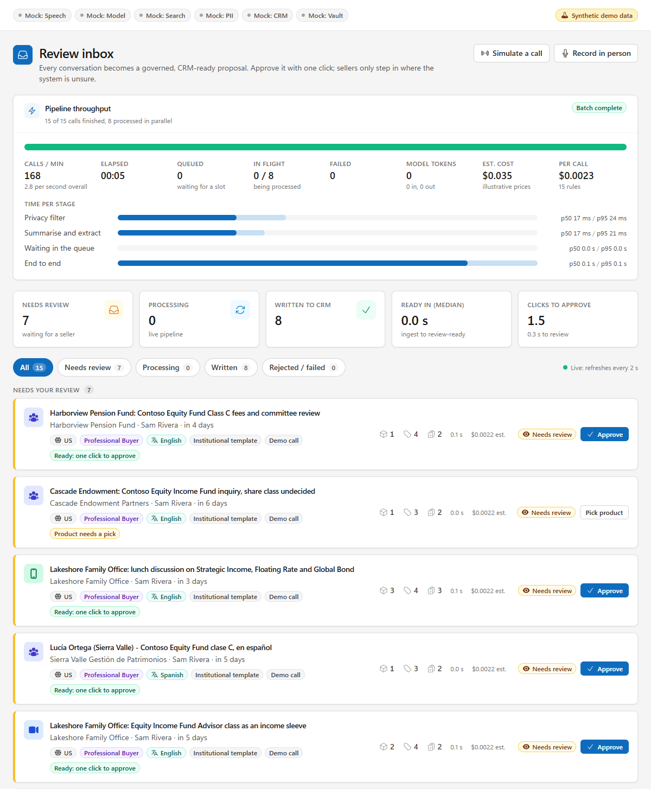

A proposal is either *ready: one click to approve* or `needs_review` with an explicit reason (`product_needs_pick`,
`crm_match_ambiguous`, `crm_match_missing`, `validation_failed`). Rows show channel, market, business line, language,
template, product / topic / task counts and the per-call cost estimate; the cards come from `GET /api/v1/metrics/summary`.
The UI polls every 2 s; there is no websocket.

### Review: one click, with the evidence beside it

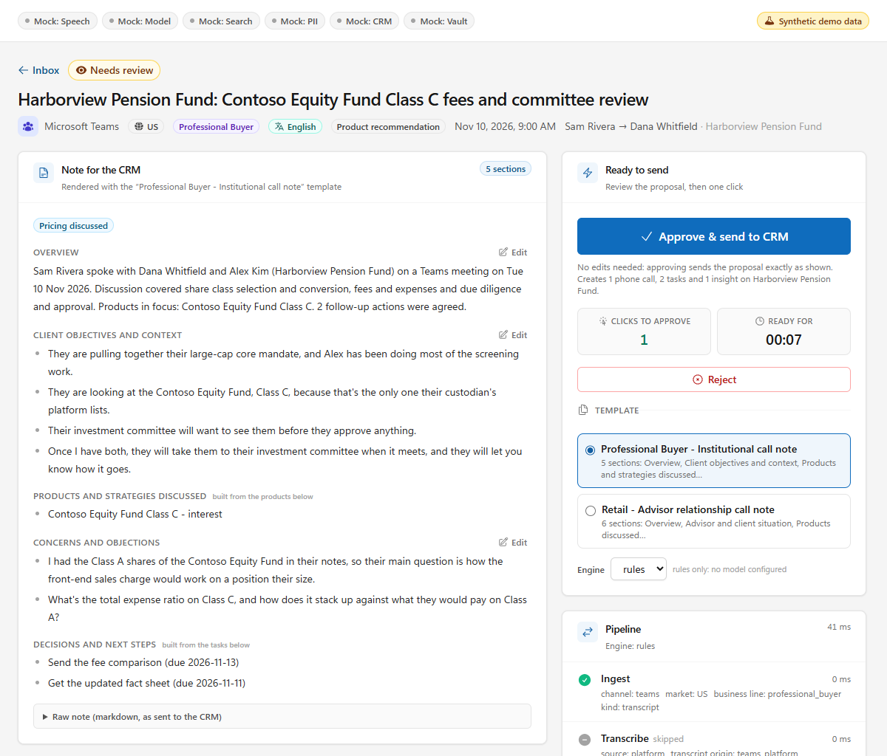

The note is rendered from a selectable template (`pb_institutional` here, `retail_advisor` is the other) and every
section maps to a CRM field. *Approve & send to CRM* posts an empty body. Edits (product pick, topic and task edits,
section edits, template switch) are re-rendered and re-validated for leaks before they are accepted. The right-hand
column is the pipeline's own timeline, with usage and cost per stage.

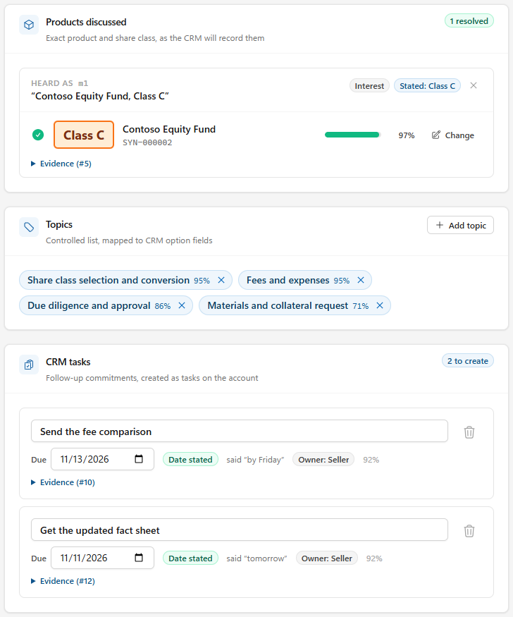

The share class is part of the product identity (`SYN-000002` is Contoso Equity Fund *Class C*, 97 %). Class A comes up in
the call only as a comparison and is not tagged. Topics come from the controlled list with a confidence each. Tasks are
the seller's commitments only, with the date resolved from the spoken phrase ("by Friday" becomes 2026-11-13) and the
supporting segments one click away.

### Exact product, never guessed - and what the privacy policy did

<table>
<tr>
<td valign="top" width="62%">
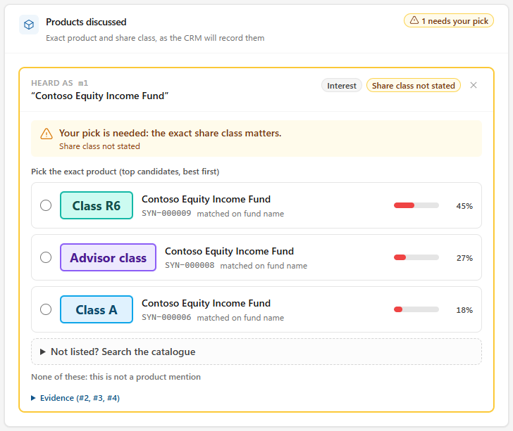
<br><sub><b>The class is never guessed.</b> If the speaker names a fund but not the class, the mention is held for review
with the fund's classes as ranked candidates (ordered by a business-line prior). Approval is blocked until a human picks,
searches the catalogue, or marks it "not a product".</sub>
</td>
<td valign="top" width="38%">
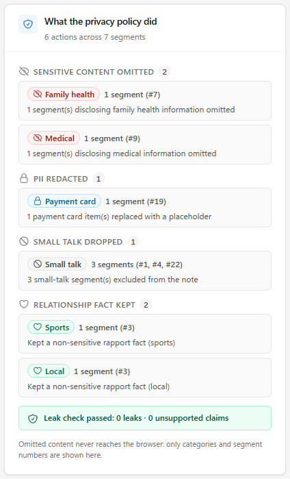
<br><sub><b>What the privacy policy did.</b> A per-call audit of categories and segment numbers only - omitted text never
reaches the browser. Medical and family-health segments are dropped, the card number is replaced by a placeholder, small
talk is dropped, non-sensitive relationship facts are kept, and the leak check is reported.</sub>
</td>
</tr>
</table>

### Every channel, one pipeline

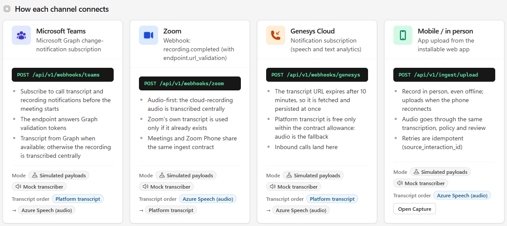

Each channel's inbound path, endpoint and **transcript order**: use the platform's own transcript where it is free and
entitled, otherwise send the audio to central Azure Speech. That order is policy (`data/policies/policies.yaml`), not
code. The demo drives the same parsers with simulated native payloads: Teams VTT, Zoom VTT/JSON, Genesys transcript JSON,
or audio with a sidecar.

<table>
<tr>
<td valign="top" width="240">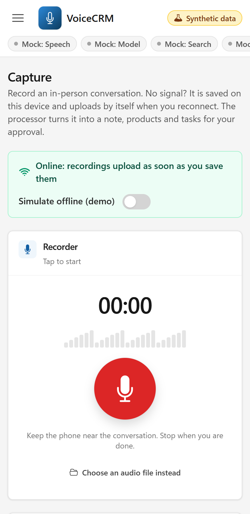</td>
<td valign="top">
<b>In-person capture (installable web app, <code>/capture</code>)</b><br><br>
Record on a phone. Recordings queue in IndexedDB when there is no signal and upload when the connection returns; retries
are idempotent on <code>source_interaction_id</code>. The audio then goes through the same transcription, policy and review as
every other channel (<code>POST /api/v1/ingest/upload</code>).<br><br>
Microphone access needs a secure context, so serve the UI over HTTPS on a real device (<code>localhost</code> is fine for
testing).
</td>
</tr>
</table>

### Real speech, real services, at scale

<table>
<tr>
<td valign="top" width="400">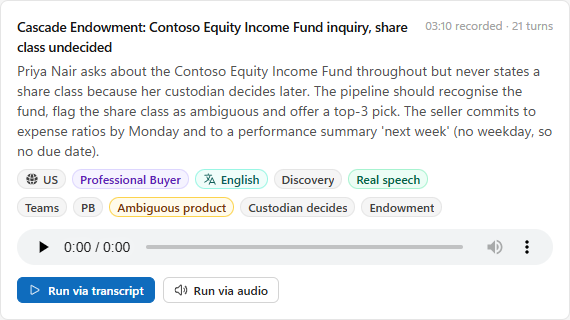</td>
<td valign="top">
<b>Play the call, then process it</b><br><br>
<code>scripts\make_audio.bat</code> speaks the scripted calls with Azure neural voices (stereo for Genesys, Spanish turns in
Spanish). A recorded call shows a <i>Real speech</i> badge and a player; <i>Run via audio</i> sends the recording through
Azure Speech, the Language service and the model (about 20 s for a 3-minute call, word error rate 1-1.5%, 0 privacy leaks).
</td>
</tr>
</table>

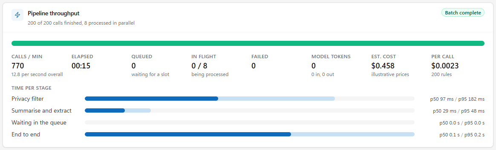

The Inbox shows live **pipeline throughput** while a batch runs: calls per minute, ETA, queue depth, calls in flight,
failures, tokens, estimated cost and p50/p95 per stage. This capture is 200 calls on mock adapters (it shows the
instrumentation, not Azure's speed). On real services 800 calls took 172 s (about 280 calls per minute, $5.91) with 0 failures on an
800K-TPM `gpt-5.4-mini` deployment, and `scripts\bulk_load.bat` measured 300-370 calls per minute on a 5M-TPM one; see
[docs/live-demo.md](docs/live-demo.md).

### Run the live scenarios from the browser

The **Live demo** page (second item in the sidebar) runs scenarios A and C against the real services with no command line, and
checks B. Both captures below are from live Azure Speech, Azure AI Language and a Foundry model (`chat54mini`, a
`gpt-5.4-mini` deployment, on a demo tenant with Entra auth), taken by [`tools/capture_live_demo.py`](tools/capture_live_demo.py).
See [docs/live-demo.md](docs/live-demo.md), section 1.

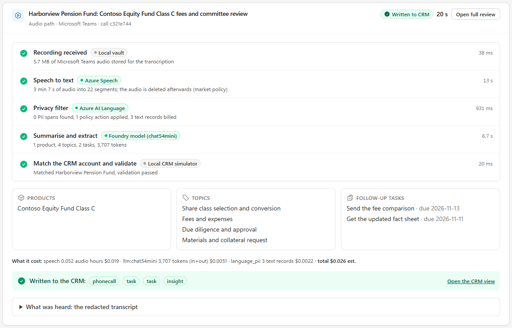

**A: play a recorded call and watch Azure process it.** Pick a recording, play it, press *Process with Azure*. Each pipeline step
names the service behind it and how long it took (here 5.6 s of speech to text, 1.1 s of privacy filter, 6.6 s of extraction),
then the products, topics and tasks that came out, what the call cost (about $0.023 for this 3-minute call), and a one-click
approval that writes the phone call, tasks and insight to the CRM. The redacted transcript is one click away; the CRM never gets it.

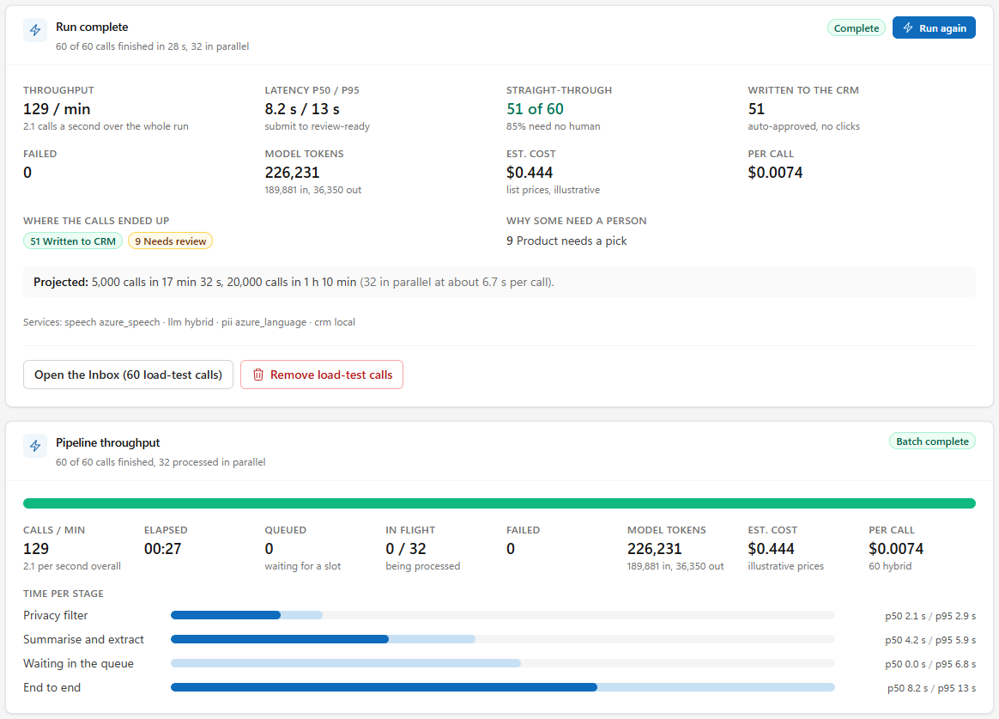

**C: hundreds of calls at once.** Choose the number of calls (50, 200, 800, or up to 2,000), the input (platform transcripts, or
the real recordings through Speech), the arrival rate, the parallelism and whether clean calls are auto-approved. The page sizes
the run first (tokens, list-price cost, time), asks before spending, shows a live board and the throughput card, and ends with a
report: calls per minute, latency p50/p95, how many calls needed no human, cost per call, why the rest need a person, and a
projection to 5,000 and 20,000 calls from the measured per-call time. This capture is 60 real calls: 25 s, $0.265, 51 written to
the CRM with zero clicks, 9 waiting for a seller to pick a product. Every call a run creates is tagged *Load test* and can be
removed in one click from the Inbox, the vault, the state store and the CRM simulator.

**B: a Teams meeting.** The page checks the tenant setup with the same probes as `scripts\teams_check.bat`, shows the live ingestion
card, and rehearses the flow with a clearly labelled *simulated* Teams call until the tenant is ready.

### Governance as configuration

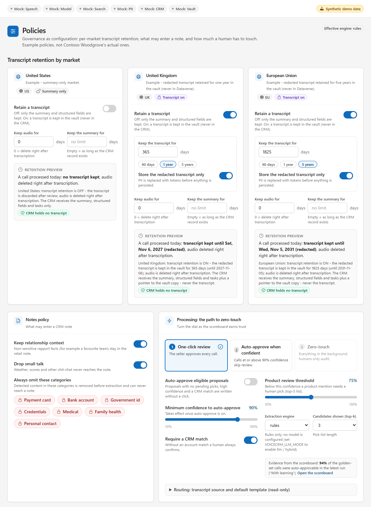

Per-market transcript retention (US off, UK 365 days, EU 1,825 days - examples, not any real firm's policy), the notes policy
(categories that are always omitted, relationship context, small talk) and the path to zero-touch: one-click review, then
auto-approve above a confidence threshold (off by default), then zero-touch. Edits are stored as an override file under
`.state\`; the retention preview on each market card shows exactly what a call processed today would keep.

### What landed in the CRM, and how well it works

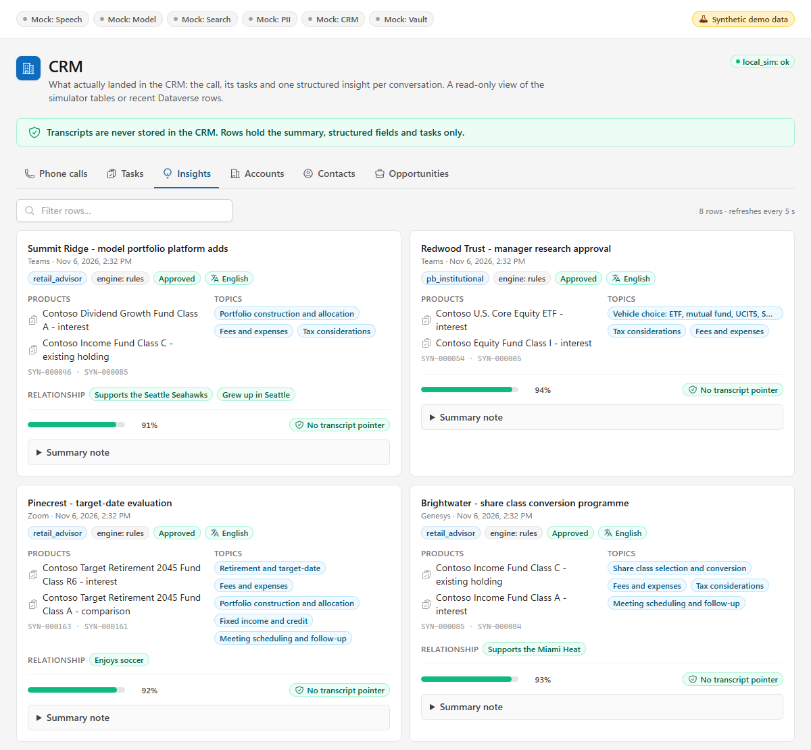

A read-only view of the simulator tables (or recent Dataverse rows): the phone call with the note, the tasks, and one
structured insight per conversation - template, language, engine, review status, product ids, topic ids, relationship
facts, extraction confidence, and a vault pointer only when the market keeps a transcript.

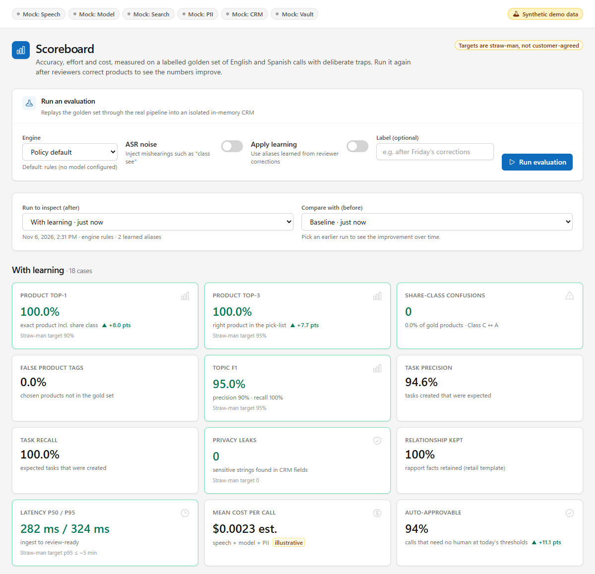

The golden set replays through the real pipeline into an isolated in-memory CRM, and every run is stored, so
before/after is a comparison rather than a claim. This shows the baseline against the run after learned aliases. The
targets are straw-man, and the set is a development set (see [Evaluation](#evaluation)).

## What it demonstrates

Traceable to the customer's stated requirements.

| The customer asked for | Where it lives |
|---|---|
| Hang up, approve, done: as few clicks as possible | Review screen with one-click approve and the auto-approve dial (`pipeline/service.py`, `frontend/src/pages/ReviewPage.tsx`) |
| Teams, Zoom, Genesys and in-person through one processor | `adapters/sources/*`, transcription policy per channel (`data/policies/policies.yaml`), the mobile web app at `/capture` |
| Exact product and share class (Class C is not Class A); top-3 pick list when unsure | `engines/product_resolver.py`, `engines/catalogue_index.py` |
| Topics as CRM dropdown values | `engines/topics.py`, `data/taxonomy/topics.json` |
| Follow-ups become CRM tasks (seller / internal only) | `engines/tasks.py`, `pipeline/crm_package.py` |
| Two selectable summary templates (data contracts for the downstream analytics team) | `data/templates/*.yaml`, `engines/templates.py` |
| Omit card / medical / personal data, drop small talk, keep relationship facts | `engines/notes_policy.py`, `adapters/pii/*`, `engines/validator.py` |
| Transcript on/off by market; never in Dataverse | `engines/retention.py`, `adapters/vault/*`, `data/policies/policies.yaml` |
| English and Spanish | Speech language identification, bilingual lexicons and taxonomy, scripted Spanish calls |
| Show improvement over time | learned aliases from reviewer corrections, measured on the scoreboard (`eval/*`) |
| Measurable success: accuracy, latency, cost per call | `eval/*`, per-call usage meter, `engines/cost.py` |

## Architecture

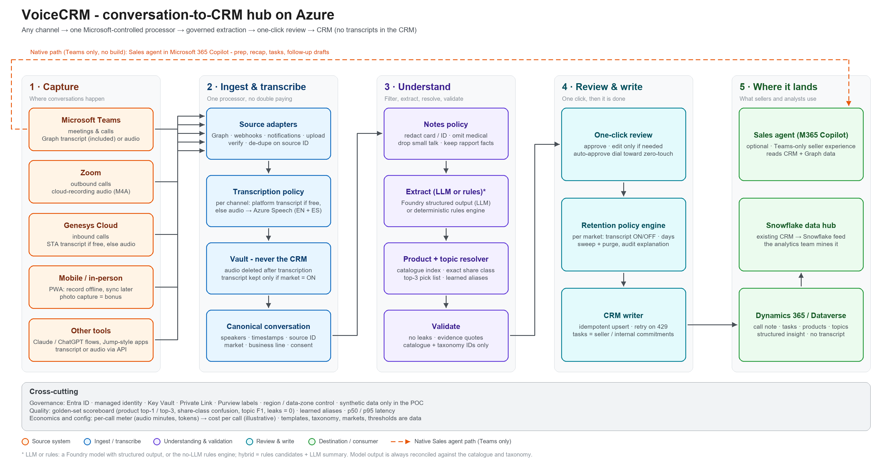

Editable source: [`docs/diagrams/voicecrm-architecture-v2.excalidraw`](docs/diagrams/voicecrm-architecture-v2.excalidraw)
(generated by `tools/gen_architecture_diagram.py`). Full write-up: [docs/architecture.md](docs/architecture.md).

```
domain/       pydantic models and enums, no I/O (extra = forbid)
ports/        Protocols: transcription, llm, search, pii, crm, vault, state
engines/      pure logic behind the Protocols in engines/contracts.py (rules; optional LLM extractor)
adapters/     mock / local and live implementations of the ports; channel parsers in adapters/sources
pipeline/     PipelineService: the orchestrator, review actions, retention sweep
api/          FastAPI routers under /api/v1; also serves the built SPA
eval/         golden-set harness, metrics, data integrity checks
container.py  composition root - the only place that knows which adapter is in use
```

| Principle | What it means in the code |
|---|---|
| **Compute in Python, let a model only write** | Product matching, topic tagging, task dates, redaction and validation are deterministic engines. An optional model writes prose and may *confirm* what the engines found; it cannot invent a product or pick a share class. |
| **Ports and adapters** | Every external dependency is a `Protocol` in `ports/` with a mock/local adapter (default) and a live one. `container.py` decides which. |
| **Privacy by construction** | Engines are handed a *redacted* conversation. `CrmPackage` has no transcript field. A validator re-scans every CRM-bound field before anything is sent. |
| **Policy is data** | Retention per market, the notes policy, the transcript source per channel and the default template per business line live in `data/policies/policies.yaml` and are editable in the UI. |
| **Honest degradation** | A live service that is not configured falls back to its mock (in `VOICECRM_DEMO_MODE`) and the UI says which services are live. An engine failure falls back to the rules engine and is flagged on the proposal. |

## How a call flows

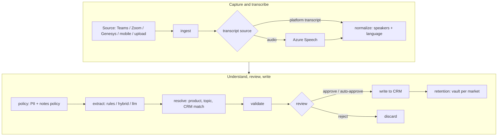

Every stage is recorded as an event (status, duration, detail) and as usage (audio seconds, tokens, PII records), which
drives the timeline in the review screen and the cost engine.

| Stage | What happens |
|---|---|
| `ingest` | A channel payload becomes one canonical conversation (speakers, segments, metadata, consent). Idempotent on `source:source_interaction_id`. |
| `transcribe` | Per-channel preference: the platform transcript when it is free and entitled (Teams, Genesys by default), otherwise central Azure Speech on the audio (Zoom, mobile). Skipped when a transcript is supplied. |
| `normalize` | Speaker roles and language (English / Spanish). |
| `policy` | PII redaction, then the notes policy: omit sensitive segments, drop small talk, keep safe relationship facts. |
| `extract` | Note sections, product mentions, topics and tasks - `rules`, `hybrid` or `llm` engine. |
| `resolve` | Products against the catalogue, topics against the taxonomy, and the CRM match (email, then phone number, then name and organisation, then meeting metadata). |
| `validate` | The last gate (see below). |
| `review` | One-click approve, or automatic when the policy dial allows it. |
| `write` | Idempotent upsert of the phone call, tasks and insight record. |
| `retention` | Vault copies kept or deleted according to the market policy. |

## Decision logic

**Product and share class** (`engines/product_resolver.py`, `engines/catalogue_index.py`)
- The catalogue index is idf-weighted over fund *families* (a fund with all its share classes), with English and Spanish
  aliases, tolerance for common ASR slips, and a share-class phrase lexicon.
- A mention is a fund name plus the class the speaker actually said. Negation ("not class A"), later corrections and
  coreference ("the global equity fund") are handled, and the stance is tagged: interest, existing holding, comparison,
  objection or info only.
- If the class was never said, the mention is `needs_review` with that fund's classes as ranked top-k candidates. A product
  mention below the policy threshold (default 75 %) also needs a human pick. The class is never guessed.

**Topics** (`engines/topics.py`, `data/taxonomy/topics.json`): a transparent lexical classifier over a controlled list of
20 topics with English and Spanish synonyms. Every tag carries its supporting segments. Topic ids map to CRM option values
(pin them in `data/crm/field_profile.yaml` before reordering the taxonomy).

**Tasks and dates** (`engines/tasks.py`): only the seller's and the seller's team's commitments; customer promises are not
tasks. Relative dates resolve against the call date by one documented convention: a bare weekday or "by Friday" is the next
such day strictly after the call; "next Tuesday" is that weekday of the following Monday-Sunday week; "tomorrow" is +1;
"end of the week" is Friday; "next week" or "soon" gives no date. Each task keeps `due_text` (as said), `due_basis`
(stated, inferred or none) and its evidence.

**Privacy and notes policy** (`adapters/pii/*`, `engines/notes_policy.py`): local rules (Luhn-checked card numbers, spoken
digits, identifiers, spoken email addresses) with Azure AI Language PII as an optional second detector. Medical and
family-health segments are dropped entirely, not just masked; small talk is labelled and left out; non-sensitive rapport
facts (a team, a hobby, a hometown, a contact preference) are kept from the customer's own segments. The audit trail names
categories and counts, never text.

**Validation** (`engines/validator.py`): an independent gate before a reviewer or the CRM sees anything. It re-scans every
CRM-bound field for card numbers, identifiers and medical content (scrub and report), checks each claim against the
redacted transcript segments (a product without evidence goes to review; a topic or task without evidence is dropped),
and checks catalogue and taxonomy membership and template conformity.

**Learning loop** (`pipeline/service.py`, `store/sqlite_store.py`): when a reviewer picks a product for a mention the system
could not resolve, the spoken phrase becomes a learned alias (`source: reviewer_correction`). On later calls aliases are
applied first (reason `learned_alias`) and never override a class the speaker stated. Reset with `DELETE /api/v1/aliases`.

**Engines** (`engines/extractor.py`, `adapters/llm/*`): `rules` is the default and needs no model. `hybrid` lets the rules
suggest and a model write and confirm; `llm` also lets the model decide topics and tasks, while products stay
catalogue-grounded. Model output is reconciled against the catalogue, the taxonomy, the call date and the transcript
segments. A failing model call never blocks a call: it falls back to rules and flags the proposal (`llm_fallback`,
`engine_unavailable:<engine>`).

## Data contract

The CRM never receives the transcript. `CrmPackage` (`domain/crm.py`) has no field for it. It is built only from a reviewed
proposal (`pipeline/crm_package.py`) and has three parts - a phone call carrying the note, tasks, and one structured
insight. Abridged, from a real run of the `pb-teams-equity-class-c` call:

```json
{
  "idempotency_key": "teams:<source_interaction_id>:v1",
  "regarding": {
    "account":     { "id": "acc-001", "name": "Harborview Pension Fund" },
    "contact":     { "id": "con-001", "name": "Dana Whitfield" },
    "opportunity": { "id": "opp-001", "name": "Harborview - large-cap core mandate" },
    "method": "email", "confidence": 0.99, "ambiguous": false
  },
  "phone_call": {
    "subject": "Professional Buyer - Institutional call note: Harborview Pension Fund: ...",
    "description": "<the rendered note, Markdown>",
    "direction": "outbound", "start": "2026-11-10T15:00:00Z", "duration_minutes": 17,
    "owner_email": "sam.rivera@contoso.example"
  },
  "tasks": [
    { "source_task_id": "t1", "subject": "Send the fee comparison", "description": "<the seller's commitment sentence>",
      "due": "2026-11-13", "priority": "normal", "owner_email": "sam.rivera@contoso.example" },
    { "source_task_id": "t2", "subject": "Get the updated fact sheet", "description": "<the seller's commitment sentence>",
      "due": "2026-11-11", "priority": "normal", "owner_email": "sam.rivera@contoso.example" }
  ],
  "insight": {
    "template_id": "pb_institutional", "language": "en", "engine": "rules",
    "product_ids": ["SYN-000002"],
    "topic_ids": ["share_class_selection", "fees_expenses", "due_diligence_approval", "materials_request"],
    "relationship_facts": [], "confidence": 0.934, "review_status": "approved",
    "transcript_pointer": null
  }
}
```

What the CRM does receive is *derived from* the redacted conversation: the note sections and each task's description (the
seller's commitment sentence). The rules engine is extractive, so it re-uses selected sentences; the model engines
paraphrase. The validator re-scans all of it before anything is sent. `transcript_pointer` is set only when the market keeps
a transcript, and points into the vault.

The Dataverse adapter (`adapters/crm/dataverse.py`) uses the standard `phonecall` and `task` tables plus an insight
record by default (no schema changes), or custom columns through `data/crm/field_profile.yaml`. `tools/dataverse_bootstrap.py`
previews the schema as a dry run first. The idempotency key (`source:source_interaction_id:vN`) makes a retry a no-op, and
reprocessing bumps `N`.

**Where the transcript lives**

| Vault kind | Content | Lifetime |
|---|---|---|
| `audio` | the recording | per market `audio_retention_days` (0 = deleted right after transcription) |
| `working` | the redacted conversation held while a proposal awaits review, so it can be reprocessed or re-validated | 24 hours at most, deleted when the call is finalised |
| `transcript` | the redacted transcript | only if the market policy is on, until `transcript_retention_days`; the CRM gets a pointer, never the text |

The stored proposal keeps short redacted evidence quotes only while it awaits review; they are stripped when the market's
retention is off (or the call is rejected). `POST /api/v1/retention/sweep` (or `voicecrm.cli sweep`) removes anything past its
expiry, and in Azure a storage lifecycle rule is the backstop.

## HTTP API

FastAPI under `/api/v1`, with OpenAPI at `/docs`. Full reference: [docs/api-contract.md](docs/api-contract.md).

| Area | Endpoints |
|---|---|
| Ingest | `POST /ingest/upload` (audio, VTT or JSON), `POST /ingest/simulate` (a scripted call rendered as the channel's native payload), `POST /webhooks/{teams,zoom,genesys}` |
| Review | `GET /conversations`, `GET /conversations/{id}`, `GET /conversations/{id}/transcript` (redacted; 404 with the policy explanation when the market discards it), `POST /conversations/{id}/{approve,reject,reprocess}` |
| Policy and reference data | `GET/PUT /policies...`, `GET /templates`, `GET /taxonomy`, `GET /catalogue/stats`, `GET /catalogue/search`, `GET/DELETE /aliases` |
| CRM, vault, retention | `GET /crm/records?entity=`, `GET /crm/health`, `GET /vault/items`, `POST /retention/sweep` |
| Metrics | `GET /metrics/summary`, `POST /eval/run`, `GET /eval/runs`, `GET /eval/runs/{id}` |
| Meta | `GET /health`, `GET /config` (which services are live and which are mock) |

Statuses: `received`, `processing`, `needs_review`, `approved`, `written`, or `rejected` / `failed`. The happy path, end to end:

```powershell
$api = 'http://127.0.0.1:8010/api/v1'

# replay a scripted Teams call through the real adapter path: native payload, parser, pipeline
$id = (Invoke-RestMethod -Method Post "$api/ingest/simulate" -ContentType application/json `
        -Body '{"fixture_id":"pb-teams-equity-class-c"}').conversation_id

# poll until the proposal is ready
do { Start-Sleep 1; $c = Invoke-RestMethod "$api/conversations/$id" }
while ($c.record.status -in 'received', 'processing')
$c.record.status                                   # needs_review - one click away
$c.record.proposal.result.products | Select-Object surface, chosen_product_id, confidence | Format-Table

# approve: an empty body is the one-click path
Invoke-RestMethod -Method Post "$api/conversations/$id/approve" -ContentType application/json -Body '{}' | Out-Null
$tasks = Invoke-RestMethod "$api/crm/records?entity=task"
$tasks | Select-Object subject, due, owner_name | Format-Table
```

The learning loop is the same call with `product_choices` (mention id to product id). `pb-teams-legacy-blue-chip` uses a fund
name that is not in the catalogue, so its first run stops with `product_needs_pick` (reason `no_candidate`):

```powershell
$id = (Invoke-RestMethod -Method Post "$api/ingest/simulate" -ContentType application/json `
        -Body '{"fixture_id":"pb-teams-legacy-blue-chip"}').conversation_id
do { Start-Sleep 1; $c = Invoke-RestMethod "$api/conversations/$id" }
while ($c.record.status -in 'received', 'processing')
$c.record.proposal.review.reasons                  # product_needs_pick

# the reviewer finds the product in the catalogue and picks it; the correction becomes a learned alias
$m    = $c.record.proposal.result.products | Where-Object { $null -eq $_.chosen_product_id } | Select-Object -First 1
$hits = Invoke-RestMethod "$api/catalogue/search?q=equity%20fund%20class%20c&top=3"
$body = @{ product_choices = @{ $m.mention_id = $hits[0].product_id } } | ConvertTo-Json -Depth 3
Invoke-RestMethod -Method Post "$api/conversations/$id/approve" -ContentType application/json -Body $body | Out-Null

# surface: contoso blue chip fund class c / product_id: SYN-000002 / source: reviewer_correction
$aliases = Invoke-RestMethod "$api/aliases"
$aliases | Format-List
```

Run the same call again and the mention resolves on its own: no review reasons, and the candidate shows `learned_alias`.

## Evaluation

`eval/` replays every scripted call through the real pipeline in an isolated container and scores it against hand-written gold
labels. Run it from the Scoreboard page, `POST /api/v1/eval/run`, or `python -m voicecrm.cli eval [--learn] [--noise]` (from
`backend\`). Results on the 18-call set, rules engine, mock transcription:

| Metric | Baseline | + learned aliases | + ASR noise |
|---|---|---|---|
| Product top-1 (exact product including share class) | 92.0 % | 100 % | 100 % |
| Product top-3 (right product in the pick list) | 92.3 % | 100 % | 100 % |
| Share-class confusions (e.g. Class C for Class A) | 0 | 0 | 0 |
| False product tags | 0 % | 0 % | 0 % |
| Topics: precision / recall | 90.5 % / 100 % | 90.5 % / 100 % | 90.2 % / 96.5 % |
| Tasks: precision / recall (with due dates) | 94.6 % / 100 % | 94.6 % / 100 % | 91.9 % / 97.1 % |
| Privacy leaks in CRM fields | 0 | 0 | 0 |
| Relationship facts kept | 100 % | 100 % | 100 % |
| Auto-approvable calls (no human needed at default thresholds) | 83.3 % | 94.4 % | 88.9 % |

Latency (ingest to review-ready) is about 0.3 s at p50 and 0.3-0.5 s at p95 on a developer machine, **excluding speech
recognition** because transcription is mocked. Cost is about $0.02 per call, from the placeholder prices in
`data/pricing.yaml`; replace them with current Azure or negotiated prices before quoting anything.

How to read it:
- **Top-1 is scored on the unambiguous gold mentions.** For the deliberately ambiguous calls (class never said) the right
  behaviour is to ask, which top-3 scores; the two use different denominators on purpose.
- **The two baseline misses are by design.** `pb-teams-legacy-blue-chip` and `retail-zoom-legacy-heritage-compass` use fund
  names the catalogue has never seen; the learning column is what happens after a reviewer teaches those two aliases.
- **This is a development set.** The engines were tuned while looking at it, and the learning column is measured on the same
  calls. Treat it as a regression gate and a demonstration of the mechanism, not as expected production accuracy. Real
  accuracy has to be measured on customer calls.

## Run it

Needs Python 3.11+ and Node.js 20.19+ (or 22.12+). Windows scripts:

```bat
scripts\setup_backend.bat        rem venv + editable install with dev tools; creates .env from .env.example
scripts\run_all.bat              rem API on :8010 and UI on :5173 in two windows (npm install runs on first start)
scripts\seed_demo.bat            rem optional: fill the inbox with 6 scripted calls
```

- UI: <http://localhost:5173> (Vite dev server, proxies `/api` to the API). API and docs: <http://127.0.0.1:8010/docs>.
- To run a single process, `npm run build` in `frontend\` and open <http://127.0.0.1:8010>: the API serves the built UI.
- Use `127.0.0.1` for the API, not `localhost`: on some Windows machines `localhost` resolves to `::1` first, where
  Docker or WSL may be listening. If 8010 is busy, `python -m voicecrm.cli serve --port 8011` and set
  `VITE_API_PROXY=http://127.0.0.1:8011` for the dev UI.
- State (SQLite, vault, CRM simulator, policy overrides) lives in `.state\`; delete it for a clean slate, or set
  `VOICECRM_STATE_DIR` to put it elsewhere.

A five-minute tour: open the inbox and pick the call whose share class is undecided, choose a class and approve; open the CRM
page to see what was written; run `pb-teams-legacy-blue-chip` from Sources, teach it on the review screen, then run it again;
flip a market's transcript switch on Policies and run the same call; press *Run evaluation* on the Scoreboard. The scene-by-scene
script is [docs/demo-script.md](docs/demo-script.md).

CLI, without the UI (run from `backend\`):

```bat
..\.venv\Scripts\python.exe -m voicecrm.cli doctor                      rem what is live vs mock, what data is loaded
..\.venv\Scripts\python.exe -m voicecrm.cli fixtures                    rem list the scripted calls
..\.venv\Scripts\python.exe -m voicecrm.cli simulate pb-teams-equity-class-c --approve
..\.venv\Scripts\python.exe -m voicecrm.cli eval --learn                rem scoreboard; add --noise for ASR errors
..\.venv\Scripts\python.exe -m voicecrm.cli sweep                       rem enforce retention now
```

Checks and screenshots:

```bat
scripts\test_all.bat                                   rem pytest (1,496 tests) + frontend typecheck and build
.venv\Scripts\python.exe -m ruff check backend tools --config backend\pyproject.toml
.venv\Scripts\python.exe -m pip install playwright     rem tooling only: uses the installed Chrome or Edge
.venv\Scripts\python.exe tools\capture_screenshots.py  rem regenerate docs\screenshots (needs frontend\dist)
.venv\Scripts\python.exe tools\capture_live_demo.py --base-url http://127.0.0.1:8010   rem the two live-demo captures: real Azure, spends a few cents
scripts\check_public.bat                               rem before every push: fails on a customer name, tenant id, internal host or secret (see below)
```

## Live demo

[docs/live-demo.md](docs/live-demo.md) is the step-by-step guide for three real scenarios, with the numbers measured against
a real Azure account:

| | Scenario | Tooling | Verified |
|---|---|---|---|
| A | play a call -> Azure Speech -> Azure Language -> a Foundry model | **Live demo page**; `scripts\make_audio.bat`, `scripts\rehearse_audio.bat` | live: WER 1-1.5%, topics and tasks 100%, 0 leaks |
| B | a Teams meeting ends and lands in the review queue by itself (Microsoft Graph, poll or webhook) | **Live demo page** (check, status, simulated rehearsal); `scripts\teams_check.bat`, `scripts\crm_add.bat`, `scripts\make_meeting_audio.bat` (eight scenario calls to play into the meeting), `scripts\rehearse_audio.bat --meeting` | live on a demo tenant: a real scheduled meeting was listed by Graph (within 8 min), downloaded and turned into a CRM-matched proposal (2026-11-06); the eight recordings scored live through Speech, Language and the model (topics and tasks 100%, 0 leaks, WER 1.8%); webhook mode and multi-speaker transcripts not run live |
| C | 800 calls at once | **Live demo page**; `scripts\run_bulk_backend.bat`, `scripts\bulk_load.bat` | live: 800 calls in ~3 min, $5.91, 0 failures (800K-TPM `gpt-5.4-mini`) |

```bat
scripts\preflight.bat --burst 16     rem validates .env and probes every live service for real; marks A, B, C READY or not
```

The same check runs from the browser: **Live demo -> Check services now**. A run started there (`/api/v1/live/load`) goes through the
same pipeline in the API process, so it needs no second terminal; `scripts\run_bulk_backend.bat` is still the way to give it a
clean state folder and 64 parallel calls.

What the live work added to the product: a **preflight** that names the fix for each failure (and never prints a secret), a
text-to-speech call generator, a rehearsal scorer, a load generator, live **pipeline statistics** (`GET /api/v1/metrics/pipeline`),
Microsoft Teams ingestion through Graph (poll or webhook, idempotent, with a Sources status card), **privacy-filter packing**
(billed Language records fall about 7x and requests about 5x, no detection lost), SQLite WAL and cached text normalisation (about 12x
less CPU per call, which keeps the UI responsive during a bulk run), real Azure list prices in `data/pricing.yaml`, and a fix for a
concurrency race in the model adapter.

## Going live

Set the `VOICECRM_*` variables (see [`.env.example`](.env.example)). Authentication is Entra ID by default; **keys work too and are
what the demo uses**: Entra needs `az login` in the tenant that owns the Azure resources
(`VOICECRM_AZURE_TENANT_ID`), which is not always your default tenant. Enable one service at a time and run the evaluation after
each; the order, the role each identity needs and how to verify each step are in [docs/runbook.md](docs/runbook.md).

| Service | Mock / local (default) | Live |
|---|---|---|
| Transcription | `MockTranscriber`: replays scripted calls, optional ASR noise | Azure Speech fast transcription (EN + ES, diarization, phrase lists from the catalogue) |
| Extraction | rules engine, no model | AI Foundry model with structured output (`hybrid` or `llm`) |
| Catalogue search | in-process index | Azure AI Search |
| PII | local rules (Luhn, spoken digits, identifiers) | Azure AI Language, merged with the local rules |
| CRM | SQLite simulator | Dynamics 365 / Dataverse Web API, **non-production environment only** |
| Vault | local filesystem | Azure Blob Storage |

`VOICECRM_DEMO_MODE=true` (the default) means a service whose settings are incomplete silently falls back to its mock, so
check what is actually live in the top bar, `GET /api/v1/config`, or `voicecrm.cli doctor`. With `VOICECRM_DEMO_MODE=false`
the app refuses to start when a requested live service is incomplete.

Channels: **Teams** has live ingestion through Microsoft Graph (poll or webhook; see [docs/live-demo.md](docs/live-demo.md),
scenario B). The **Zoom** and **Genesys** webhook endpoints and parsers exist, but their credentials and downloads are not wired in
this MVP. Each channel can still be driven with a file upload or the simulator through exactly the same pipeline. What each
needs to go live is in the runbook.

## Azure deployment

`scripts\deploy_azure.bat` wraps `azd up`. The Bicep in `infra\` provisions one resource group: a Container App (API and
built UI in one container) with a user-assigned managed identity, AI Services (Speech and the model deployment), AI Search,
Blob Storage for the vault with a lifecycle backstop, Log Analytics and Application Insights, and a Container Registry; Cosmos
DB is optional and not yet read by the app. All data-plane access is Entra ID with least-privilege roles.

It is **compiled and linted but has never been deployed** and creates billable resources: use `scripts\deploy_azure.bat /preview`
for a what-if first. Before sharing the URL, note that the app has no end-user sign-in (set an IP allow-list or put Entra
authentication in front). Resources, RBAC, parameters, cost drivers and the security checklist:
[docs/infrastructure.md](docs/infrastructure.md).

## Layout

```
backend/voicecrm/   domain -> ports -> engines -> adapters -> pipeline -> api, plus container.py, cli.py, eval/, store/
backend/tests/      engines, adapters, api, pipeline, eval, domain (1,496 tests)
data/               synthetic catalogue, taxonomy, templates, policies, pricing, CRM seed, scripted calls
frontend/           React + TypeScript UI (inbox, live demo, review, sources, capture, policies, catalogue, CRM, scoreboard)
infra/              Bicep modules + azd (Dockerfile and azure.yaml are at the root)
scripts/            Windows helpers: setup, run, seed, test, deploy, plus preflight, make_audio, make_meeting_audio, rehearse_audio, run_bulk_backend, bulk_load, teams_check, crm_add
tools/              generators (catalogue, diagram, screenshots, call audio, meeting audio) and dev helpers (bulk_load, live_check, capture_live_demo, env_set, eval_diff, dataverse_bootstrap, ...)
docs/               architecture, API contract, demo script, live demo guide, runbook, infrastructure, diagrams, screenshots
```

Documents: [architecture](docs/architecture.md) ·
[API contract](docs/api-contract.md) · [demo script](docs/demo-script.md) · [live demo guide](docs/live-demo.md) ·
[runbook (live mode)](docs/runbook.md) · [infrastructure](docs/infrastructure.md) · [demo data](data/README.md)

## Guardrails

- The transcript never reaches the CRM or the logs: `CrmPackage` has no field for it, logs carry counts and timings, and the
  validator re-scans every CRM-bound field. The redacted transcript lives in the vault only - a short-lived working copy while
  a proposal awaits review, durable only when the market policy says so. See [Data contract](#data-contract) for exactly what
  the note and tasks do contain.
- Only the seller's and the seller's team's commitments become CRM tasks.
- Model output is always reconciled against the catalogue and taxonomy, and edits made in review are re-validated for leaks.
- Writes go to a dedicated **non-production** Dataverse environment only (never MSX).
- Nothing customer-specific is published: `.env*`, `.state*` and the generated audio are git-ignored, and
  `scripts\check_public.bat` scans what git would publish against your own deny-list (`.deny-terms.local`, also git-ignored)
  and for secret shapes. All data in the repository is synthetic.

## Honest limitations

- **Azure AI services and Teams polling have run live; the rest has not.** Speech, Language and a Foundry model have been
  exercised end to end ([docs/live-demo.md](docs/live-demo.md)), and Teams ingestion processed one real scheduled meeting on the
  demo tenant (Graph listing, the transcript download with speaker names, the meeting's attendees, a CRM-matched proposal).
  Dataverse, Blob, AI Search, Zoom and Genesys are unit-tested against mocked HTTP and synthetic payloads, and Teams webhook mode
  and transcripts with several real speakers have not run live. Teams needs a tenant with Graph transcript access enabled, an
  app registration with admin consent and an application access policy; Graph publishes a transcript some minutes after the
  meeting ends (within 8 minutes in our run): it is not a live stream, and it covers scheduled meetings, not "Meet now". Live
  use of the rest needs accounts, admin consent and a first supervised write.
- **Model quality is measured on a development set.** With a real model (hybrid engine, gpt-4.1 family) the 18-call set scores
  topics P 88-100% / R 100% and tasks 94%, and gpt-5.4-mini topics F1 94.2% and tasks P 94.6% / R 100%, but
  the engines and prompts were tuned while looking at it; real accuracy has to be measured on customer calls. The rules engine
  writes English notes for Spanish calls from structured elements only; the model engines write richer free text.
- **The scoreboard is a development set.** See [Evaluation](#evaluation): the learning column is measured on the same calls.
- **Genesys caller number (ANI) is not extracted from live notifications yet.** Uploaded and simulated payloads carry it and
  drive the phone match; the live path does not.
- **CRM insight rows carry product ids only** (names are looked up for display), and the insight `confidence` is the
  extraction-time score: it is not recomputed after a reviewer corrects a product, so a corrected call can show a low value.
- **One replica, no end-user auth.** State is SQLite behind a `StateStore` Protocol (the seam for Cosmos DB or Postgres), and
  the app has no sign-in of its own.
- **The follow-up email draft is not built** (it was not part of the first slice), and the Snowflake / analytics
  hand-off is shown as the existing downstream, not implemented.
- **Policies and data are illustrative; prices are list prices.** Retention periods are examples. Cost figures use Azure retail
  list prices (East US 2, read 2026-11-03) and exclude discounts and commitments, so they are still flagged illustrative. Whether
  Zoom transcripts are entitled on the customer's plan and how Genesys transcription is billed for their volume are still open questions.
