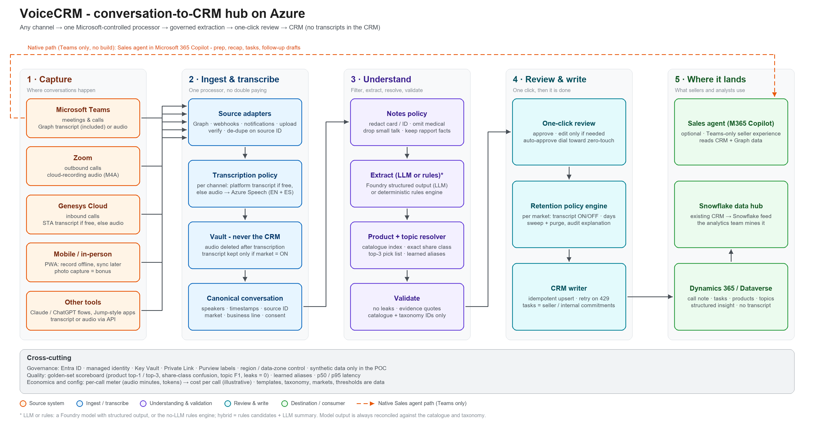
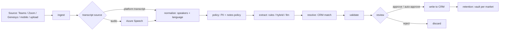

# Architecture

VoiceCRM turns any recorded or transcribed sales conversation - Teams, Zoom, Genesys, an in-person recording on a phone,
or an uploaded file - into **governed, CRM-ready output**: a structured note, the exact product (including share class),
topics from a controlled list and the seller's follow-up tasks. One pipeline, one processor, per-market transcript
retention, and the transcript never lands in the CRM.



The diagram source is `diagrams/voicecrm-architecture-v2.excalidraw` (generated by `tools/gen_architecture_diagram.py`).

## 1. Design principles

| Principle | What it means in the code |
|---|---|
| **Compute in Python; a model writes, the code decides** | Product matching, topic tagging, task dates, redaction and validation are deterministic engines. A model (optional) writes the prose and may *confirm* what the engines found; in the `llm` engine it also proposes topics and tasks. Every model answer is reconciled against the catalogue, the taxonomy, the call date and the transcript segments, and it can never invent a product or pick a share class. |
| **Ports and adapters** | Every external dependency is a `Protocol` in `voicecrm/ports/`. Each has a mock/local adapter (default, no Azure needed) and a live adapter. `container.py` is the only place that knows which one is used. |
| **Privacy by construction** | The pipeline hands engines a *redacted* conversation. The CRM package type has no transcript field. A validator re-scans every CRM-bound field before anything is sent. |
| **Policy is data** | Retention per market, the notes policy, the preferred transcript source per channel and the default template per business line live in `data/policies/policies.yaml`, editable from the UI. |
| **Honest degradation** | A live service that is not configured falls back to its mock (in `VOICECRM_DEMO_MODE`) and the UI says which services are live. An engine failure falls back to the rules engine and is flagged on the proposal. |

## 2. Layers

```
domain/      pydantic models and enums - no I/O                      (VModel: extra = forbid)
ports/       Protocols: transcription, llm, search, pii, crm, vault, state
engines/     pure logic behind engines/contracts.py Protocols         (rules; optional LLM extractor)
adapters/    mock/local + live implementations of the ports; channel parsers (sources/)
pipeline/    PipelineService: the orchestrator, review actions, retention sweep
api/         FastAPI routers under /api/v1, serves the built SPA
eval/        golden-set harness, metrics, data integrity checks
container.py composition root (+ Container.isolated() for evaluation and tests)
```

### Engines (`backend/voicecrm/engines/`)

| Module | Role |
|---|---|
| `notes_policy.py` | Replaces PII spans with placeholders, **omits** segments that disclose medical / family-health information, captures safe rapport facts (sports teams, hobbies, hometown, contact preferences), labels small talk. The audit trail (`PolicyAction`) names categories and counts, never text. |
| `catalogue_index.py` | idf-weighted token index over the catalogue: fund families (a fund with all its share classes), aliases (EN + ES), ASR-slip tolerant matching, share-class phrase lexicon. Also the offline `CatalogueSearchPort`. |
| `product_resolver.py` | Detects fund mentions, links a share-class phrase to each (respecting "not class A" and later corrections), tags the stance (interest / existing holding / comparison / objection / info only), resolves coreferences ("the global equity fund"), and returns an exact product - or the fund's classes as ranked top-k candidates when the class was never said. Learned aliases are applied first. |
| `topics.py` | Lexical, transparent classifier over the controlled taxonomy (EN + ES synonyms). |
| `tasks.py` | Seller / colleague commitments -> tasks with due dates resolved against the call date by one documented convention. Customer promises are not tasks. |
| `summarizer.py` | Extractive note builder: fills every template section from structured results. |
| `extractor.py` | `rules` (all of the above), `hybrid` (rules suggest, model writes and confirms) and `llm` (model also decides topics and tasks; products stay catalogue-grounded). Model output is **reconciled** against catalogue, taxonomy, call date and transcript segments. |
| `validator.py` | Independent last gate: PII/medical re-scan of every CRM-bound field (scrub + report), evidence check, catalogue/taxonomy check, template conformity. |
| `templates.py`, `retention.py`, `cost.py` | Template selection and Markdown rendering; per-market retention decisions; usage -> cost lines (illustrative prices from `data/pricing.yaml`). |

## 3. The pipeline



Stages are recorded as events (status, duration, detail) and usage records (audio seconds, tokens, PII records) so the UI can
show a timeline and the cost engine can price each call.

**Transcript source** is chosen per channel (`transcription_source_preference`): use the platform's own transcript when it is
free and entitled (Teams, Genesys by default - no transcription fee), or send the audio to central Azure Speech
(Zoom, mobile). The decision is visible per call and in the cost breakdown.

**Review.** A proposal is `needs_review` with explicit reasons (`product_needs_pick`, `crm_match_ambiguous`,
`crm_match_missing`, `validation_failed`). The happy path is an empty-body approve (one click). Edits (product pick, dropped
mention, topics, task edits, section edits, template switch) are re-rendered and **re-validated for leaks**; picking a product
for a mention whose class *was* stated teaches a learned alias. With `auto_approve_enabled` the same checks run without a human
(off by default - it is a dial to show the path to zero-touch).

**Idempotency.** `source:source_interaction_id:vN` is the CRM idempotency key; reprocessing bumps `N`.

## 4. Where the transcript lives

| Vault kind | Content | Lifetime |
|---|---|---|
| `audio` | the recording | per market `audio_retention_days` (0 = deleted right after transcription) |
| `working` | redacted conversation held while a proposal awaits review (needed to reprocess, switch template, re-validate edits) | <= 24 h, deleted on finalize |
| `transcript` | redacted transcript | only if the market policy says `on`, until `transcript_retention_days`; the CRM gets a pointer, never the text |

Invariants (enforced in code and tests): the transcript never reaches the CRM - `CrmPackage` has no field for it, and logs carry counts
and timings only. What the CRM does receive is *derived from* the redacted conversation: the note sections, and each task's description,
which is the seller's commitment sentence (the rules engine is extractive, so it re-uses selected sentences; the model engines paraphrase).
The validator re-scans all of it for card numbers, IDs and medical content before anything is sent. The stored proposal holds short
redacted evidence quotes only while it awaits review - they are stripped when the market's retention is off (or the call is rejected), and
kept with the proposal when retention is on (production should give them the same expiry as the vault copy); only seller / internal
commitments become tasks; writes go to a non-production Dataverse environment only.

## 5. Data and persistence

- **State** (`store/sqlite_store.py`): conversations (JSON documents), stage events, usage, learned aliases, evaluation runs.
  SQLite is deliberate for the MVP (one replica); the `StateStore` Protocol is the seam for Cosmos DB / Postgres.
- **CRM** (`adapters/crm/`): `LocalCrm` (SQLite simulator with accounts, contacts, opportunities, phone calls, tasks, insights) and
  `DataverseCrm` (Web API; standard tables by default - phone call, task, plus an *insight* record - or custom columns via
  `data/crm/field_profile.yaml`). Matching: email -> phone number -> name + organisation -> meeting metadata.
- **Vault** (`adapters/vault/`): local filesystem or Azure Blob (Entra auth).
- **Config as data** (`data/`): catalogue, taxonomy, templates, policies, pricing, CRM seed, scripted calls with gold labels.
  Everything is synthetic.

## 6. Channels (`adapters/sources/`)

| Channel | Inbound path | Notes |
|---|---|---|
| Teams | Graph change notifications -> transcript (VTT) / recording; or file upload | Handler + parser; live use needs tenant admin consent and a transcript policy |
| Zoom | webhook (URL validation + HMAC signature) -> recording files (audio / VTT) | Transcript entitlement unconfirmed -> default is central Speech on the audio |
| Genesys | notification handler -> platform transcript or audio | A phone match on the caller's number when the payload carries it (uploaded and simulated payloads do; extracting the caller number from live notifications is not built) |
| Mobile | PWA `/capture`: record, offline queue, auto-upload | In-person meetings |
| Upload | `POST /api/v1/ingest/upload` | WebVTT / JSON transcripts and audio (wav, mp3, m4a, ogg, webm) |

`detect_and_parse(filename, content_type, data, channel=...)` normalises any of them to the canonical conversation; each parser
has a `render(parse(x))` round-trip test. The demo drives the same code with simulated native payloads.

## 7. API and UI

FastAPI under `/api/v1` (see [api-contract.md](api-contract.md)): config/health, fixtures + simulate/upload/webhooks, conversations
(list, detail, transcript, approve, reject, reprocess), policies, templates, taxonomy, catalogue (stats, search, learned aliases),
CRM records, vault items, retention sweep, metrics summary and the evaluation endpoints. The React SPA (`frontend/`) provides the
inbox, review screen, sources, capture PWA, policies, catalogue, CRM view and the scoreboard; it also has an in-browser mock mode.

## 8. Evaluation

`eval/` replays every scripted call through the real pipeline in an isolated container and scores it against gold labels:
product top-1 / top-3, share-class confusion, topic precision / recall / F1, task precision / recall with due dates, privacy leaks,
relationship facts kept, latency and cost per call. The "learned" run applies simulated reviewer corrections first, to show the
improvement loop. **The golden set is a development set** - engines were tuned while looking at it - so treat its numbers as a
regression gate and a demonstration, not as expected production accuracy. Real accuracy has to be measured on customer calls.

## 9. Production path (what changes, what does not)

| MVP | Production |
|---|---|
| Mock transcriber replaying scripts | Azure Speech fast transcription (built, and run live: EN + ES, diarization, catalogue phrase lists); batch transcription only if very long recordings need it |
| Rules engine | `hybrid` with a Foundry model deployment; same reconciliation and validator |
| SQLite state, one replica | Cosmos DB / Postgres behind `StateStore`; queue (Service Bus) between ingest and the pipeline |
| Local vault | Blob with private endpoints, customer-managed keys, lifecycle rules for retention |
| CRM simulator | Dataverse in a sandbox, then production, with an application user and field mapping agreed with Dynamics owners |
| Local PII rules | Azure AI Language PII (merged with the local rules) |
| No end-user auth | Entra ID (SSO) on the API / SPA, role-based review, audit log export |
| Illustrative prices | Validated cost model per channel; token / unit costs reported per call |

See [infrastructure.md](infrastructure.md) for the Bicep deployment and [runbook.md](runbook.md) for enabling live services.
