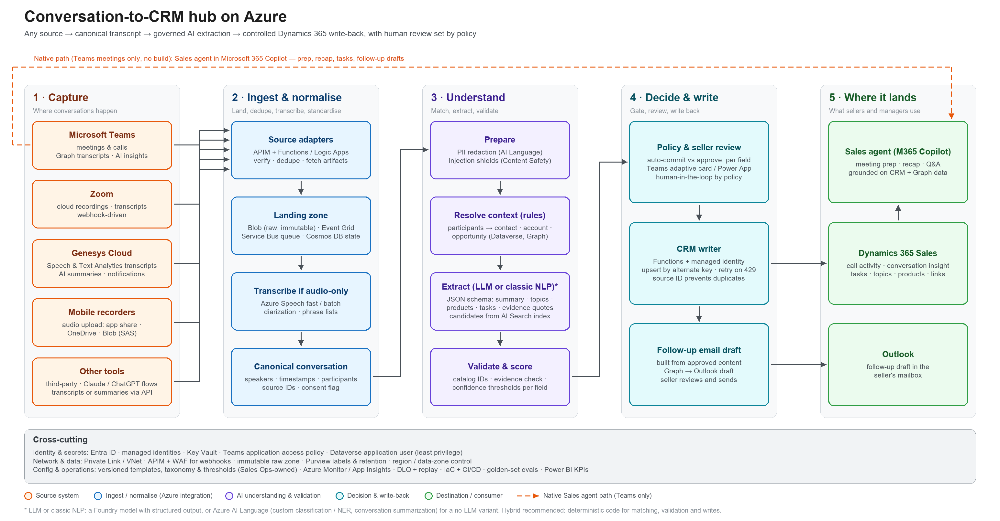
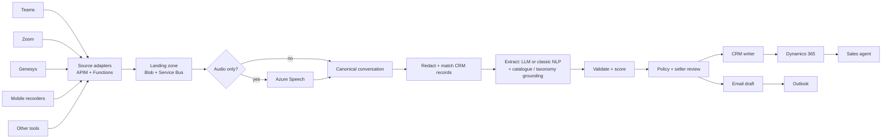

# Conversation-to-CRM on Azure — architecture draft & technical discovery guide

*Draft for a customer discovery conversation. Items marked ⚠ are assumptions or things I could not verify from public docs — confirm against the customer's tenant, licences and contracts.*



*Editable version: `conversation-to-crm-architecture.excalidraw` (File → Open in excalidraw.com).*

---

## 0. TL;DR

- **Framing:** this is a *cross-platform post-call automation* problem, not a voice-agent problem. The valuable asset is a **source-agnostic pipeline** that turns any recording/transcript into the same governed CRM outcome.
- **Recommended pattern (hybrid):**
  - Keep the **Sales agent** for the seller experience on Teams meetings (prep, recap, tasks, drafts) — no build.
  - Build a **conversation hub** on Azure for *all* sources (Teams, Zoom, Genesys, mobile, other tools): adapters → canonical transcript → enrichment → validation → controlled Dynamics 365 write-back with human review set by policy.
  - **Deterministic code** for identity matching, validation and CRM writes; **models only for language understanding** (summary, topics/products, tasks, email draft).
- **LLM is optional.** A classic-NLP variant (Azure Speech + Azure AI Language) works for transcripts, PII, recap/follow-up summaries and rule/classifier-based tagging; the GenAI variant is better at custom templates and nuance. Hybrid is the default recommendation (section 5).
- **Biggest early risks** are not model quality: (1) can we *get* the content from each source (licences, admin approvals, customer-hosted meetings), (2) the product/topic taxonomy, (3) governance/consent.

---

## 1. Requirement → design map

| Customer need | How the design meets it |
|---|---|
| Handle recordings/transcripts from Teams, Zoom, Genesys, mobile apps | One adapter per source; all land in a common Blob + Service Bus pipeline and a **canonical conversation** schema (appendix A) |
| Keep using existing tools (3rd-party, Claude/ChatGPT flows, Genesys summaries) | Adapters accept **transcript, audio, or a pre-made summary**; nothing forces replacement. Existing summaries become a quality benchmark |
| Summarise in predefined ways | Versioned **summary templates per call type**, enforced with a JSON schema (GenAI) or Language-service summarisation aspects (classic) |
| Add to CRM | Controlled **Dataverse write-back**: activity + structured insight + tasks, idempotent, least-privilege (section 6) |
| Associate topics and products | **Controlled taxonomy + product catalogue grounding** (AI Search); IDs validated against the catalogue before any write |
| Almost eliminate post-call admin | **Auto-commit** low-risk fields, **one-click approve** for tasks, **email drafts** waiting in Outlook; measured by edit/accept rate |
| Microsoft ecosystem + CRM | Entra ID, Azure integration services, Foundry, Dataverse, Graph, Outlook, Teams, Power BI |

---

## 2. Architecture

### 2.1 Flow in one paragraph
Each source emits a "conversation ready" signal (webhook, Graph change notification, Genesys notification/trigger, blob-created). An adapter verifies and de-duplicates it, fetches the transcript/audio/summary, stores the raw artifacts, and queues a message. Audio-only inputs are transcribed (Azure Speech). Everything is normalised to the canonical schema, PII-redacted where policy requires, matched to CRM contacts/accounts/opportunities by rules, then run through extraction against the approved templates, product catalogue and taxonomy. A validation gate checks schema, catalogue IDs, evidence quotes and confidence. A policy engine decides per field what auto-commits and what goes to the seller for one-click review (Teams adaptive card / Power App). The CRM writer upserts to Dynamics 365 using a source-derived key; an email draft is created for the seller to send.

### 2.2 Layers and services

| Layer | Azure / Microsoft services | Role | Design notes |
|---|---|---|---|
| Capture | Graph change notifications (Teams) · Zoom webhooks · Genesys Notifications API / Architect trigger / API polling · Blob SAS or OneDrive folder (mobile) · partner webhooks | Detect "conversation ready" | Subscriptions need renewal; Zoom needs a fast ack (see section 3) |
| Ingest | **API Management** (+ WAF) · **Functions** (or Logic Apps) · Event Grid · **Service Bus** · **Blob Storage** · Cosmos DB (state ledger) | Verify, de-dupe, fetch, store raw, queue | Raw zone immutable + lifecycle policy; ledger holds idempotency keys, status, template/model versions |
| Normalise | **Azure Speech** (fast / batch transcription) · transcript parsers (VTT/JSON) | Canonical JSON | Diarization needs **mono** audio; stereo = one speaker per channel (use channel separation instead) |
| Understand | **Azure AI Language** (conversation PII — preview, summarisation, classification/NER) · **Content Safety / Foundry guardrails** · **AI Search** (catalogue/taxonomy) · **Foundry model(s)** · *(alt)* **Content Understanding** | Redact, ground, extract | LLM sees only redacted text where policy requires; transcript text is treated as **data, never instructions** |
| Decide | Policy engine (code + Azure App Configuration / Dataverse config) | Auto-commit vs review per field | Thresholds tuned on the evaluation set, not guessed |
| Review | Power Automate / Teams bot → **adaptive card**, or Power App | Seller approves/edits | Edits become evaluation data |
| Write | Functions + **managed identity** → **Dataverse Web API**; Graph → **Outlook draft** | Controlled writes | Upsert by alternate key; retry/back-off on 429 |
| Experience | Sales agent · D365 timeline · Outlook · Power BI | Consume | Sales agent reads CRM + Graph data ⚠ confirm it surfaces non-Teams summaries written to CRM |
| Cross-cutting | Entra ID · Key Vault · Private Link/VNet · Purview · Azure Monitor/App Insights · IaC + CI/CD · Foundry evaluations | Security, ops, quality | See section 7 |

### 2.3 Teams: three ways to get the content

| Option | How | Pros | Cons |
|---|---|---|---|
| A. Native only | Sales agent (prep, recap, action items) | No build; best seller UX | Fixed output; no custom template/taxonomy/product tags; **only Teams** |
| B. Meeting AI Insights API | `GET /copilot/users/{id}/onlineMeetings/{id}/aiInsights/{id}` → `meetingNotes`, `actionItems`, mentions | Microsoft documents this exact pattern ("Autogenerate meeting summaries for CRM updates") | Requires a **Microsoft 365 Copilot-licensed user**; can take **up to ~4 hours**; fixed structure, no taxonomy tagging |
| C. Transcript → hub | Graph change notification → fetch transcript (VTT) → same pipeline as other sources | **Same template and tags as every other source**; you control latency | You own the pipeline; needs Graph app permission + tenant settings |
| **Recommendation** | A for seller UX **+** C for CRM consistency (B optional as a cross-check or fast first summary) | | |

---

## 3. Source-by-source ingestion

| Source | "Ready" signal | Get the content | Watch-outs |
|---|---|---|---|
| **Teams** | Graph change notification on `communications/onlineMeetings/getAllTranscripts` (application permission `OnlineMeetingTranscript.Read.All`; meeting-scoped RSC alternative) | Graph transcript content (VTT); speaker-attributed if the tenant allows | Notification fires **only if the subscription exists before transcription starts** · tenant settings *Graph API access to transcripts* and *speaker attribution* must allow it · application access policy scopes the app to sellers ⚠ · transcripts are tied to the **organizer** → customer-hosted meetings are out of reach · ad hoc (Teams Phone) calls use different resources/permissions · channel/private-channel limits |
| **Zoom** | Webhooks (`recording.completed`, `recording.transcript_completed`); app needs a cloud-recording read scope such as `cloud_recording:read:recording` | REST download of transcript (VTT/JSON) or M4A audio; AI Companion summary API if licensed | Endpoint must return 200/204 **within 3 s** → ack, queue, process async · needs **cloud recording** on the host's account · customer-hosted Zoom calls are not recorded in your account · real-time (RTMS) needs Zoom approval |
| **Genesys Cloud** | Notifications API topics (WebSocket) · Architect trigger → workflow/data action to our HTTPS endpoint · or poll analytics API | `GET /api/v2/speechandtextanalytics/conversations/{id}/communications/{id}/transcripturl` (words + timings, sentiment/topic events, participants) · `GET /api/v2/conversations/{id}/summaries` (AI summary + wrap-up) · recordings API for audio | **Transcript URL expires in 10 minutes** → fetch and persist immediately · EventBridge is AWS-centric; conversation events are Notifications-API only · live transcription topic needs a **cloud edge** (GCV / BYOC Cloud) · STA licensing ⚠ · the **Summarization Connector** lets Genesys call *our* endpoint (`summary` string in/out) — a way to reuse our model/templates inside Genesys |
| **Mobile recorders** | Blob-created event · OneDrive/SharePoint folder watcher · app webhook | Audio (+ sidecar metadata: seller, time, optional account hint) → Azure Speech | Consent on personal devices · formats/size · mapping recording → seller/account · offline uploads |
| **Other tools / custom Claude-ChatGPT flows** | Their webhook/API/e-mail-in/export | Transcript and/or their summary (skip transcription if text exists) | Schema mapping · keep their summary as a benchmark during evaluation |

**Generic rules for every adapter:** verify signatures/tokens · respond fast, work async · idempotency key = `(source, sourceInteractionId, version)` · persist raw artifacts before any processing · never block on CRM availability (queue + retry).

---

## 4. Processing: LLM vs non-LLM at each step

| # | Step | Non-LLM option | LLM option | Recommendation |
|---|---|---|---|---|
| 1 | Transcribe (audio-only) | Azure Speech fast / batch, diarization, phrase lists | LLM-enhanced speech models (preview) | **Azure Speech**; add phrase lists for product names |
| 2 | PII / PCI redaction | Language conversation PII (preview) + regex for card numbers | — | Redact **before** the LLM where policy requires; guardrails on output too |
| 3 | Match participants → account / contact / opportunity | Dataverse lookups on email/phone/domain + calendar match | LLM only to rank ambiguous candidates | **Deterministic first**; ambiguity → review queue, never guess |
| 4 | Summary (predefined format) | Language summarisation: recap, follow-up tasks, chapter titles (limited customisation) | Foundry model with per-call-type JSON schema | **LLM** for template control; Language as fallback/cross-check |
| 5 | Topics | Custom text classification (needs labelled data) · keyword/phrase rules | LLM constrained to taxonomy IDs + evidence quotes | **Hybrid**; validate IDs against taxonomy |
| 6 | Products | Dictionary/fuzzy match vs catalogue (+ synonyms), AI Search | LLM classifies *mention type* (interest / existing / competitor / objection) on a retrieved shortlist | **Retrieve candidates → LLM classify → validate IDs** |
| 7 | Tasks, owners, due dates | Language follow-up tasks + rules | LLM extraction with owner/due/evidence | **LLM + deterministic checks** (owner must be a participant; relative dates resolved against call date) |
| 8 | Follow-up email | Dataverse/Outlook template merge | LLM draft in house tone | **LLM draft, human sends** |
| 9 | Quality gate | Schema validation · evidence-quote exists in transcript · confidence thresholds | LLM-as-judge (evaluation only, not runtime) | **Deterministic gate** |
| 10 | CRM write | Dataverse Web API upsert | — | **Code only** |

*Sizing rule of thumb (estimate — validate with real calls): one hour of conversation ≈ 9–10k words ≈ 12–15k tokens. Plan one extraction call per conversation, chunking or a long-context model for very long meetings. Cost drivers: audio hours, tokens, concurrency, storage, region.*

---

## 5. Three variants and the recommendation

| Variant | Services | Strengths | Limits | Fit |
|---|---|---|---|---|
| **A. Classic NLP (no LLM)** | Speech + Language (PII, summarisation, key phrases, custom classification/NER) + rules + templates. The Speech **Ingestion Client** accelerator is this pattern | Deterministic, predictable cost, easy to audit | Fixed summary shapes; needs labelled data for topics/products; weaker on commitments, objections, implicit next steps | Strict compliance, high volume, simple outputs |
| **B. GenAI-centric** | Speech *or* **Content Understanding** (`prebuilt-callCenter` / custom analyzer: transcript with speaker roles, summary, sentiment, entities, categories, custom fields) + Foundry LLM with JSON schema + AI Search grounding | Fast to build; custom templates; handles nuance | Needs evaluation + guardrails; token cost; prompt-injection surface | Rich summaries, fast iteration |
| **C. Hybrid (recommended)** | B for understanding + A components as **cross-checks** (e.g. catalogue match must agree with LLM product tag) + deterministic matching/validation/writes | Best accuracy/control balance; graceful fallback | Slightly more moving parts | Default for this customer |

Microsoft's reference design for the audio branch: **Azure Architecture Center — "Extract and analyze call center data"** (Speech batch → Language PII → Foundry model, or Content Understanding), which already shows storing outputs in a CRM. Our hub extends it with multi-source adapters, a canonical schema, review, and controlled CRM write-back.

*Models:* use a Foundry-hosted GPT model with structured outputs as the default. If they want continuity with Claude prompts they already tuned, **Claude is available in Foundry** (hosted on Azure or Anthropic infrastructure) — ⚠ check subscription type (CSP subscriptions are not supported), region/data-zone and hosting option against their residency rules.

---

## 6. CRM write-back and "near-zero admin" policy

### 6.1 Data model (proposal — to be shaped by discovery)
- **Standard activity** (phone call / appointment) *regarding* the account/contact/opportunity → appears in the timeline and is visible to Sales agent.
- **Conversation insight** (custom table; make it an *activity-type* table if timeline visibility is required): source system, source interaction ID, start/end, participants, language, summary per template, key points, sentiment, confidence, **template + model version**, **review status**, links to raw transcript/recording.
- **Topic** and **Product** links (N:N or child rows) carrying *mention type*, *confidence* and *evidence quote*.
- **Tasks** (standard `task`) flagged *AI-suggested*, regarding the opportunity, with evidence timestamp.
- **Email draft** created in the seller's Outlook (not stored in CRM until sent/tracked).
- Keep **large artifacts (audio, full transcripts) in Blob/SharePoint** with links — avoids Dataverse capacity pressure; summaries and structured fields live in CRM.

### 6.2 Reliability and safety
- **Idempotency:** alternate key `(source, interactionId, version)` + Upsert; Service Bus de-dupe; Cosmos ledger. Re-processing creates a **new version**, never overwrites seller edits.
- **Identity:** Dataverse *application user* with a least-privilege custom role. Optionally write *as the seller* (impersonation) so ownership/audit look native — a customer decision.
- **Throttling:** Dataverse service-protection limits return **429 + `Retry-After`** — queue-based load levelling, bounded concurrency.
- **Ambiguity:** unmatched or multi-match conversations go to an **"unassigned conversations" review view**, not a guess.

### 6.3 Automation policy (default — tune with data)

| Field | Default | Why |
|---|---|---|
| Summary (per template) | Auto-write as *AI draft* | Low risk, visible, editable |
| Topics | Auto if in taxonomy **and** ≥ threshold, else review | Controlled vocabulary |
| Products mentioned | Auto-tag mentions; *interest/objection* → review | Mentions ≠ buying intent |
| Tasks | Create as *proposed*; one-click accept (auto only if owner + date explicit and high confidence) | Avoid task spam |
| Follow-up email | **Draft only, never auto-send** | External communication |
| Opportunity stage/amount/close date | **Suggest only** | Forecast integrity |
| Unmatched conversation | Review queue | Avoid wrong-record writes |

Track **acceptance/edit rate per field** → raise automation thresholds only where the data supports it.

---

## 7. Security, governance, quality

- **Identity & secrets:** managed identities everywhere; Graph app permission scoped to sellers with an *application access policy* ⚠; Zoom/Genesys credentials in Key Vault; Dataverse application user.
- **Network:** Private Link/VNet for storage, Foundry, Cosmos, Search; **public ingress only through APIM + WAF** for third-party webhooks (⚠ conflicts with "private-only" policies — raise early; allow-list source IPs where published).
- **Data:** immutable raw zone, lifecycle/retention aligned to policy, Purview labels, region/data-zone control, optional customer-managed keys. Consent flag carried on every conversation; "do not process" honoured.
- **AI safety:** PII redaction before the LLM where required; Content Safety / prompt shields; structured outputs only; **evidence quote must exist in the transcript** or the field is dropped; model/template versions pinned and change-controlled.
- **Evaluation:** golden set of ~50–100 real calls across sources/languages/call types with human-labelled outputs → metrics: record-link accuracy, task precision/recall, topic/product F1, unsupported-claim rate, summary rubric score, seller edit rate, time-to-CRM. Run **shadow mode** before any auto-commit; regression-test every template/model change.
- **Operations:** App Insights + Log Analytics, dead-letter queue + replay, KPI workbook/Power BI (calls processed, success %, latency, acceptance rate, minutes saved).

---

## 8. Where the accelerators fit (honest view)

| Accelerator | Useful for | Not a fit for |
|---|---|---|
| **Call Center Voice Agent Accelerator** (Voice Live + ACS; supports Genesys Cloud AudioHook, Twilio, others) | **Real-time** audio streaming scenarios — e.g. live transcription/agent-assist from Genesys; telephony plumbing | Importing existing post-call transcripts/summaries |
| **ART (Real-Time Voice Agent) Accelerator** | `azd` infra scaffolding (Speech, Azure OpenAI, ACS, Cosmos, Redis, container hosting), agent/tool registry patterns, demo UI; a **voice debrief agent** for mobile (seller dictates a debrief, agent asks clarifying questions, writes the structured update) | The core post-call pipeline — adapters, canonical schema, CRM writer are new build |

So: reuse their **infra patterns and Speech/LLM plumbing**, and position the **voice debrief** idea as the mobile-capture option and a stretch demo. The post-call pipeline is the MVP.

### MVP scope (proposal — size after discovery)
**In:** Teams transcript path (pilot group) + one non-Teams path (Zoom *or* Genesys sample) + audio upload path (mobile) · canonical schema · 1–2 summary templates · topic/product tagging against a sample catalogue · Dataverse **sandbox** write-back (activity, insight, tasks) · seller review card · Outlook draft · evaluation set (20–30 calls) · KPI view.
**Out (later):** real-time, auto-commit without review, all sources, full taxonomy governance, "ask my calls" search.

### Demo storyline for the meeting
1. Sales agent on a Teams meeting (prep → recap → tasks/draft) — as agreed.
2. **Same transcript through the hub** → structured JSON → CRM sandbox record with topics/products/tasks.
3. A **non-Teams** sample (Zoom VTT or Genesys transcript) through its adapter → identical output shape.
4. Review card + Outlook draft. 5. Evaluation/KPI view. *(Steps 2–5 can use synthetic transcripts if real data isn't available yet.)*

---

## 9. Technical discovery questions

**⭐ = ask in the first conversation.** Right-hand column shows what the answer changes.

### A. Outcomes & scope
| # | Question | Why it matters |
|---|---|---|
| 1 | ⭐ Walk us through what a seller does after a call today — step by step. Where do the minutes go (notes, CRM fields, tasks, email)? | Defines automation targets and the baseline for ROI |
| 2 | ⭐ Can we see 3–5 approved examples: a transcript and the CRM record/summary a seller *should* produce? | Golden set + schema; fastest way to align on "good" |
| 3 | What does "almost eliminate post-call admin" mean numerically (minutes/call, % auto-processed, acceptable correction rate)? | Sets auto-commit thresholds and success metric |
| 4 | Which call types matter first (discovery, demo, renewal, service-style calls on Genesys)? Different templates per type? | Template library and routing |
| 5 | Pilot users: how many, which regions/languages, which source has the most volume? | MVP scope and source priority |

### B. Teams & Microsoft 365
| # | Question | Why it matters |
|---|---|---|
| 6 | ⭐ Are sellers the meeting **organizers**? What share of customer meetings are hosted by the customer (Teams/Zoom/Meet)? | Transcript access is organizer-tied; customer-hosted meetings need another capture method |
| 7 | Current Teams meeting policies: transcription/recording allowed, auto-transcribe on, who can start? | Coverage; Graph notification only fires if transcription is on and subscribed beforehand |
| 8 | Are *Graph API access to transcripts* and *speaker attribution* enabled? Will security approve an app with `OnlineMeetingTranscript.Read.All` scoped by an application access policy? | Viability and lead time of the Graph route |
| 9 | How many sellers hold Microsoft 365 Copilot licences? Sales agent rollout and CRM connection status? | Meeting AI Insights API needs a licensed user; defines Teams option A/B/C |
| 10 | Do sellers also use Teams Phone / ad hoc calls for customers? | Different Graph resources and permissions |
| 11 | Where should sellers review/approve — Teams chat, Outlook, or inside Dynamics? | Review UX component |

### C. Zoom
| # | Question | Why it matters |
|---|---|---|
| 12 | ⭐ Zoom plan/admin model; is cloud recording + audio transcript enabled for sellers? AI Companion licensed? | Webhook route vs bot/local capture |
| 13 | Can a Zoom admin create a server-to-server/Marketplace app with cloud-recording read scopes, and may a public Azure endpoint receive webhooks? | Approvals and network design |
| 14 | Do sellers join **customer-hosted** Zoom calls? How are those recorded today? | No cloud recording for them → alternate capture |
| 15 | Transcript quality: real speaker names or "Speaker 1"? Languages? Retention in Zoom cloud? | Speaker mapping, diarization, timing of fetch |

### D. Genesys
| # | Question | Why it matters |
|---|---|---|
| 16 | ⭐ Genesys Cloud (which licence/AI add-ons, which region) or Engage on-prem? | API availability |
| 17 | Is Speech & Text Analytics (voice transcription) enabled and licensed for the relevant queues/users? Are recordings dual-channel? | Transcript availability; diarization vs channel separation |
| 18 | Which Genesys AI summary/wrap-up product is used today, and can its output be read via API/trigger? What does it lack (structure, topics, products)? | Reuse vs replace; whether the Summarization Connector is useful |
| 19 | How should Genesys notify us — Architect trigger + data action to our webhook, Notifications WebSocket, or polling? Any outbound-webhook or IP-allow-list restrictions? | Ingestion design and network approval |
| 20 | Is there already a Genesys ↔ Dynamics integration (CTI/embedded client) creating phone-call activities? Which identifiers match (ANI, interaction ID)? | Avoid duplicates; matching keys |
| 21 | Are these interactions sales, service, or both? Targets are opportunity vs case? | CRM data model |
| 22 | Any real-time need (live agent assist) or post-call only? | Whether the real-time accelerators matter |

### E. Mobile apps & other tools
| # | Question | Why it matters |
|---|---|---|
| 23 | ⭐ Which mobile apps/devices record meetings (names, OS, MDM-managed)? What do they output — audio, transcript, summary? API/webhook/export, or manual share only? | Adapter feasibility |
| 24 | Audio formats, sizes, sample rates, mono vs stereo, typical length, offline uploads? | Speech configuration, upload design |
| 25 | How do we know whose recording it is and which account — metadata, calendar match, manual selection? | Matching strategy |
| 26 | For the third-party tools and Claude/ChatGPT flows: where do they run, what do they output, who owns them, and are they staying? Can we reuse their prompts/outputs as a baseline? | Adapter vs replace; benchmark |
| 27 | What are the consent/regulatory rules for recording on personal devices? | Gating and governance |

### F. Dynamics 365 / Dataverse
| # | Question | Why it matters |
|---|---|---|
| 28 | ⭐ Which Dynamics apps/licences (Sales Enterprise/Premium/Pro, Customer Service, Contact Center)? Environment topology (dev/test/prod), managed solutions, DLP policies? | Deployment/ALM approach |
| 29 | ⭐ Where should output land: phone-call/appointment activity, notes, a custom table, opportunity fields? What exists today for topics/products? | Data model |
| 30 | Product catalogue: source of truth (Dataverse `product`, ERP/PIM)? Count, hierarchy, synonyms/aliases, update cadence? | Grounding approach (dictionary vs AI Search) |
| 31 | Topic taxonomy: exists? Owner? Multi-level / multi-select? Reporting needs (Power BI/Fabric)? | Taxonomy source and validation |
| 32 | Matching rules: how are account/contact/opportunity found today; duplicates; several open opportunities; desired behaviour when ambiguous? | Resolver logic and review queue |
| 33 | Security model: business units, teams, field-level security. Should writes appear as the seller or a service account? Audit expectations? | App user, roles, impersonation |
| 34 | Task conventions: standard `task` or custom, owner assignment, due-date defaults, regarding record, de-duplication with seller-created tasks, Planner/To Do sync? | Task design |
| 35 | Dataverse capacity and API budget: transcripts in Dataverse vs links to Blob/SharePoint; expected writes per hour; other integrations consuming the limits? | Storage and throttling design |
| 36 | Email: Outlook drafts vs Dynamics email activities; templates/tone/disclaimers; is auto-send ever allowed? Exchange policy for app mailbox access? | Email design and approvals |

### G. AI quality & approach
| # | Question | Why it matters |
|---|---|---|
| 37 | ⭐ What are the predefined summary formats and fields (MEDDICC/BANT, sections, length, language)? Who approves changes? | Prompt/schema versioning and governance |
| 38 | Which error is worse: wrong product tag or missed tag? Wrong task or missed task? | Precision/recall targets and thresholds |
| 39 | Do they want evidence (quote + timestamp) stored in CRM? | Traceability design |
| 40 | Languages, accents, domain jargon? | Speech language ID, phrase lists, custom speech |
| 41 | Is there labelled history (past transcripts with known CRM outcomes) and how much? | Evaluation set; feasibility of classic classifiers |
| 42 | Model/data residency constraints; preference for Azure OpenAI vs Claude in Foundry; "no retention/training" requirements? | Model choice and deployment type |
| 43 | Do calls contain card data or other regulated data? Redact before the LLM? Keep unredacted originals? | Pipeline step and storage design |
| 44 | Latency: is "within minutes of the transcript being ready" fine, or near-real-time? Is overnight acceptable for some sources? | Queue vs streaming; Teams AI-insights delay |
| 45 | Volumes: calls/day per source, average length, peak concurrency, historical backfill? | Capacity and cost |

### H. Security, compliance & operations
| # | Question | Why it matters |
|---|---|---|
| 46 | ⭐ Recording-consent regimes (jurisdictions, two-party consent) and who is accountable for consent flags per source? | "Do not process" gating |
| 47 | Retention, legal hold, eDiscovery for raw audio, transcripts and AI outputs; who may view them? | Storage design, Purview |
| 48 | Can public endpoints receive Zoom/Genesys webhooks (APIM + WAF + IP allow-list), or must everything be private? | Ingress design |
| 49 | Existing standards: IaC (Bicep/Terraform), CI/CD (GitHub/Azure DevOps), SIEM, integration platform, Power Platform governance? | Implementation constraints |
| 50 | Who will own and run it (support model, on-call) and what skills (Power Platform vs .NET/Python)? | Low-code vs pro-code choice |
| 51 | Third-party risk reviews needed for Zoom/Genesys API credentials and for sending transcripts to AI services? | Timeline risk |

### I. Success & rollout
| # | Question | Why it matters |
|---|---|---|
| 52 | Pilot success criteria and decision date; what would make this a no-go? | MVP definition |
| 53 | Will sellers trust auto-written CRM entries? Is human approval mandatory initially? Who owns the feedback loop? | Review UX, thresholds |
| 54 | Budget/ownership (Sales Ops vs IT) and other systems to include later? | Scope and sponsorship |

---

## 10. Risks and items I could not verify

- ⚠ **Customer-hosted meetings/calls** cannot be captured through your tenant's Teams/Zoom APIs — needs another capture method (local recording/upload, bot) or an explicit exclusion.
- ⚠ **Licensing/admin gates:** Meeting AI Insights API (Copilot licence), Genesys STA, Zoom plan/cloud recording, Graph app permissions + tenant transcript settings.
- ⚠ **Webhook ingress vs private-only network policy** (Zoom/Genesys must reach a public endpoint).
- ⚠ **Taxonomy and catalogue quality** is the long pole for topic/product accuracy.
- ⚠ **Preview features:** Conversation PII API and some LLM-speech options are preview; Graph recording endpoints and some transcript types are beta — check status when you commit to a design. Check Content Understanding release status and region availability.
- ⚠ **Sales agent visibility:** I could not confirm that Sales agent surfaces non-Teams summaries written to CRM — test in the POC.
- ⚠ **Genesys:** confirm which Architect trigger topics exist for the customer's scenario (the documented example uses the Virtual Agent summaries topic) and the exact AI summary product/licence.
- ⚠ **Zoom:** `recording.transcript_completed` is documented in Zoom's own integration guidance; confirm event availability for the customer's account type.
- ⚠ **Claude in Foundry:** subscription-type and region restrictions apply.

---

## Appendix A — Canonical schemas (illustrative)

**Canonical conversation**
```json
{
  "conversationId": "zoom:9f2c…",
  "source": "zoom",
  "sourceInteractionId": "…",
  "channel": "meeting",
  "startUtc": "2026-11-03T15:02:00Z",
  "endUtc": "2026-11-03T15:47:00Z",
  "language": "en-US",
  "seller": { "upn": "seller@contoso.com", "entraId": "…" },
  "participants": [{ "name": "…", "email": "…", "phone": null, "role": "external" }],
  "segments": [{ "id": 118, "speaker": "P1", "startMs": 1200, "endMs": 5400, "text": "…" }],
  "artifacts": { "rawTranscriptUri": "blob://…", "audioUri": "blob://…", "sourceSummary": null },
  "consent": { "status": "unknown", "basis": "…" },
  "adapterVersion": "1.0"
}
```

**Extraction result (per template)**
```json
{
  "templateId": "discovery-call-v3",
  "summary": { "overview": "…", "customerGoals": ["…"], "objections": ["…"], "decisions": ["…"] },
  "topics":   [{ "topicId": "TOP-014", "confidence": 0.91, "evidence": [{ "segmentId": 118, "quote": "…" }] }],
  "products": [{ "productId": "PRD-2201", "mention": "interest", "confidence": 0.84, "evidence": [{ "segmentId": 131, "quote": "…" }] }],
  "tasks":    [{ "title": "…", "ownerRef": "participant:P2", "dueDate": "2026-11-10", "dueDateBasis": "stated", "confidence": 0.78, "evidence": [{ "segmentId": 160, "quote": "…" }] }],
  "followUpEmail": { "subject": "…", "bodyHtml": "…" },
  "flags": ["pricing_discussed", "competitor_named"]
}
```

## Appendix B — Mermaid fallback (Excalidraw → Insert → Mermaid)



## Appendix C — References (verified during this review)

- Sales agent: [use Sales agent / meeting prep & follow-up](https://learn.microsoft.com/microsoft-sales-copilot/use-sales-chat)
- Dynamics 365 conversation intelligence: [setup, storage & third-party dialers](https://learn.microsoft.com/dynamics365/sales/fre-setup-ci-sales-app) · [Twilio Flex integration (preview)](https://learn.microsoft.com/dynamics365/sales/integrate-twilioflex-with-ci)
- Graph: [transcript/recording change notifications](https://learn.microsoft.com/graph/teams-changenotifications-callrecording-and-calltranscript) · [meeting transcripts & recordings](https://learn.microsoft.com/microsoftteams/platform/graph-api/meeting-transcripts/overview-transcripts) · [Meeting AI Insights API](https://learn.microsoft.com/microsoftteams/platform/graph-api/meeting-transcripts/meeting-insights)
- Azure: [Extract and analyze call center data (Architecture Center)](https://learn.microsoft.com/azure/architecture/ai-ml/openai/architecture/call-center-openai-analytics) · [Content Understanding audio](https://learn.microsoft.com/azure/ai-services/content-understanding/audio/overview) · [Speech language ID & diarization](https://learn.microsoft.com/azure/ai-services/speech-service/configure-language-identification-diarization) · [post-call analytics quickstart](https://learn.microsoft.com/azure/ai-services/speech-service/call-center-quickstart) · [Language summarisation](https://learn.microsoft.com/azure/ai-services/language-service/summarization/overview) · [Conversation PII](https://learn.microsoft.com/azure/ai-services/language-service/personally-identifiable-information/conversation-pii-overview) · [Claude in Foundry](https://learn.microsoft.com/azure/foundry/foundry-models/concepts/claude-models)
- Dataverse: [service protection API limits](https://learn.microsoft.com/power-apps/developer/data-platform/api-limits)
- Genesys: [transcript URL](https://developer.genesys.cloud/analyticsdatamanagement/speechtextanalytics/transcript-url) · [transcription notifications](https://developer.genesys.cloud/analyticsdatamanagement/speechtextanalytics/transcription-notifications) · [EventBridge vs Notifications](https://developer.genesys.cloud/api/rest/v2/notifications/event_bridge) · [Summarization Connector](https://help.genesys.cloud/articles/configure-and-activate-the-genesys-summarization-connector/) · [summaries API & trigger example](https://help.genesys.cloud/articles/retrieve-the-conversation-summary-and-wrap-up-code-that-virtual-agent-generates-for-a-bot-interaction/)
- Zoom: [webhooks](https://developers.zoom.us/docs/api/webhooks/) · [recording & transcription pipeline](https://github.com/zoom/skills/blob/main/skills/general/use-cases/recording-transcription.md) · [AI Companion integration](https://github.com/zoom/zoom-plugin-codex/blob/main/skills/general/use-cases/ai-companion-integration.md)
- Accelerators: [Call Center Voice Agent Accelerator](https://github.com/Azure-Samples/call-center-voice-agent-accelerator) · [ART Agent Accelerator](https://github.com/Azure-Samples/art-voice-agent-accelerator)
