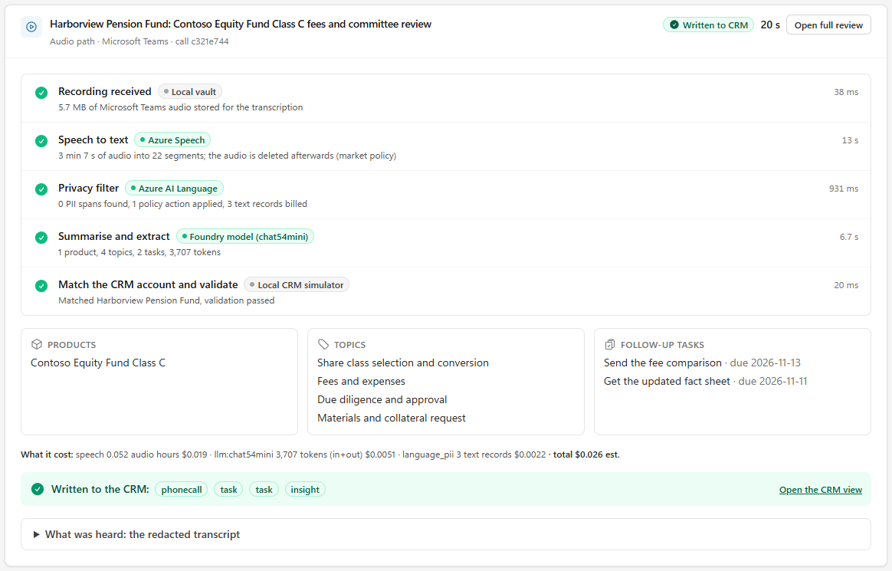
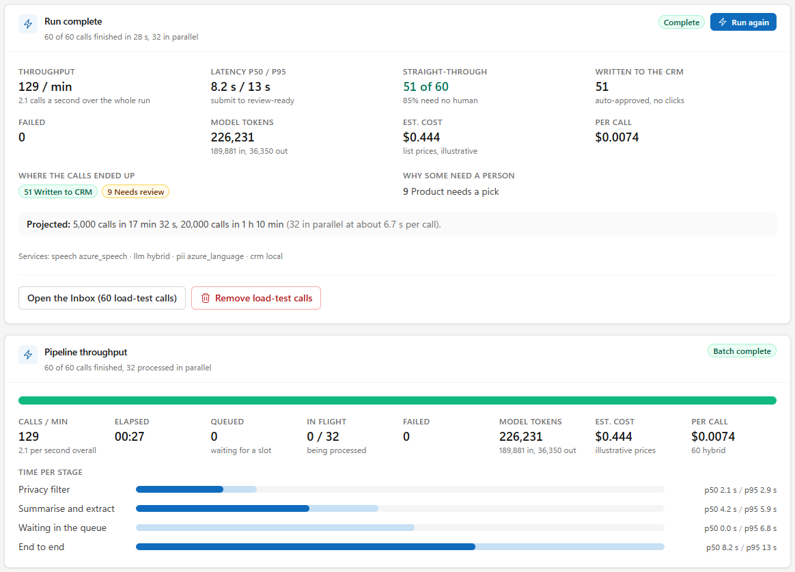
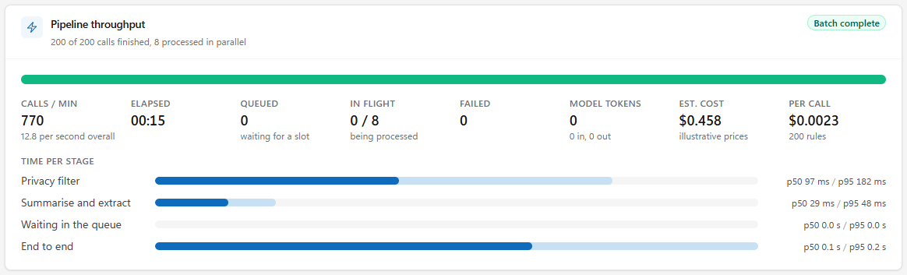
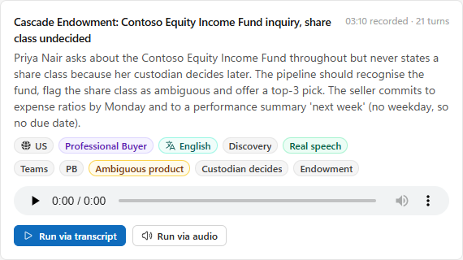

# Live demo guide: three real scenarios

How to run the three live scenarios from the demo brief against real Azure services. Everything here is Windows, run from the
repo root. It is set up on the **demo tenant** (section 1) and the numbers were measured there on
2026-11-05; earlier measurements from the first Azure account are marked as such.

| | Scenario | What is real | Status |
|---|---|---|---|
| **A** | Play a call -> speech-to-text -> language service -> model -> review | Azure Speech, Azure AI Language, a Foundry model | **Verified live** on the demo tenant, ready |
| **B** | A Teams call lands in VoiceCRM after it ends | Microsoft Graph, Teams transcription | **Verified live** end to end on 2026-11-06: a real scheduled meeting was listed by Graph, downloaded, and became a CRM-matched proposal (section 3.4) |
| **C** | Hundreds of calls at once (800) | the same real services, in parallel | **Verified live** up to 300 calls on the demo tenant (800 is the same code at the model's quota, about 4-5 minutes), ready |

> **B is not literally real-time.** Microsoft Graph publishes a Teams transcript some minutes after the meeting ends, later than
> the Teams chat shows it (listed within 8 minutes in the one run we measured; a Microsoft Q&A report says about 20; there is no guaranteed time), not as a stream. The
> demo is "hang up, and the call is in the CRM review queue without anyone touching anything", so end the meeting well before
> you present. It works for **calendar-backed (scheduled) meetings only**, not "Meet now" (section 3.4). Streaming
> transcripts exist only through Work IQ (takes effect 14 Nov 2026) or a media bot (section 3.8).

## Run it from the browser: the Live demo page

Open **http://127.0.0.1:8010/live** (sidebar: *Live demo*, under the Inbox). A and C need no second terminal and no script; B
gets its checks, its status card and a rehearsal. Restart the backend and run `npm run build` in `frontend` after pulling.

| Section | You do | You get |
|---|---|---|
| **Services behind these runs** | **Check services now** | which services are live or mock, then the probes of `scripts\preflight.bat` (a few tiny requests, under a cent) and READY / NOT READY for A, B and C with the fix for anything that fails |
| **A: play a recorded call** | pick a recording, play it, **Process with Azure** | the pipeline step by step, each with the service behind it and its duration; products, topics, tasks; the cost; one click to write it to the CRM; the redacted transcript |
| **B: a Teams call** | **Check Teams setup**; watch the ingestion card; **Simulate a Teams call** | the tenant checks with the fix for each failure; the live ingestion card; a rehearsal labelled *Simulated* |
| **C: hundreds of calls** | calls (50 / 200 / 800 / your number), input, arrival, parallelism, auto-approve, **Start** | an estimate (tokens, list-price cost, time), a confirmation when billed services are live, a live board with the throughput card, then a report; **Remove load-test calls** |





Both captures are real runs on the first Azure account (`tools\capture_live_demo.py`): the audio call took 13 s end to end for
$0.023; 60 calls took 25 s and $0.265, 51 were written to the CRM with zero clicks and 9 waited for a product pick. On the
demo tenant the same page measured 10.6 s and $0.026 for the audio call and 172 s and $5.91 for 800 calls (section 4).

What the page guards, so a click cannot surprise you:

* **Nothing is spent without a confirmation.** If Speech, Language or a model is live, **Start** shows the billed services, the
  estimated cost, tokens and time first. The API refuses a billed run without `confirm: true`.
* **A load test never writes to a live CRM.** Auto-approve is available only with the local CRM simulator (Dataverse has no
  delete, so a bulk run could not be cleaned up). With `VOICECRM_CRM_MODE=dataverse` the switch is off and the API answers 422.
* **One run at a time, capped at 2,000 calls** (`VOICECRM_LOAD_MAX_CALLS`). **Stop** drops the calls not yet sent and lets the
  ones in the pipeline finish.
* **Every call a run creates is tagged** *Load test* (a `batch` column in the state store). The next run replaces the previous
  run's calls; **Remove load-test calls** (here and on the Inbox banner) deletes them from the Inbox, the vault, the state store
  and the CRM simulator. Calls you made any other way are never touched.
* **Parallelism** defaults to 32 when a live service is involved (or `VOICECRM_MAX_CONCURRENCY` if that is higher) and 16 on
  mocks; the run raises the privacy-filter client's concurrency to match and restores both afterwards.

## 0. Demo-day checklist

```bat
az account get-access-token --tenant <tenant-id> --query expiresOn -o tsv    rem a date = your sign-in is alive; an error = az login --tenant <tenant-id>
scripts\preflight.bat --burst 16      rem 20 s, a few cents: every live service answers, scenarios A/B/C marked READY
scripts\teams_check.bat               rem 5 s: Graph sign-in, the three hosts, and the newest transcript downloaded and read (scenario B)
scripts\rehearse_audio.bat            rem 60 s: all recorded calls through the real audio path, scored against the answer key
scripts\make_meeting_audio.bat        rem once, 30 s: the 8 calls you play into the Teams meeting for scenario B (section 3.4)
scripts\rehearse_audio.bat --meeting  rem 60 s: those 8 recordings through Speech, Language and the model, scored (section 3.4)
scripts\run_backend.bat               rem API + built UI on http://127.0.0.1:8010
```

Open **http://127.0.0.1:8010**. The top bar shows which services are *Live* and which are *Mock*; say so out loud.
The preflight also runs in the browser: **Live demo -> Check services now** (without the burst test).
`scripts\run_all.bat` also starts the Vite dev server (http://localhost:5173) if you want hot reload.
After changing the frontend run `npm run build` in `frontend` (the API serves `frontend\dist`).

## 1. The demo tenant: what is set up, and how `.env` uses it

Created on 2026-11-05 in the demo tenant (`admin@<tenant>.onmicrosoft.com`, tenant
`<tenant-id>`, subscription `<subscription>`). Nothing that already existed in the
tenant was changed.

| What | Name | Notes |
|---|---|---|
| Resource group | `<resource-group>` (East US 2) | delete it and every Azure resource below goes with it |
| Foundry resource | `<foundry-resource>` (AIServices, S0, custom domain) | one resource: Speech, Language and the model endpoint |
| Model deployment | `chat54mini` = gpt-5.4-mini (2026-03-17), Global Standard, **800K TPM** | table below |
| Your access | *Cognitive Services User* and *Cognitive Services OpenAI User* on the resource | Entra data-plane roles for `admin@<tenant>...` |
| Teams (scenario B) | an Entra app, two Teams tenant settings, an application access policy for three hosts | section 3.2 |

**Why Entra and not keys.** The tenant's governance policy forces `disableLocalAuth=true` on every Cognitive Services
resource, so keys are rejected. VoiceCRM signs in with your `az login` session (`DefaultAzureCredential`) and pins the
tenant, so other tenants in your `az` profile cannot interfere. If Azure calls start failing with a sign-in error, run
`az login --tenant <tenant-id>` and restart the backend; **Live demo -> Check services now** names the
problem. To let a colleague run the demo against these resources, give their identity the same two roles on `<foundry-resource>`.

`.env` as it stands (written with `tools\env_set.py`, which never prints values; the previous configuration for the first
account, keys included, is kept in `.env.<name>`, git-ignored):

| Setting | Value | Why |
|---|---|---|
| `VOICECRM_AZURE_AUTH` | `entra` | keys are disabled by policy |
| `VOICECRM_AZURE_TENANT_ID` | `<tenant-id>` | the tenant that owns the resources |
| `VOICECRM_SPEECH_ENDPOINT`, `VOICECRM_LANGUAGE_ENDPOINT` | `https://<foundry-resource>.cognitiveservices.azure.com/` | Entra needs the custom-domain endpoint |
| `VOICECRM_FOUNDRY_ENDPOINT` | `https://<foundry-resource>.services.ai.azure.com/openai/v1` | the OpenAI-compatible v1 route |
| `VOICECRM_FOUNDRY_DEPLOYMENT` | `chat54mini` | table below |
| `VOICECRM_DEMO_MODE` | `false` | a misconfigured service must fail loudly, not fall back to its mock |
| `VOICECRM_TEAMS_*` | poll mode, the app, three organisers | section 3.3 |

Search, CRM and vault stay local/simulated on purpose (nothing in the demo needs them live; the CRM simulator is a Dataverse
stand-in, never a live CRM).

**Which model deployment.** The gpt-4.1 family used on the first account is *Legacy* (retires 2027-04-14) and has no quota in this
subscription, so the tenant's model is gpt-5.4-mini. Same 18-call golden set, hybrid engine, measured live on `chat54mini`:

| Measure | Result |
|---|---|
| Topics F1 | 94.2% |
| Tasks precision / recall | 94.6% / 100% |
| Privacy leaks | 0 |
| Calls with no review reason (auto-approvable) | 83.3% |
| Latency p50 / p95 (model stage inside a full call) | 6.4 s / 12.4 s |
| List price per 1M tokens (in / out) | $0.75 / $4.50 (reasoning tokens bill as output) |
| Quota | 800K TPM |

`gpt-5.4-nano` was tried and removed: it was slower (p50 8.4 s) and no call passed the auto-approve bar (0% against 83.3%),
which would defeat scenario C. To switch models, change `VOICECRM_FOUNDRY_DEPLOYMENT` in `.env` and restart;
`scripts\run_bulk_backend.bat` uses whatever `.env` says. The first account's comparison (gpt-4.1, gpt-4.1-mini, gpt-6-astra on
the same set) is in section 7.

New optional settings (all have safe defaults; see `.env.example`): `VOICECRM_MAX_CONCURRENCY`, `VOICECRM_PII_CONCURRENCY`,
`VOICECRM_PII_PACK_CHARS`, `VOICECRM_TEAMS_*`.

## 2. Scenario A: real audio -> Speech -> Language -> model

The scripted calls are text. `scripts\make_audio.bat` speaks them with Azure neural voices (one voice per speaker, Spanish
turns in Spanish, Genesys calls as stereo with the seller on the left channel) so the audio path has real speech to hear.

```bat
scripts\make_audio.bat                rem once: 8 recordings in data\audio\live (~25 s, well under $1; git-ignored)
scripts\rehearse_audio.bat            rem verify: speech-to-text, privacy filter, model, scored against the gold answers
```

Expected rehearsal result (measured on the first account; the demo tenant scores the same across the 8 recordings: topics
P 100% / R 100%, tasks P 100% / R 100%, leaks 0, mean WER 2.4%, with speech-to-text at 4-13 s and the model stage at 3-9 s per call):

```
call                                 total    stt    pii    llm    WER  products  topics     tasks      leaks
pb-teams-equity-class-c              20.4s   6.8s   0.8s  12.5s   1.5%  1/1       P4/4 R4/4  P2/2 R2/2      0
retail-teams-relationship-privacy    16.3s   4.8s   0.4s  11.0s  11.6%  2/2       P3/3 R3/3  P2/2 R2/2      0   (WER counts the redactions)
pb-teams-spanish-clase-c             21.2s   8.0s   0.3s  12.7s   1.4%  1/1       P3/3 R3/3  P2/2 R2/2      0
pb-genesys-inbound-service           18.0s   6.5s   1.0s  10.2s   1.1%  1/1       P2/2 R2/2  P1/2 R1/2      0   (both tasks found; the key wants "call back")
across 8 calls: topics P 100% R 100%, privacy leaks 0, mean WER 2.4%
```

**In the UI** (Live demo, section A)

1. The hero call, *Harborview Pension Fund: Contoso Equity Fund Class C fees*, is pre-selected. Press play so the audience hears
   the call.
2. Press **Process with Azure**. Five steps fill in, each with the service behind it and how long it took: *Speech to text*
   (Azure Speech, 4-13 s for a 3-minute call; the first call after a pause is the slowest), *Privacy filter* (Azure AI Language,
   about 1 s), *Summarise and extract* (the Foundry model, 3-9 s), *Match the CRM account and validate*. About 10-20 s in total
   (the hero call measured 10.6 s on the demo tenant).
3. Read the result out loud: the product with the exact share class, topics, tasks with resolved due dates, what it cost
   (about $0.026). A call with no review reason offers **Approve and write to the CRM**: one click, and the phone call, two
   tasks and the insight appear in the CRM view. *What was heard* shows the redacted transcript; **Open full review** has the
   evidence quotes and the privacy actions (categories only, never the text).

The older route still works: **Sources -> Simulate a call**, then **Run via audio** on a call with a *Real speech* badge.

**Calls worth running**

| Call | What it shows |
|---|---|
| `pb-teams-equity-class-c` | the hero: "class C, not class A", two tasks with resolved dates |
| `retail-teams-relationship-privacy` | a spoken card number and a medical disclosure removed; "Seahawks fan" kept; leaks 0 |
| `pb-teams-spanish-clase-c` | Spanish audio in, English CRM note out |
| `pb-genesys-inbound-service` | stereo contact-centre recording: speakers separated by channel, no diarization guesswork |
| `pb-ambiguous-equity-fund` | the share class is never said: the system offers a top-3 pick instead of guessing |

**Speak it live (best "this is real" moment).** Open **Record in person** (`/capture`) on a phone or the laptop, record
30 seconds, e.g. *"Hi Dana, it's Sam from Contoso Woodgrove. Following up on the Contoso Equity Fund, class C. I'll send
the fee comparison by Friday and set up a session with your committee."* Say "class C" explicitly. Browsers record
WebM/Opus; verified live that WebM, Ogg/Opus and MP3 all transcribe correctly (about 1.4-2.1 s for a 10-second clip). You can also
upload any wav/mp3/m4a/ogg/webm on **Sources -> Upload**.

**Cost of one call, audio path (list prices):** speech $0.018 (3 minutes at $0.36/hour) + privacy filter $0.002 + model
about $0.005 on `chat54mini` = **$0.026 measured** for the hero call (section 5).

## 3. Scenario B: Teams call -> VoiceCRM

### 3.1 How it works

```
Teams meeting ends  ->  Graph publishes the transcript  ->  VoiceCRM finds it (poll every 20 s, or a webhook)
   -> downloads the speaker-attributed WebVTT + meeting details (subject, attendees)
   -> the same pipeline as every other channel  ->  review queue  ->  CRM
```

* **poll** (recommended for the demo): needs no public URL. `VOICECRM_TEAMS_MODE=poll`.
* **webhook** (the production design): Graph POSTs to `/api/v1/webhooks/teams`; needs a public https URL (a dev tunnel
  works) and a subscription created *before* the meeting starts. `VOICECRM_TEAMS_MODE=webhook`.
* Either way the Graph transcript id is the idempotency key: a restart, a re-delivery, or both modes running never create
  a second conversation.

### 3.2 What the tenant needs, and what is already done in the demo tenant

Use a tenant where you are **Global Administrator and Teams is licensed**. A corporate tenant is usually not practical:
granting application permissions there needs corporate approval.

| # | Where | What | Without it | Demo tenant |
|---|---|---|---|---|
| 1 | Teams admin centre -> Meetings -> Meeting settings -> **Transcript API access** | **Microsoft Graph access = On** (default Off) | `403 GraphAccessToTranscriptsDisabled` | **done** (was Off) |
| 2 | same page -> Configure | **Include speaker attribution = On** (default Off) | `403 SpeakerAttributionNotAllowed`: no speaker names | **done** (was Off) |
| 3 | Entra ID | an app registration with **application** permissions `OnlineMeetingTranscript.Read.All`, `OnlineMeetings.Read.All` (+ `User.Read.All` only if you configure organisers by UPN, or want directory display names: without it the host's name comes from the transcript's speaker label), admin consent granted, and a client secret | `403` / sign-in errors | **done**: app `VoiceCRM Teams ingest` (`<app-client-id>`), the two permissions only, secret stored in `.env` |
| 4 | Teams PowerShell | an **application access policy** for the app, granted to each seller who organises a meeting | `403` "no application access policy" | **done**: policy `VoiceCRM-Transcripts` granted to **Aisha West, Alan Steiner, Babak Shammas** |

Listing transcripts is an application-permission-only API; there is no delegated alternative.

**Why those three hosts and not the admin account.** `admin@<tenant>...` is an *application-instance* type account in
Teams (it carries the Teams Rooms / phone-system virtual-user licences), and Teams refuses to grant it a user policy ("User
can't be granted this policy"). Aisha, Alan and Babak are regular licensed users, so one of them hosts the demo meeting. A user
can hold only one application access policy (a new grant replaces the old one), so check before granting a different policy.
The Graph and policy changes can take up to 30 minutes to reach every call; listing already worked when this was written.

PowerShell (as Global Administrator; replace the placeholders). This is what was run for the demo tenant:

```powershell
# 1 + 2: Teams settings (MicrosoftTeams 8.0.0; on this machine it came from PSGallery after Register-PSResourceRepository -PSGallery -Trusted)
Install-PSResource MicrosoftTeams -Scope CurrentUser
Connect-MicrosoftTeams -TenantId <tenant id> -UseDeviceAuthentication
Set-CsTeamsMeetingConfiguration -EnableGraphTranscriptAccess $true -EnableAttributedTranscripts $true -Identity Global

# 3: the app (Azure CLI)
az login --tenant <tenant id>
$app = az ad app create --display-name "VoiceCRM Teams ingest" --sign-in-audience AzureADMyOrg | ConvertFrom-Json
az ad sp create --id $app.appId
$graph = "00000003-0000-0000-c000-000000000000"
foreach ($role in "OnlineMeetingTranscript.Read.All","OnlineMeetings.Read.All") {       # add "User.Read.All" only to use UPNs as organisers
  $id = az ad sp show --id $graph --query "appRoles[?value=='$role'].id | [0]" -o tsv
  az ad app permission add --id $app.appId --api $graph --api-permissions "$id=Role"
}
az ad app permission admin-consent --id $app.appId          # may need a minute after the permissions are added
az ad app credential reset --id $app.appId --display-name voicecrm --years 1 --query password -o tsv    # the secret VALUE: shown once
az ad user show --id <host UPN> --query id -o tsv           # the host's object id

# 4: the access policy (takes up to 30 minutes to apply)
New-CsApplicationAccessPolicy -Identity VoiceCRM-Transcripts -AppIds $app.appId -Description "VoiceCRM transcript ingestion"
Grant-CsApplicationAccessPolicy -PolicyName VoiceCRM-Transcripts -Identity <host object id>      # or -Global for the whole tenant
```

(The secret never touched a terminal here: it was piped from `az` into `.env` by `tools\env_set.py --stdin`.)

### 3.3 Configure and check

`.env` (already set for the demo tenant):

```
VOICECRM_TEAMS_MODE=poll
VOICECRM_TEAMS_TENANT_ID=<tenant id>
VOICECRM_TEAMS_CLIENT_ID=<app id>
VOICECRM_TEAMS_CLIENT_SECRET=<secret value>
VOICECRM_TEAMS_ORGANIZERS=<host UPN or object id>        # comma-separated for several hosts; object ids need no User.Read.All
```

```bat
scripts\teams_check.bat               rem signs in as the app and tests each step; every failure prints the fix
```

Before the first meeting had been transcribed (measured 2026-11-05):

```
[PASS] config: teams app                                  VOICECRM_TEAMS_MODE=poll
[PASS] teams: app sign-in                  872 ms  signed in as the app (client <app-client-id>) to tenant <tenant-id>
[PASS] teams: list transcripts (<object-id>)  1.3 s  <object-id>: access works; no transcripts in the last 24 h (hold a scheduled Teams meeting with transcription on, then run this again to test the download)
[PASS] teams: list transcripts (<object-id>)  708 ms  ... access works; no transcripts in the last 24 h ...
[PASS] teams: list transcripts (<object-id>)  1.2 s  ... access works; no transcripts in the last 24 h ...
[PASS] teams: Graph access                     app sign-in and transcript listing; the download is untested until a transcript exists
```

After a scheduled, transcribed meeting (measured 2026-11-06) the same command also downloads the newest transcript and reads the meeting:

```
[PASS] teams: list transcripts (<object-id>)  1.9 s  <object-id>: 1 transcript(s) in the last 24 h
[PASS] teams: download transcript            1.5 s  downloaded the newest transcript: 21 cues, speakers: Aisha West
[PASS] teams: meeting details                633 ms  meeting 'Sales Call' with 1 attendee(s)
[PASS] teams: Graph access                   app sign-in, transcript listing and download
```

`scripts\preflight.bat` includes the same probe and flips scenario B to READY. In the browser the same probe is **Live demo ->
B -> Check Teams setup**; with `VOICECRM_TEAMS_MODE=off` it says so and shows the settings to add.

### 3.4 Run the demo

Only a person in the Teams client can start a meeting transcript, so this part is yours. One time, about 10 minutes:

1. **Sign in as the host.** Aisha West (Sales Manager persona), `AishaW@<tenant>.onmicrosoft.com`. Her password was set on
   2026-11-05 and handed over in chat, not stored in the repo; to set another: Entra admin centre -> Users -> Aisha West ->
   Reset password. Use a separate Edge profile or an **InPrivate window** so your own session stays signed in as you.
   **Some tenants demand MFA for every user** (check the tenant's Conditional Access policies) and
   **block registering an MFA method unless the sign-in comes from a trusted network range**. If so,
   the very first sign-in as the host must come from a trusted network (register your phone or
   Authenticator as her MFA method once); after that it is a normal MFA prompt. A service
   account or another licensed user that is exempt from MFA can be the host instead: it would
   need the same application access policy (`Grant-CsApplicationAccessPolicy`) and its object id
   added to `VOICECRM_TEAMS_ORGANIZERS`. Do not weaken the policies for the demo: they are the
   tenant's security baseline.
2. **Make the guest resolvable.** The caller must exist in the CRM or the proposal says "CRM match missing" (also a fine
   thing to show). The invited guest's e-mail address is what links the call to the CRM contact: add the address you will invite
   (a second account of yours, a colleague) as Dana:
   `scripts\crm_add.bat --email <the guest's address> --name "Dana Whitfield" --account "Harborview Pension Fund"`
3. Restart the backend (`scripts\run_backend.bat`). **Sources** and **Live demo -> B** now show a **Live Teams ingestion** card:
   *Polling*, last check, the three organisers.

Each rehearsal:

4. As the host, create a **scheduled** meeting: Teams -> **Calendar -> New meeting** -> add a title and the guest -> **Save**, then
   open it from the calendar and join. **Not "Meet now"**: Microsoft's Get callTranscript documentation covers calendar-backed
   meetings only, and that is what we observed: a scheduled meeting ("Sales Call") was listed by Graph within 8 minutes, while a Meet
   now meeting held the evening before (its transcript was visible in the Teams chat) had still not appeared 13 hours later.
   The check: the meeting is on the host's Teams Calendar. The guest's invited address is what the CRM match reads (Graph
   returned it in the meeting's attendee list), and the note names the guest from that address, so invite an account whose
   name matches the person in the script if you want the note, the transcript and the CRM to agree.
5. Join, **Start transcription** (Meeting controls -> Record and transcribe; confirm the spoken language: English (US), or
   **Spanish (Mexico)** for the Spanish call), then **play the call** (next section) and **end the meeting** a few seconds after
   the last line. One recording per meeting: a meeting makes one transcript, and one transcript makes one proposal.
6. On the ingestion card press **Check now** (or wait up to 20 s per poll). Graph publishes the transcript some minutes after
   the meeting ends: the Teams chat shows it first (listed within 8 minutes in our run; one Microsoft Q&A report says about 20
   minutes; no guaranteed time).
   The card then shows *ingested*; the Inbox gets a new Teams conversation. Open it, **Approve & send to CRM**.

Tip: end the meeting at least 30 minutes before you present (better: the day before), so the transcript is already in; the
Live demo page's *Check now* then shows it landing. If step 6 stays empty after that long,
run `scripts\teams_check.bat`: a 403 on the listing means the access policy has not propagated yet (up to 30 minutes after it was granted).

**The calls to play.** Nobody has to improvise. `data\audio\meeting` holds eight recordings, 2:45 to 3:25 each: Aisha West
(Contoso Woodgrove) talking to Dana Whitfield (CIO of Harborview Pension Fund), two Azure neural voices. Each one is a
scenario with an answer key, so every run can show a different capability with the same host (Aisha) and the same guest (the
address you added as Dana in step 2). `scripts\make_meeting_audio.bat` makes them (about 30 s, about $0.30 of speech; it skips
what exists; `--force` overwrites, `--list` prints the play list, a script name makes just that one, `--stems` adds each voice
on its own track). The folder is git-ignored. Next to every WAV are the script with times (`.txt`) and the same call as a
Teams-style transcript (`.vtt`, see 3.6); the scripts and their answer keys are `data\meeting\<name>.json`.

| # | Recording | Length | What it shows | What you will see on the Review screen |
|---|---|---|---|---|
| 1 | `class-c-call` | 3:10 | **Share-class precision.** Class C is the product; Class A is named only to be rejected. | Contoso Equity Fund Class C only; 4 topics; 2 tasks (fee comparison due Mon, fact sheet due Wed); auto-approvable. |
| 2 | `ambiguous-fund-call` | 3:25 | **It asks instead of guessing.** The fund is clear (Equity Income Fund); the share class never is. | *Product needs a pick*; the reviewer picks a class. That pick is recorded for this call only and is **not learned**, because the phrase never named a class: the same call asks again. 3 topics; tasks: expense ratios due Mon, and a performance summary with **no date** ("next week" is not a date). |
| 3 | `legacy-name-call` | 3:06 | **It learns.** The customer says "Contoso Blue Chip Fund, class C": a former name that is not in the catalogue. | First run: *Product needs a pick* and **no wrong tag**. Pick *Contoso Equity Fund Class C* and approve: the phrase is learned. Play the call again (or upload its `.vtt`): it resolves by itself, with no review reason and auto-approvable. 3 topics; tasks: trailing returns due Thu, redemption process due next Mon. |
| 4 | `privacy-call` | 3:12 | **Privacy by design.** A card number, a personal cell number and a medical aside are spoken. | Card and phone redacted, the knee-surgery aside omitted, small talk dropped (the *Policy actions* panel lists each); none of it reaches the note, the tasks or the CRM fields. Mid Cap Value Fund Class R6; tasks: fee comparison due Mon, forum confirmation due Wed. |
| 5 | `competitor-call` | 2:46 | **Objections and competitors.** The customer prefers a cheaper Vanguard index fund. | Contoso Equity Fund Class R6 is the only product; the competitor is the topic *Competitor comparison* (with fees and follow-up), not a product tag. Tasks: fee waiver terms due Mon, portfolio-manager call due next Tue. |
| 6 | `etf-vs-fund-call` | 3:04 | **Similar names, different products.** An ETF and a Class I mutual fund. | Both tagged, as two separate products (ETF and Equity Fund Class I); 4 topics including ETF vs mutual fund and flows and liquidity. Tasks: fee and cost comparison due Thu, holdings file due Wed. |
| 7 | `no-actions-call` | 3:16 | **Restraint.** Market chat and no commitments. | Dividend Growth Fund Class R6 tagged; topics market outlook and allocation; **no tasks invented**; small talk dropped. |
| 8 | `spanish-call` | 2:46 | **Spanish in, English out.** The same call as #1, spoken in Spanish. | The same result as #1, with the note and the task titles in English. Set Teams' spoken language to Spanish (Mexico) first (3.7). |

Play them in this order for a story (1 the clean case, 2 and 3 the two review paths, 4 privacy, 5 and 6 judgement, 7 restraint,
8 language), or pick the two or three that suit the audience: every run is its own scheduled meeting, so the same host and guest
can be reused as often as you like. To rehearse without a meeting, `scripts\rehearse_audio.bat --meeting -v` runs all eight
recordings through Speech, Language and the model and scores them against their answer keys (about a minute and $0.25;
`--via transcript` skips Speech and scores the extraction on the script text).

**Dates.** Weekday words are resolved against the meeting's start date (UTC): "by Monday" is the first Monday after it, "next
Tuesday" is the Tuesday of the following week, and "next week" on its own is no date. The table and the answer keys assume a
Friday meeting (Mon 2026-11-09, Tue 11-10, Wed 11-11, Thu 11-12); on another weekday the same words land on other, equally
correct, dates.

How to get it into the meeting (this worked on 2026-11-06: Teams transcribed the whole call, 21 cues and 430 words):

* **Second device (recommended).** Copy the WAV to a phone or tablet (OneDrive, or a Teams chat to yourself), hold its speaker
  10-20 cm from the laptop microphone, keep Aisha unmuted and the room quiet, and press play once transcription is running.
  In Teams -> Settings -> Devices set **Noise suppression** to Low. The speech starts 1.5 s after you press play.
* **One device.** Keep the built-in microphone as Teams' microphone and set Teams' *speaker* to a headset, then play the WAV on
  the laptop speakers. Playing it through the speakers Teams itself uses is the worst case: echo cancellation tends to remove it.
* **Do not count on "Include computer sound".** Teams documents transcribing *participant speech*; whether shared computer
  sound is transcribed was not verified. If you try it, watch the live transcript for the first 20 seconds.
* **Watch the live transcript** in Teams while it plays: the words should appear within a couple of seconds. If they do not,
  fix the audio before ending the meeting.

**What it produced** (the real meeting of 2026-11-06, "Sales Call", 196 s of speech, picked up by the live poller): Graph listed
the transcript within 8 minutes of the meeting ending, and it downloaded as 21 cues under one speaker label, "Aisha West". The
pipeline turned it into the product Contoso Equity Fund Class C (Class A rejected), 4 topics (fees, share class, materials
request, due diligence), exactly two seller tasks due Mon 2026-11-09 ("by Monday") and Wed 2026-11-11 ("by Wednesday"), the CRM
match Harborview Pension Fund / Dana Whitfield / the large-cap core opportunity by e-mail (0.99), validation passed, no review
reason, $0.0075 (Teams' own transcript, so no Speech charge) and about 10 s from the poll to review-ready. Teams' speech
recognition slipped a little ("large-cap corps mandate", the first two turns merged into one cue) and the extraction was
unaffected. The simulated transcripts of 2026-11-05 (one speaker label, two, and the audio through Azure Speech at $0.026) gave
the same result. The note header names the seller from the transcript's speaker label ("Aisha West", see 3.2) and the guest from
the invited address.

**One microphone, one speaker** (confirmed on 2026-11-06: the real transcript has a single label). Everything played through the
host's microphone is labelled "Aisha West", Dana's lines
included. The script is written for that: every commitment is Aisha's (a customer promise would be filed as a seller task),
and it avoids "today", "tonight" and "tomorrow" because the call date is the UTC start time, which is already tomorrow for an
evening meeting in the US. For a true two-speaker transcript generate the stems (`scripts\make_meeting_audio.bat class-c-call --stems --force`),
play the seller track near the host's microphone and the customer track near a second participant's (a second device signed in as
the guest), and start both together.

One label also means no line is attributed to the customer, so the rule that keeps a customer's non-sensitive rapport (a team
they follow, where they grew up) has nothing to keep: in scenario 4 the Seattle and Seahawks chat is dropped as small talk (the
institutional template leaves relationship context out in any case).

### 3.5 Webhook mode (optional, for the architecture story)

```bat
devtunnel host -p 8010 --allow-anonymous                rem or any https tunnel to http://127.0.0.1:8010
rem .env: VOICECRM_TEAMS_MODE=webhook, VOICECRM_TEAMS_PUBLIC_BASE_URL=https://<tunnel>, VOICECRM_TEAMS_CLIENT_STATE=<long random string>
scripts\teams_check.bat subscribe                       rem subscribe BEFORE the meeting starts: Graph notifies only for later transcripts
scripts\teams_check.bat subscriptions                   rem a 55-minute subscription; re-run to renew (production uses the lifecycle endpoint)
```

Notifications are accepted only with the matching `clientState`, answered in milliseconds, and ingested in the background.

### 3.6 Fallbacks if the tenant is not ready

* **Upload the transcript.** In the Teams meeting recap, Transcript -> Download (.vtt), then **Sources -> Upload** with channel
  Teams. Same parser and pipeline; only the discovery step is manual. The calls from 3.4 are ready as transcripts too:
  upload `data\audio\meeting\<name>.vtt` (channel Teams, seller Aisha West, customer Dana Whitfield with the
  guest's e-mail address). It is also the cheap way to play scenario 3 a second time.
* **Simulate.** **Live demo -> B -> Simulate a Teams call** (or run `pb-teams-equity-class-c` from the Sources gallery): it renders
  the call as a native Teams WebVTT and ingests it through the real parser. The Speech step reads *skipped: platform transcript
  used, no transcription fee*, which is the point of the Teams path. Say that it is a simulation; the page labels it too.

### 3.7 Honest limits

* The whole path is **verified live** on the demo tenant with one real scheduled meeting (2026-11-06): the app signs in, Graph
  lists the transcript, it downloads with speaker names, the meeting's attendees are read, and the poller turned it into a
  CRM-matched proposal. **Not verified live:** webhook mode (3.5) and a transcript with two or more real speakers (one microphone
  gave one label). The 70+ tests against a mocked Graph cover those and the error cases.
* Scheduled (calendar-backed) meetings only: "Meet now" meetings and channel meetings are not covered by `getAllTranscripts`
  (a Meet now meeting never appeared in Graph in our run); transcription must be started.
* The transcript is available after the meeting ends, and Graph shows it later than the Teams chat does (listed within 8 minutes
  in our run; about 20 minutes in one published report; no guaranteed time). Plan the demo around that (3.4). For streaming,
  see 3.8.
* The Spanish call needs the meeting's spoken language set to Spanish (Mexico) or Spanish (Spain). Verified: the pipeline reads
  the language from the text, and the recording through Azure Speech scored 2.8% WER with English task titles. **Not verified
  live:** Teams transcribing the Spanish call.
* Speech recognition can mishear a fund name or a share-class letter, and Teams' recogniser is not Azure Speech: Azure Speech
  returned "the share class our plan can hold" as "the share Class R plan", a phantom second product, so the scripts avoid that
  phrase. If a rehearsal shows a stray mention or a missing task, read the transcript on the conversation page first.

### 3.8 What real-time would take (next step)

| Option | Notes |
|---|---|
| **Work IQ real-time transcripts** | delegated (a signed-in user), tenant switch under Transcript API access -> Work IQ access, takes effect 14 Nov 2026 |
| **A Teams media bot / Azure Communication Services** | joins the meeting, receives audio, streams it to Azure Speech (continuous recognition); the pipeline stays the same |
| **Browser-side streaming** | the Capture page could stream microphone audio to Speech instead of uploading a file; useful for in-person |

## 4. Scenario C: hundreds of calls at once

Every call is really transcribed, privacy-filtered, summarised, matched and queued for review: the 18 scripted calls are
cycled under unique ids through the same pipeline the webhooks use.

**In the UI** (Live demo, section C), no second terminal:

1. Choose **800** (or 50, 200, or any number up to 2,000). Input: *Platform transcripts* (what Teams, Zoom and Genesys deliver;
   no speech charge) or *Real audio* (the recordings through Azure Speech). Leave arrival *All at once*, parallelism *auto* (32),
   and auto-approve on. *Summaries* can be set to *Rules only* to show the run without any model cost.
2. The box on the right sizes the run before anything is spent: model tokens, cost at list prices, time, the billed services.
   For 800 transcript calls on `chat54mini` it says about **$5.67**, 2.9M tokens, about 4.5 minutes (the real run, below:
   $5.91, 3.0M tokens, 2.9 minutes; the time estimate is deliberately cautious).
3. Press **Start 800-call run**, read the confirmation (billed services, cost, tokens, time) and confirm. The page scrolls to the
   live board: finished, in flight, waiting, failed, written to the CRM, plus the **Pipeline throughput** card (calls/min, ETA,
   p50/p95 per stage, tokens, cost). **Stop** discards what has not been sent and waits for the calls in the pipeline.
4. The **report** gives calls per minute over the whole run, latency p50/p95 (submit to review-ready), how many calls needed no
   human, how many were written to the CRM with zero clicks, why the rest need a person, tokens, cost per call, and a
   **projection to 5,000 and 20,000 calls** from the measured per-call time (it says what it assumed, for example "32 in
   parallel at about 5.6 s per call"; it does not know your model quota, see below). Open the Inbox to show the queue;
   **Remove load-test calls** cleans up.

**From the command line** (scripted or unattended runs):

```bat
rem stop the normal backend first (same port), then:
scripts\run_bulk_backend.bat          rem own state folder (.state-bulk), 32 calls in parallel, the model named in .env
scripts\bulk_load.bat --dry-run --count 800        rem the plan and the sizing, sends nothing
scripts\bulk_load.bat --count 800 --approve clean  rem asks before spending; approves the calls that need no human
```

Open the **Inbox** while it runs: the **Pipeline throughput** card updates every second (calls/min, ETA, queued, in
flight, failures, tokens, cost, p50/p95 per stage); the review queue fills behind it.



**Measured live on the demo tenant** (2026-11-05; transcript path, hybrid engine on `chat54mini` at 800K TPM, 32 in parallel,
Azure Language with packed documents; the Live demo page's own endpoint, so these are the numbers the page shows):

| Run | Wall time | Throughput | Failures | Notes |
|---|---|---|---|---|
| 300 calls | 82 s | 218 calls/min | 0 | $2.22 ($0.0074 a call), 950k in / 181k out tokens, end to end p50 10.3 s / p95 13.4 s, 251 written / 49 need a pick, 0 fell back to rules |
| **800 calls (the demo run)** | **172 s** | 279 calls/min | **0** | **$5.91**, 2.53M in / 0.48M out tokens, end to end p50 8.8 s / p95 17.1 s (slowest 79 s: a call that waited out throttling), **667 written with zero clicks, 133 need a product pick, 0 fell back to rules** |

**What the first 800-call run taught us.** It also finished with 0 failures, but 102 calls (13%) had fallen back to the rules
engine: the 800K TPM quota was exceeded (the run averaged about 1.05M tokens a minute), the model answered with HTTP 429, and
Azure's `Retry-After` was only about 0.2 s, so four retries were used up within a second. The retry policy was changed in two
places (`adapters/transcription/_azure_common.py`, `adapters/llm/foundry.py`): *Retry-After is now a floor under an exponential
back-off* (1 s doubling to 30 s) and the model gets six retries (about a minute). With the back-off fix alone 15 calls still fell
back; with both, none did, at the price of a longer tail (the p95 above). The page shows "N fell back to rules" under *Failed*
if it ever happens again; the remedy is more quota or fewer calls in parallel.

**Measured earlier on the first account** (transcript path, hybrid engine on `chat41mini`, 5M TPM, Azure Language with packed documents):

| Run | Parallel | Wall time | Throughput | Failures | Notes |
|---|---|---|---|---|---|
| 60 calls | 32 | 19 s | 193 calls/min | 0 | extract p50 6.5 s |
| 200 calls | 32 | 53 s | 224 calls/min | 0 | queue wait p50 20 s behind the burst |
| 192 calls | 64 | 38 s | 304 calls/min overall, ~370 steady | 0 | extract p50 6.5 s: no throttling |
| 800 mock calls | 32 | 37 s | 1,295 calls/min | 0 | the app's own ceiling, no external services |
| 60 calls, from the UI | 32 | 25-28 s | 127-145 calls/min over the whole run (ramp-up and tail included) | 0 | $0.265 (estimated $0.265), 222k tokens (estimated 219k), 51 written / 9 need a pick |
| 8 audio calls, from the UI | 16 | 36 s | 13 calls/min (8 calls in one wave) | 0 | $0.185 (estimated $0.185), 29 s per call under 8-way Speech load, 6 written / 2 need a pick |
| 91 calls, stopped from the UI | 32 | 27 s | 202 calls/min | 0 | Stop at 9 s: 91 of 300 finished, the rest never sent |

Expect for 800 live calls on the demo tenant: **about 3-4 minutes** (the first minutes run on burst capacity, after that the
800K TPM quota is the cap, about 210 calls/min), about 3.0M model tokens, **about $5.9** at list prices, about 83% of calls with
no review reason (the rest need a seller to pick a product). The report's projection to 5,000 calls (about 15 minutes) comes from
the per-call time and does not know the quota: on 800K TPM plan for about 24 minutes.

What the numbers mean:

* **Throughput = parallelism / time per call**, until the model quota says otherwise. The model call is the long pole; the API
  accepts a call in 200-500 ms and queues the work, which is exactly where a message queue sits in production.
* **Limits that matter:** the model quota (`chat54mini` has 800K TPM; the 800-call run averaged about 1.05M, so the service
  throttled part of it and the adapter backed off). Raise the quota in the Foundry portal (Deployments -> Edit) or lower *Calls
  in parallel*: at 16 and about 5.6 s a call that is roughly 170 calls/min, under the quota, so about 4.7 minutes (arithmetic,
  not measured). The other limit is Language: in the runs above the slowest call spent about 30 s in the privacy step because
  one Language request hit its 30 s read timeout when the first burst arrived, and succeeded on the retry; nothing failed.
  Packing PII documents (`VOICECRM_PII_PACK_CHARS`, default 4000) cut billed Language records about 7x and requests about 5x
  (380 -> 55 records for the 18-call set) without losing a detection.
* **Bigger models do not fit the quota:** gpt-5.4, gpt-5.6 and gpt-6 have 250K TPM in this subscription: fine for scenario A,
  too small for C. gpt-5.4-nano has plenty of quota but nothing it summarises clears the auto-approve bar (section 1).
* **Audio at scale:** `scripts\bulk_load.bat --count 40 --via audio` sends the real recordings through Speech (about 190
  calls/min measured on the first account; add $0.018 per call). The UI keeps at most parallel + 4 recordings in memory (about
  6 MB each); the 8 recordings repeat, and Speech is billed for every repeat (the estimate says so).
* **Reset:** the UI's **Remove load-test calls**, or stop the bulk backend and delete `.state-bulk`. Your `.state` (and the
  conversations in it) is never touched by the second route; the first removes only calls tagged as a load test.



## 5. Cost and capacity cheat sheet

List prices read from prices.azure.com on 2026-11-03 (gpt-5.4-mini on 2026-11-05; East US 2, USD). They exclude discounts,
commitments and Data Zone premiums (+10%). `data/pricing.yaml` holds them and stays flagged *illustrative*: validate against the
customer's agreement before quoting.

| Meter | Price | Per call (3-minute call) |
|---|---|---|
| Speech, fast transcription | $0.36 / audio hour | $0.018 (audio path only; platform transcripts cost nothing) |
| Language, text records | $0.75 / 1,000 records | $0.0023 with packing (~3 records), $0.0165 without (22) |
| **gpt-5.4-mini** (`chat54mini`) | **$0.75 in / $4.50 out per 1M tokens** | **about $0.005** (3.1k in, 0.6k out measured; reasoning tokens bill as output) |
| gpt-4.1-mini (first account) | $0.40 in / $1.60 out per 1M tokens | $0.0021 (3.2k in, 0.53k out measured) |
| gpt-4.1 (first account) | $2.00 / $8.00 | about $0.0108 |
| gpt-6-astra (first account) | $10 / $50 | about $0.0775 (reasoning tokens bill as output) |

| 800 calls, transcript path | Model | Privacy filter | Total |
|---|---|---|---|
| **`chat54mini` (demo tenant)** | $4.1 | $1.8 | **about $5.9 (measured $5.91)** |
| `chat41mini` (first account) | $1.7 | $1.8 | about $3.5 |
| `chat41` (first account) | $8.6 | $1.8 | about $10.5 |
| `chat6astra` (first account) | $62 | $1.8 | about $64 |

Add $14 for 800 three-minute recordings through Speech. Not included: hosting, storage, Dataverse, Search, the queue.

## 6. Troubleshooting

| Symptom | Cause and fix |
|---|---|
| Top bar says a service is **Mock** | a setting is missing and `VOICECRM_DEMO_MODE=true` hid it; set it to `false` to fail loudly, or run `scripts\preflight.bat` |
| `tenant provided in token does not match resource token` | Entra auth with another tenant's `az login`: `az login --tenant <tenant-id>`, keep `VOICECRM_AZURE_TENANT_ID` set, restart (section 1) |
| 401/403 from Speech, Language or the model while `VOICECRM_AZURE_AUTH=key` | the tenant's policy turns local (key) auth off (`disableLocalAuth=true`): use `VOICECRM_AZURE_AUTH=entra` and keep the two data-plane roles on `<foundry-resource>` (section 1) |
| "Please run 'az login'" or `DefaultAzureCredential failed to retrieve a token` | your `az` session expired: `az login --tenant <tenant-id>`, then restart the backend |
| `HTTP 429` / throttled | the adapters already back off (Retry-After is a floor under an exponential back-off; the model gets six retries); lower **Calls in parallel** or raise the deployment quota. "N fell back to rules" on a report means the retries ran out |
| Port 8000 busy | the backend uses **8010** (WSL/Docker often hold 8000); use `127.0.0.1`, not `localhost`, from tools |
| Teams: `GraphAccessToTranscriptsDisabled` | Teams admin centre -> Meeting settings -> Transcript API access -> Graph access On |
| Teams: `SpeakerAttributionNotAllowed` | turn on *Include speaker attribution* (same page) |
| Teams: 403 on listing, or "application access policy" | create and grant the policy (3.2 step 4), wait up to 30 minutes |
| Teams: `User can't be granted this policy` | the account is an application-instance (resource) account, like `admin@<tenant>...`: use a regular licensed user as the host (3.2) |
| Teams: signing in as the host asks for MFA, or says setting up security info is blocked | the tenant's Conditional Access requires MFA for every user except exempt accounts and blocks MFA registration outside trusted network ranges: do the first sign-in from a trusted network, or host as an MFA-exempt service account or licensed user (3.4 step 1) |
| Teams: 404 on a transcript | not a scheduled calendar meeting, expired, or the wrong organiser |
| Teams: sign-in `AADSTS7000215` | the secret is wrong: use the secret **value**, not its id |
| Teams: nothing appears | `Check now` on Sources shows the last error; confirm transcription was started and the meeting has ended |
| UI looks stale after pulling changes | `npm run build` in `frontend`, then hard-refresh |
| A call "needs review" unexpectedly | that is the product working (ambiguous share class, no CRM match): open the review reasons |
| Live demo: **Start** says "confirmation required" | the run uses billed services: the page asks first; an API call needs `"confirm": true` |
| Live demo: auto-approve is greyed out | the CRM is live (Dataverse) and a load test never writes to it: use the local CRM simulator for bulk runs |
| Live demo: a step says *Mock transcriber* or *Local detector* | that service is a mock in this run; **Check services now** names the missing setting |
| Live demo: "No recordings yet" | run `scripts\make_audio.bat` once, then reload |
| Live demo: a run shows throttling errors or "N fell back to rules" | the model quota is exhausted: lower **Calls in parallel** or raise the model deployment's quota (TPM); the adapters already retry |
| Load-test calls are still in the Inbox | **Remove load-test calls** (Live demo, or the banner on the Inbox); the next run also replaces them |

## 7. Appendix: what was measured

Live, against the demo tenant (`<foundry-resource>`, East US 2, Entra auth, `chat54mini`), 2026-11-05:

* **Service check (browser and CLI):** all 16 probes pass in 20 s: speech 5.2 s (11 s clip), Language 3.6 s, model 3.7 s. Entra
  sign-in is verified live for Speech, Language and the model; Teams app sign-in and transcript listing work for the three hosts.
* **Audio rehearsal, 8 recorded calls (`tools\live_check.py`):** topics P 100% / R 100%, tasks P 100% / R 100%, privacy leaks 0,
  mean WER 2.4%; speech-to-text 4-13 s and the model stage 3-9 s a call.
* **Golden set, 18 calls, hybrid engine on `chat54mini`:** topics F1 94.2%, tasks P 94.6% / R 100%, leaks 0, 83.3%
  auto-approvable, model stage p50 6.4 s / p95 12.4 s. `gpt-5.4-nano` on the same set: 0% auto-approvable, p50 8.4 s (removed).
* **Scenario A through the Live demo page's endpoint:** the hero recording end to end in 10.6 s (speech 5.5 s, privacy filter
  0.8 s, model 4.2 s) for $0.026 (speech $0.019, model $0.005, Language $0.002); matched to Harborview Pension Fund, validation
  passed, leaks 0; the proposal waits for a person (`needs_review`, auto-approve eligible).
* **Scenario C:** 300 calls in 82 s and 800 calls in 172 s, both with 0 failures; the 800-call run cost $5.91 and, after the
  retry fix, none of its calls fell back to rules (section 4).
* **Scenario B, before any meeting existed:** app sign-in 0.9 s, transcript listing 0.7-1.3 s per host.
* **Scenario B, the call to play (`scripts\make_meeting_audio.bat`):** 3:10, 21 turns, 2,402 characters, spoken with Entra auth in 9 s.
  Ingested three ways (audio through Azure Speech in 6.3 s; a one-speaker and a two-speaker Teams transcript): identical result,
  product Class C only, 4 topics, 2 seller tasks, CRM match by e-mail, validation passed, $0.026 from audio and $0.007 from a transcript.
* **Scenario B, a real meeting (scheduled "Sales Call", 2026-11-06, the call above played into it):** Graph listed the
  transcript within 8 minutes of the end (first check); `teams check`: sign-in 0.5 s, listing 1-2 s, download 1.5 s (21 cues, 430
  words, one speaker label), meeting details 0.6 s (1 attendee). The poller ingested it 3-5 s after a server start and it was
  review-ready about 10 s later: Class C, 4 topics, 2 seller tasks (Mon 11-09, Wed 11-11), CRM match by e-mail 0.99, validation
  passed, $0.0075. The first run named the seller "Aishaw" (made from the alias `AishaW`: the app has no `User.Read.All`); the name
  now comes from the transcript's speaker label ("Aisha West"). A Meet now meeting held the evening before never appeared in Graph.
* **Scenario B, the eight recordings (`scripts\rehearse_audio.bat --meeting`, 2026-11-06, hybrid engine on `chat54mini`, audio
  through Azure Speech):** 8 calls in 56 s at concurrency 2: topics P 100% / R 100%, tasks P 100% / R 100% (every due date as
  expected for a Friday meeting), privacy leaks 0, mean WER 1.8% (0.0% to 6.5%; the privacy call's spoken digits are the high
  end; the Spanish call 2.8%), every call matched to Harborview Pension Fund / Dana Whitfield by e-mail, speech 5-13 s and the
  model stage 3-4 s a call, about $0.026 a call. Product top-3 89%: the one miss is the former fund name (#3), unresolved by
  design until a reviewer teaches it. The same scripts run as one-microphone Teams transcripts through the rules engine in the
  test suite (`tests\eval\test_meeting_scenarios.py`), including the teach-once flow for #3.
* **Test suite:** 1,496 backend tests, ruff clean.

Earlier, against the first account (East US 2), keys, 2026-11-03:

* **Model comparison, 18-call golden set** (gpt-4.1 is *Legacy* and has no quota in the demo subscription):

  | Deployment | Model | Latency p50 | Extraction F1 | List price per 1M tokens (in / out) | Quota |
  |---|---|---|---|---|---|
  | `chat41` | gpt-4.1 | 5.3 s | 95.0% | $2.00 / $8.00 | 299K TPM |
  | `chat41mini` | gpt-4.1-mini | 9.2 s | 95.0% | $0.40 / $1.60 | 5M TPM |
  | `chat6astra` | gpt-6-astra | 14.5 s | 93.4% | $10.00 / $50.00 | 1M TPM |

* **Preflight:** speech 2.0 s (11 s clip), Language 1.1 s, model 2.6 s; 16-way bursts: model 228 calls/min, Language 967
  calls/min, speech 242 calls/min, all 16/16 ok.
* **Hybrid extraction, 18 calls:** topics P 87.7% / R 100%, tasks 94.3% / 94.3% (rules baseline P 90.5% / R 100%). Live model
  notes are far richer than the extractive rules note; products are grounded in the catalogue, never invented.
* **Audio rehearsal, 8 recorded calls:** mean WER 2.4% (1.0-1.5% except the privacy call, where redactions count as errors),
  topics 100%/100%, privacy leaks 0, formats WAV mono, WAV stereo, WebM/Opus, Ogg/Opus and MP3 all verified.
* **Privacy filter packing:** identical detections on the gold set; on a PII-rich transcript packing found everything
  per-segment found plus a card number split across two turns, with 16 -> 2 billed records.
* **Test suite at the time:** 1,387 backend tests, ruff clean, frontend typecheck and build clean.
* **Live demo page, from the browser** (`chat41mini`, keys): service check 8 s, all probes pass; the hero recording through
  Speech, Language and the model 13-17 s for $0.023, then one click into the CRM; 60 transcript calls 25-28 s for $0.265 (the
  estimate said $0.265, 219k tokens; the run used 222k), 51 written with zero clicks; 8 recordings in one wave 36 s for $0.185; a
  run stopped at 9 s finished the 91 calls it had sent and sent no more; *Remove load-test calls* left the Inbox with only the
  calls made another way.
