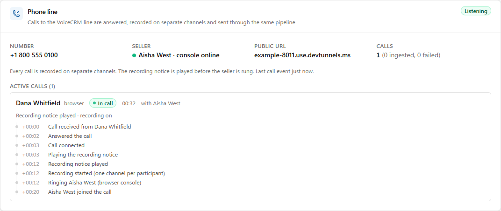
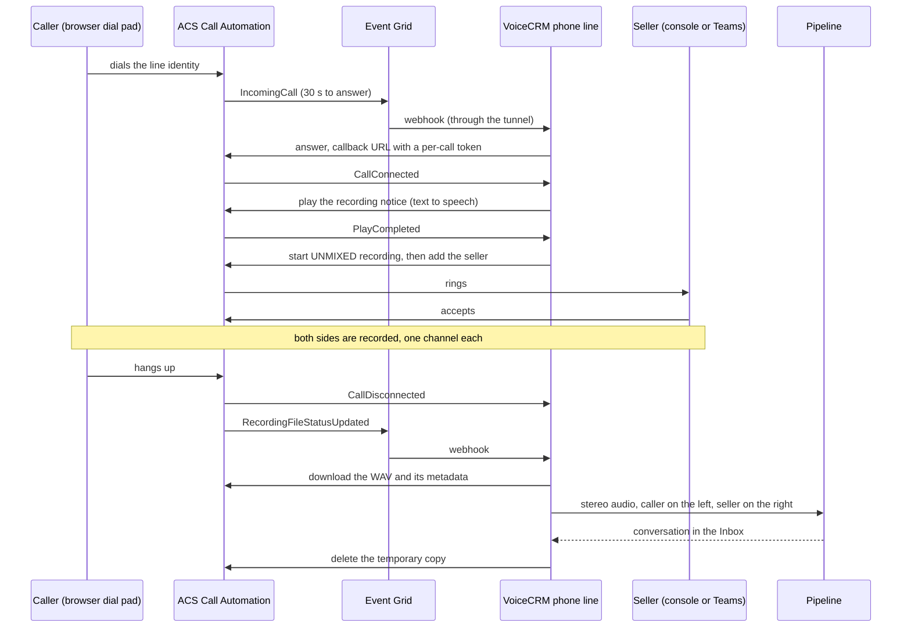
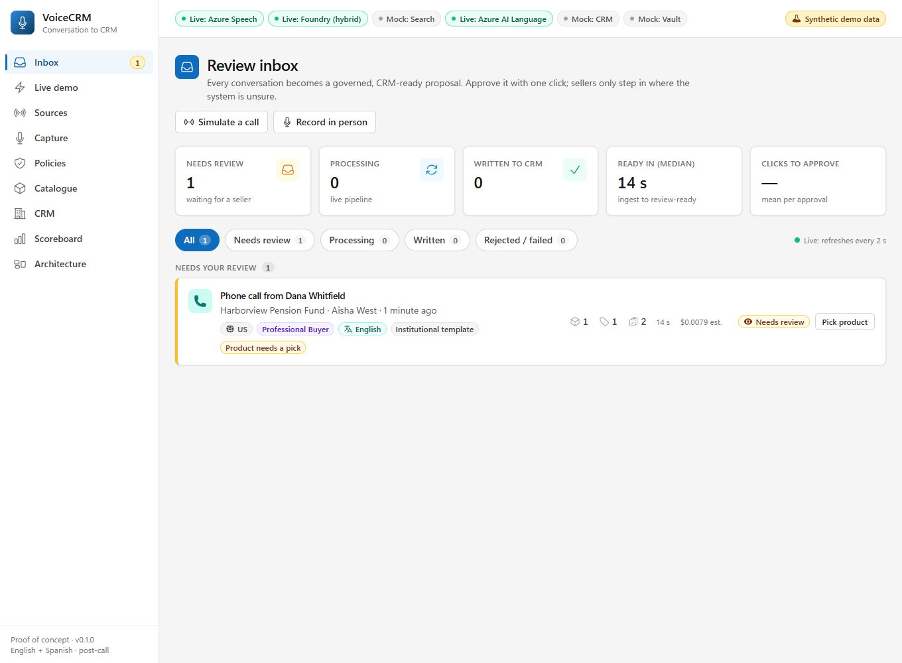

# The phone line

A caller dials the VoiceCRM line. Azure Communication Services (ACS) answers, plays a recording notice, rings the seller,
records both sides on **separate channels**, and a few seconds after the call ends the recording becomes a conversation in the
Inbox: every word attributed to the caller or the seller by channel (no diarization guesswork), matched to the CRM, summarised,
and waiting for review like a call from any other source.

It is **scenario D** on the Live demo page. Today the caller dials from a **dial pad in the browser** (a VoIP call over ACS) and
the seller answers either in a **console in a second browser tab** or in **Microsoft Teams**. A real phone number plugs in later
without changing the app (see [A real phone number](#7-a-real-phone-number)). A guided run with a screenshot at every step, and
the points to call out, is [part 7 of the walkthrough](walkthrough.md#7-scenario-d-a-phone-call-to-the-voicecrm-line).



## 1. What happens during a call



Details that matter when you explain or debug it:

* **The notice comes first and is not recorded.** Recording starts only after the notice has played. The conversation says
  whether the caller heard it (`consent: recorded_with_consent`), and with `VOICECRM_PHONE_REQUIRE_NOTICE=true` (the default) a
  call whose notice cannot be played is ended instead of recorded.
* **One channel per party.** The recording metadata names the participant on each channel, so the caller and the seller are
  found by identity whatever the channel order. The line's own identity has a channel too (its spoken prompts land there) and
  is ignored. If the identities cannot be matched the audio is mixed to mono and diarization decides, which the call's timeline
  says ("participants could not be matched to channels").
* **Nobody answers.** If the seller is not available, or does not pick up within `VOICECRM_PHONE_RING_SECONDS` (plus 5 s), the
  line tells the caller to leave a message and keeps recording for up to `VOICECRM_PHONE_VOICEMAIL_SECONDS`. A voicemail goes
  through the same pipeline, with the caller on the left channel and a silent seller channel.
* **Nothing said is not a message.** A caller who hangs up, or a voicemail left empty, produces a recording with nothing in it.
  The line measures the speech-level audio on the channels that carry the conversation (never its own prompts), and below
  `VOICECRM_PHONE_MIN_SPEECH_SECONDS` (default 1.5; `0` sends every recording on) it shows the call as **Missed** with the reason
  ("No speech in the recording ... nothing was sent to the pipeline"): no Inbox row, no Speech charge. A recording that passes
  that check but in which Azure Speech finds no language ends the same way (the call is **Missed**; the Inbox row is *failed*
  with "No speech could be recognised in the recording"). The service is never retried with a forced language: on noise it
  invents words ("Yes.") that would become a note about a call nobody spoke in.
* **A call is ingested when the pipeline is done.** After the recording is handed over, the card shows *Processing* while it is
  transcribed, summarised and matched (about 15 seconds), then *Ingested*, or *Failed* with the pipeline's own reason (for
  example the Speech role is missing). The Inbox row exists from the hand-over, as *Processing*.
* **Either side hanging up ends the call for everyone.** A caller whose browser is killed is noticed by ACS after about a
  minute (measured: 73 s), not at once.
* **The call, not the recording, gives the times.** The recording starts at the first sound, so the conversation's start,
  end and duration come from the call (connected to disconnected).
* **The temporary copy is deleted.** ACS keeps a recording for 24 hours; the line deletes it once the pipeline has taken the
  audio. The pipeline then applies its own retention policy (`data/policies`).

## 2. The pieces

| Piece | What it is | Where |
|---|---|---|
| ACS resource | answers calls, records, issues the browser tokens | Azure (created once, section 3) |
| Event Grid subscriptions | `IncomingCall` (2 attempts, 1 minute) and `RecordingFileStatusUpdated` (30 attempts, 24 hours) to one webhook | created by `phone subscribe` |
| Phone ingress | a second, tiny listener (port 8011) that serves **only** the three phone webhooks | `backend/voicecrm/api/phone_ingress.py` |
| Dev tunnel | puts the ingress port (and only it) on the internet | `scripts\run_phone_tunnel.bat` |
| Phone line | the call state machine, seller selection, recording download, channel planning | `backend/voicecrm/pipeline/phone_live.py` |
| ACS adapter | Call Automation, recording download, identity tokens | `backend/voicecrm/adapters/telephony/acs.py` |
| Wire formats | Event Grid and callback payloads, recording metadata, unmixed WAV handling | `backend/voicecrm/adapters/sources/phone.py` |
| Live demo page | status, dial pad, seller console, readiness check | `frontend/src/components/phone/` |

The pipeline is unchanged: the phone channel only adds `phone` to the channel list, a transcription policy entry
(`phone: [azure_speech]`), and `channel_speakers` so Azure Speech labels each channel with the participant it belongs to.

## 3. Set it up

You need: an Azure subscription you can create resources in, `az login`, the Foundry/Speech resources the other scenarios
already use, and the Dev Tunnels CLI (`winget install Microsoft.devtunnel`).

**1. The ACS resource** (global, data location of your choice, with a system-assigned identity):

```
az provider register --namespace Microsoft.Communication
az extension add --name communication
az communication create --name <acs-name> --resource-group <group> --location global --data-location unitedstates --mi-system-assigned true
az communication show --name <acs-name> --resource-group <group> --query hostName -o tsv
az communication show --name <acs-name> --resource-group <group> --query identity.principalId -o tsv
```

The first `show` gives the host for `VOICECRM_PHONE_ACS_ENDPOINT` (`https://<host>`), the second the identity of step 2.

**2. Let ACS speak the notice.** Call Automation reaches Azure AI Speech through your Foundry (AI Services) resource, using
the ACS identity. Give that identity the **Cognitive Services User** role on the resource and use its custom-domain endpoint
as `VOICECRM_PHONE_COGNITIVE_ENDPOINT`:

```
az role assignment create --assignee <acs-identity-principal-id> --role "Cognitive Services User" --scope <foundry-resource-id>
```

**3. Sign-in.** The app uses the same Entra sign-in as the other Azure services (`VOICECRM_AZURE_AUTH=entra`); the signed-in
identity needs access to the ACS resource (an Owner or Contributor on it is enough). A connection string works too
(`VOICECRM_PHONE_ACS_CONNECTION_STRING`, a secret).

**4. `.env`** (see `.env.example` for every setting and its default):

| Setting | Value |
|---|---|
| `VOICECRM_PHONE_MODE` | `acs` |
| `VOICECRM_PHONE_ACS_ENDPOINT` | `https://<acs-name>.<geo>.communication.azure.com` |
| `VOICECRM_PHONE_ACS_RESOURCE_ID` | the ARM id of the resource (for `phone subscribe`) |
| `VOICECRM_PHONE_PUBLIC_BASE_URL` | the tunnel's https address (step 5) |
| `VOICECRM_PHONE_WEBHOOK_SECRET` | a long random string (24+ characters); part of the Event Grid URL. Write it with `tools\env_set.py --stdin` so it is never printed |
| `VOICECRM_PHONE_COGNITIVE_ENDPOINT` | the Foundry endpoint from step 2 |
| `VOICECRM_PHONE_DISPLAY_NUMBER` | shown on the dial pad; a placeholder until a real number exists |
| `VOICECRM_PHONE_SELLER` | empty for the browser console, or `teams:<object id or UPN>` (section 5) |
| `VOICECRM_PHONE_SELLER_NAME`, `..._EMAIL` | who the CRM records as the seller when the directory cannot say |

**5. The tunnel.** `scripts\run_phone_tunnel.bat` creates a persistent dev tunnel (anonymous access, because Azure cannot sign
in) for **port 8011 only** and hosts it. Its address stays the same between runs; copy the `https://...-8011...` address into
`VOICECRM_PHONE_PUBLIC_BASE_URL`. Never tunnel port 8010: the API has no sign-in.

**6. Start the app, check, subscribe.**

```
scripts\run_backend.bat                  rem the app (and the ingress on 8011)
scripts\phone_check.bat                  rem ACS access, public URL, seller, recording notice
scripts\phone_check.bat subscribe        rem creates the two Event Grid subscriptions (needs the app and the tunnel running)
```

Creating a webhook subscription makes Event Grid call the URL once and expect the validation code back, which is why the app
and the tunnel must be up. `phone_check.bat subscriptions` lists them, `unsubscribe` removes them.

**7. Place a call.** Open the app at **http://localhost:8010** (see the note below), Live demo, scenario D. Switch on
**Answer calls in this browser** in the seller console, then press **Call** on the dial pad. Use headphones if both are on the
same computer.

> **Use `localhost`, not `127.0.0.1`.** The ACS Calling SDK only works on https, `file:` or the host name `localhost`; on
> `127.0.0.1` it fails with "ACS Web Calling SDK must be used through https, file:, or localhost". The dial pad and the
> console say so up front when the address is wrong. The microphone permission is asked once per browser.

## 4. What shows up in the Inbox

A phone call is an ordinary conversation with `source = phone`, `direction = inbound` and:

* **Transcript:** Azure Speech transcribes each channel on its own (`channels: [0, 1]`); caller segments are `cust1`, seller
  segments `seller`, so the reviewer sees who said what with no guessing. Timings are per channel, so overlapping speech is
  kept.
* **Caller:** from the dial pad's *Who is calling* fields (name, organisation, email, phone). The CRM match uses the e-mail
  first and the phone number second (digits compared, so `+1 (206) 555-0111` equals `+12065550111`). A caller from a real
  phone is identified by the number the carrier presents.
* **Seller:** the Teams user's directory entry, or the console's display name.
* **Consent:** `recorded_with_consent` with the basis "Recording notice played to the caller before recording started", or
  `unknown` when the notice was not confirmed.
* **Idempotency:** `source_interaction_id` is derived from the recording's document id, so an Event Grid redelivery or a retry
  never makes a second conversation.
* **Reset:** **Reset demo data** (Live demo, last section) removes the conversation like any other and clears the Phone line
  card's finished calls and counts. A call still in progress carries on, and the events already handled stay handled, so a
  redelivered event cannot bring a call back.



Spoken numbers in the audio (such as a call-back number left on voicemail) go through the same privacy policy as every other
source: they are redacted in the working copy.

## 5. Who answers: the console or Teams

* **Browser console** (default, `VOICECRM_PHONE_SELLER` empty). The console in the second tab registers with the API and
  heartbeats every 20 seconds; while it is online the line rings it. With the console off, callers are offered voicemail.
* **Teams** (`VOICECRM_PHONE_SELLER=teams:<object id or UPN>`). The line adds the seller's Teams identity to the call, so it
  rings in the seller's Teams client. This needs ACS to be allowed to call Teams users:

  ```
  Set-CsTeamsAcsFederationConfiguration -EnableAcsUsers $true -AllowedAcsResources @{Add='<immutable resource id of the ACS resource>'}
  Set-CsExternalAccessPolicy -Identity Global -EnableAcsFederationAccess $true
  Set-CsPhoneNumberAssignment -Identity <the seller> -EnterpriseVoiceEnabled $true
  ```

  (`az communication show --query immutableResourceId -o tsv` gives the resource id.) Verified: ACS accepts the invitation and, when
  nobody picks up, the line falls back to voicemail. Not verified here: a person answering in a Teams client.

## 6. Verified, and not

| | Status |
|---|---|
| Dial, answer, notice, unmixed recording, console answers, hang up, ingest, speaker labels by channel, CRM match | **verified on live Azure** |
| Voicemail (no seller) | verified live |
| Caller's browser killed mid-call | verified live (ended after ACS noticed, about 70 s) |
| Teams seller: invitation accepted, no answer -> voicemail | verified live |
| A person answering in Teams | **not verified** (needs a signed-in Teams client) |
| A call from a real phone | **not possible yet**: no number (section 7) |

The automated tests (`backend\tests`) cover every state transition with a scripted ACS, the Event Grid and callback payloads,
the recording metadata and WAV handling (including multi-channel `WAVE_FORMAT_EXTENSIBLE` files), the ARM calls that create
the subscriptions, the HTTP routes and the ingress, and the readiness check.

## 7. A real phone number

The dial pad is a browser call to an ACS identity. A real number reaches the same code: callers from a phone arrive as a phone
number in the same `IncomingCall` event (`caller_kind: phone`), and the line accepts extra recipients through
`VOICECRM_PHONE_ACCEPT_TO`. What is needed is a **Teams Phone service number** on a resource account connected to this ACS
resource ("Teams Phone extensibility"), because new ACS resources can no longer buy numbers directly. In outline:

1. A phone number in the tenant (Teams admin center, Voice, Phone numbers). A tenant that cannot order numbers yet shows the
   number types as unavailable (for example *KYC not compliant*, or *no wallet* for toll-free numbers): complete the
   identity verification, or add Communications Credits, in the Teams admin center first. Nothing in the app can do that.
2. A **resource account** (`New-CsOnlineApplicationInstance`) with the *Teams Phone Resource Account* licence, assigned the number
   (`Set-CsPhoneNumberAssignment -PhoneNumberType CallingPlan`), connected to the ACS resource
   (`Set-CsOnlineApplicationInstance -AcsResourceId <immutable resource id>`, then `Sync-CsOnlineApplicationInstance`), and
   registered in ACS (`PUT .../access/teamsExtension/tenants/<tenant>/assignments/<resource account id>` with
   `{"principalType": "teamsResourceAccount"}`).
3. In `.env`: `VOICECRM_PHONE_ACCEPT_TO=28:orgid:<the resource account's object id>` and `VOICECRM_PHONE_DISPLAY_NUMBER=` the real
   number. Restart; nothing else changes. The recording, the notice and the pipeline are the same.

Check the current Microsoft Learn guidance for Teams Phone extensibility before doing this: it is a recent capability, and
the ACS standalone telephony features are scheduled to retire in September 2028.

## 8. Security

* The API on port 8010 has no sign-in and is never exposed. Only the **ingress** (8011) is tunnelled, and it serves nothing but
  `/api/v1/webhooks/phone/*`: no docs, and no access log however the console is configured (the Event Grid URL carries a
  secret). It is a second server inside the same process; it does not change the main server's logging, and at startup the
  console shows one line for it ("Phone ingress listening on http://127.0.0.1:8011").
* Event Grid calls `.../events?key=<secret>`; the key is compared in constant time and never logged. Each call's callback URL
  carries an HMAC of the call id, so only a URL this app handed to Azure is accepted. Bodies over 1 MB are refused.
* Recording downloads carry the app's credentials, so only the recording service's own hosts are fetched (`*.asm.skype.com`,
  `*.asyncgw.teams.microsoft.com`, https, no credentials in the URL); the SDK checks again before attaching a token.
* `incomingCallContext` (the key to answer a call) is never logged or saved; phone numbers are masked in logs.
* `POST /phone/token` refuses the line's own identity and any identity that is not an ACS user.
* Recordings are deleted at ACS once ingested; the recording notice is on by default and required.

## 9. When it does not work

| You see | Cause and fix |
|---|---|
| Dial pad or console: "ACS Web Calling SDK must be used through https, file:, or localhost" | open the app at `http://localhost:8010` instead of `127.0.0.1` |
| `phone check`: public URL fails | the tunnel is not running, or it forwards the wrong port: it must forward 8011 (the ingress), and the app must be running |
| `phone subscribe`: the handshake fails | start the app and the tunnel first; the key in the URL must equal `VOICECRM_PHONE_WEBHOOK_SECRET` |
| At startup the console says "the phone ingress could not start" (and an "error while attempting to bind") | port 8011 is taken, usually by an earlier backend that is still running: stop it (Ctrl+C in its window) and start the app again. The app itself runs without the ingress, but no call can reach it |
| The call never gets answered | no `IncomingCall` event arrived: `phone_check.bat subscriptions` should list both subscriptions as `Succeeded`; ACS gives 30 seconds to answer |
| "Recording notice unavailable" and the call ends | the ACS identity lacks the Cognitive Services User role on the Foundry resource, or `VOICECRM_PHONE_COGNITIVE_ENDPOINT` is wrong; or set `VOICECRM_PHONE_REQUIRE_NOTICE=false` |
| The call stays "waiting for the recording" and then fails | no `RecordingFileStatusUpdated` event within 15 minutes: check the `voicecrm-phone-recordings` subscription. A late recording is still ingested |
| The call is **Missed** with "No speech in the recording", or the Inbox row says "No speech could be recognised" | nobody spoke, or too little: a caller who hung up, or a voicemail with no message. To leave a message, speak after the prompt; to be answered, switch the seller console on before dialling. If real speech is being dropped (a very quiet microphone), lower `VOICECRM_PHONE_MIN_SPEECH_SECONDS`; `0` sends every recording on |
| The timeline says "Offering voicemail (no seller is available)" | no seller console was online: switch on **Answer calls in this browser** in the seller console (it registers again within 20 seconds of an app restart); the dial pad warns about this before you call |
| Every sentence appears under both speakers | the dial pad and the seller console are on one computer, so they share its microphone. Mute the side that is not speaking (**Mute** on the dial pad and on the console; not exercised live), or have a second person answer in Teams on another device (`VOICECRM_PHONE_SELLER=teams:<user>`) |
| Both voices are in one mixed channel | the metadata could not be matched (see the call's timeline); the transcript falls back to diarization |
| The seller console never rings | it must be on and online (the Phone line card shows it); with Teams as the seller, the console is only a fallback |
| Echo | use headphones when the dial pad and the console are on the same computer |

The Phone line card on the Live demo page shows the state of every call with a timeline; the same detail is in
`GET /api/v1/sources/phone`. To see what the line is doing, run the app with the standard logging configured at INFO for
`voicecrm.pipeline.phone_live`: it logs each recording's channel layout and the plan chosen.

## 10. Cost

The phone line adds Azure Communication Services usage (VoIP minutes, recording, text to speech through the AI Services
resource) on top of the Speech, Language and model costs the pipeline already reports. The app does **not** meter ACS usage
in its cost view and this repository does not quote prices: see the Azure Communication Services pricing page for your
region and the Azure cost analysis for the resource group.
