# Walkthrough: run VoiceCRM live and explain every stage

A guided tour for a demo on real Azure services: what to click, what you should see, what to say to the business people and
what to call out for the technical ones. It follows the five stages of the [architecture](#2-the-picture-five-stages), and
covers the four live-demo scenarios (**A** a recorded call through Azure Speech, Azure AI Language and a Foundry model; **B** a
Teams meeting; **C** hundreds of calls at once; **D** a phone call to the VoiceCRM line), speaking a call into the **Record
button**, the **policies**, and the questions to expect. About 100 minutes for all of it; each part stands alone, and parts 1 to
4 plus 6 make a one-hour technical session.

Every image is a live capture (Azure Speech, Azure AI Language and a Foundry model, with synthetic data) made by
`tools\capture_walkthrough.py` ([part 12.2](#122-regenerate-the-screenshots)); the phone images in part 7 come from
`tools\capture_phone.py`. Those three services are live, and so is Azure Communication Services in part 7. The CRM, the
vault and the catalogue search are the local implementations the project ships with, so their chips read **Mock / local**;
[part 2](#2-the-picture-five-stages) says what changes in production.

Each stage is written the same way:

| Beat | What it holds |
|---|---|
| **You see** | the screen and where to click |
| **Say it** | the business point, in a sentence you can read out |
| **Call out** | technical facts to quote: the service, the API, parameters, thresholds, defaults and fallbacks, with the setting that changes each |
| **Prove it** | a click that shows the claim, or the test in `backend\tests` that holds it |

The facts were read from the code and checked on a live run. Numbers come from the captures and will differ a little on yours.
The talk track for a 15-minute version is [demo-script.md](demo-script.md); the Azure setup is [live-demo.md](live-demo.md).

| Part | What | Time |
|---|---|---|
| [1](#1-start-it-live) | Start it live: what is live, run it, check the services | 5 min |
| [2](#2-the-picture-five-stages) | The picture: the five stages, and what is real | 5 min |
| [3](#3-one-call-end-to-end-scenario-a) | One call, end to end (scenario A) | 25 min |
| [4](#4-the-policies-governance-as-data) | The policies: governance as data | 15 min |
| [5](#5-scenario-b-a-teams-meeting) | Scenario B: a Teams meeting | 10 min |
| [6](#6-scenario-c-hundreds-of-calls) | Scenario C: hundreds of calls | 10 min |
| [7](#7-scenario-d-a-phone-call-to-the-voicecrm-line) | Scenario D: a phone call to the VoiceCRM line | 15 min |
| [8](#8-scenario-a-spoken-live-the-record-button) | Scenario A, spoken live: the Record button | 10 min |
| [9](#9-the-rest-of-the-product) | The rest of the product | 10 min |
| [10](#10-questions-you-will-be-asked) | Questions you will be asked | |
| [11](#11-when-something-does-not-match-what-you-see) | When something does not match what you see | |
| [12](#12-reset-the-demo-and-regenerate-the-screenshots) | Reset the demo data, and regenerate the screenshots | 3 min |
| [A](#appendix-no-azure-account) | Appendix: no Azure account | |

## 1. Start it live

### 1.1 What is live

| Piece | What does the work | Setting in `.env` | Here |
|---|---|---|---|
| Speech to text | **Azure Speech**, fast transcription API | `VOICECRM_TRANSCRIPTION_MODE=azure_speech`, `VOICECRM_SPEECH_ENDPOINT` | live |
| Privacy filter | **Azure AI Language** PII detection, plus local card and credential rules | `VOICECRM_PII_MODE=azure_language` | live |
| Note, topics, tasks | a **Microsoft Foundry** model deployment (ours is `chat54mini`, a gpt-5.4-mini) in the `hybrid` engine | `VOICECRM_LLM_MODE=hybrid`, `VOICECRM_FOUNDRY_ENDPOINT`, `VOICECRM_FOUNDRY_DEPLOYMENT` | live |
| Teams | **Microsoft Graph**, polled every 20 seconds | `VOICECRM_TEAMS_MODE=poll` and `VOICECRM_TEAMS_*` | live on the demo tenant; off in the images (see part 5) |
| Phone line | **Azure Communication Services** (Call Automation, recording), **Event Grid** and a dev tunnel | `VOICECRM_PHONE_MODE=acs` and `VOICECRM_PHONE_*` | live on the demo tenant (part 7); off until set up |
| Product search | an in-process catalogue index, no service | `VOICECRM_SEARCH_MODE=local` | local |
| CRM | a SQLite stand-in for Dataverse; a real Dataverse writer exists | `VOICECRM_CRM_MODE=local` (or `dataverse`) | local |
| Vault | local files; an Azure Blob adapter exists | `VOICECRM_VAULT_MODE=local` (or `blob`) | local |

Authentication is Microsoft Entra by default (`VOICECRM_AZURE_AUTH=entra`): the backend signs in with `DefaultAzureCredential`, so
there are no keys in the files. A key can be set for a quick start.

### 1.2 Run it

You need Windows, Python 3.11+ and Node.js 20.19+ (or 22.12+). `setup_backend.bat` creates `.env` from `.env.example`: fill it in
before the steps that call Azure (the resources, role assignments and settings are in [live-demo.md](live-demo.md), section 1).
From the repository root:

```bat
scripts\setup_backend.bat        rem virtual environment and dependencies; copies .env.example to .env
cd frontend
npm install
npm run build                    rem builds the UI once; the API serves it
cd ..
scripts\make_audio.bat           rem the eight call recordings for scenario A: about 25 seconds, under a dollar, needs Azure Speech
scripts\run_backend.bat          rem API and UI on http://127.0.0.1:8010
```

Open **http://127.0.0.1:8010**. Use `127.0.0.1` rather than `localhost` (the [README](../README.md#run-it) says why); the one
exception is the phone scenario, whose calling SDK needs `localhost` ([part 7](#7-scenario-d-a-phone-call-to-the-voicecrm-line)).
Starting a demo with calls, CRM rows or policy edits left over from earlier runs? Clear them from the UI first
([12.1](#121-reset-the-demo-data)).

**You see** six chips in the top bar. **Live: Azure Speech**, **Live: Azure AI Language** and **Live: Foundry (hybrid)** are the
three that do the work; **Mock: Search**, **Mock: CRM** and **Mock: Vault** are the local parts. Say out loud which is which: it
keeps a demo honest.

### 1.3 Check the services

Sidebar -> **Live demo**. The first card lists the services behind every run on this page.

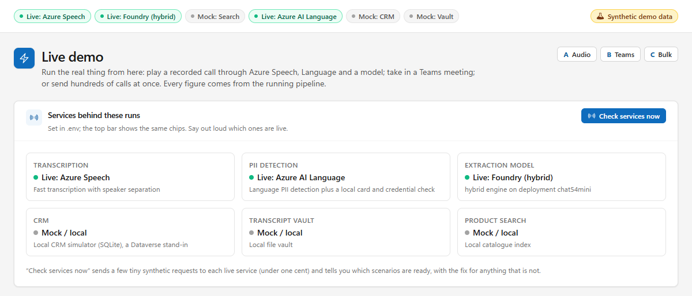

Press **Check services now** (10 to 20 seconds, under a cent). It sends a few tiny synthetic requests to each live service and
says which scenarios are ready, with the fix for anything that is not.

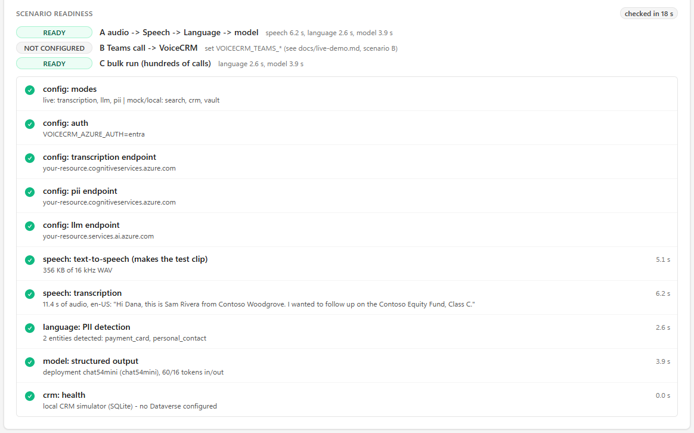

*Resource host names are replaced with `your-resource`. Scenario B reads NOT CONFIGURED here only because the capture server runs
with Teams off; on a configured tenant it reads READY.*

**Say it:** "Everything on this page is a call to a real Azure service in a subscription you control. The only scripted thing is
the call recording."

**Call out:** what each check sends, and what a pass proves.

| Check | What it sends | A pass proves |
|---|---|---|
| speech: text-to-speech | Azure Speech makes a 16 kHz test clip (`en-US-JennyNeural`) | the Speech resource and its sign-in work |
| speech: transcription | that clip goes through the same fast-transcription call the pipeline uses | audio in, the expected words out |
| language: PII detection | one fixed test text with sensitive details | Azure AI Language answers and finds `payment_card` |
| model: structured output | a JSON-only prompt with a strict schema, 200 output tokens at most | the deployment supports structured output |
| crm: health | the CRM adapter's health call | the simulator, or Dataverse, is reachable |

Scenario A needs Speech, Language and the model; C needs Language and the model; B needs the Teams settings; D needs the phone
settings and has its own check, **Check phone setup** ([part 7](#7-scenario-d-a-phone-call-to-the-voicecrm-line)).

## 2. The picture: five stages

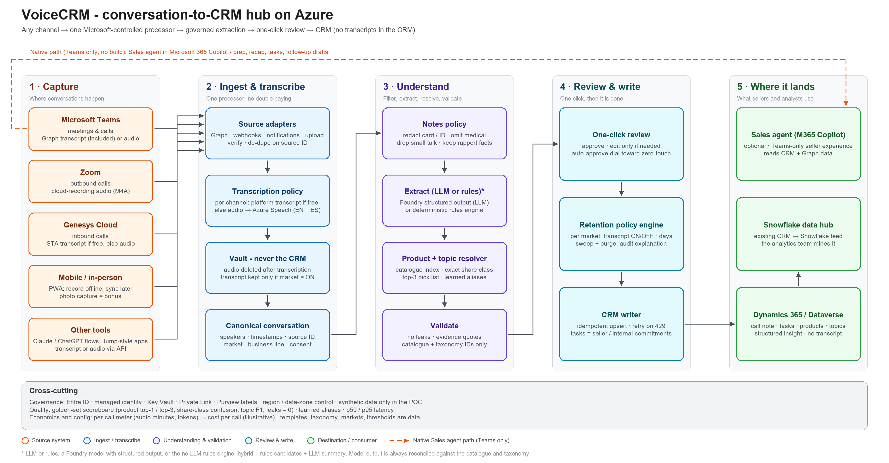

Read it left to right. The five columns are the five stages used in the rest of this guide.

| Stage | The business point | Under the hood | You see it in | Setting |
|---|---|---|---|---|
| **1 Capture** | every channel the business uses lands in one pipeline; the seller does nothing | one adapter per channel: Graph (Teams), webhook with HMAC (Zoom), notification API (Genesys), Azure Communication Services (a phone line), browser recorder and file upload (mobile, other tools) | Sources page, Capture page, Live demo section D | `VOICECRM_TEAMS_*`, `VOICECRM_ZOOM_WEBHOOK_SECRET`, `VOICECRM_PHONE_*` |
| **2 Ingest and transcribe** | one provider, no double paying: the platform's transcript when it exists, Azure Speech when it does not | de-dupe on the source id, the transcript-source policy, Azure Speech fast transcription, the vault, one canonical conversation | Pipeline card: Ingest, Transcribe, Normalize | `transcription_source_preference`, `VOICECRM_TRANSCRIPTION_MODE` |
| **3 Understand** | the exact product and share class, topics from a controlled list, the seller's tasks, and nothing sensitive | notes policy (Azure AI Language), extraction engine (rules, hybrid or model), product and topic resolver, validator | Pipeline: Privacy policy, Extract, Resolve, Validate; the Products, Topics and Tasks cards | notes policy, `VOICECRM_PII_MODE`, `VOICECRM_LLM_MODE`, `processing.engine` |
| **4 Review and write** | one click, and a person only where the system is unsure; retention decided per market | review reasons and a confidence gate, the retention engine, an idempotent CRM writer | Ready to send; Retention decision; Pipeline: Review, Retention, CRM write | `auto_approve_*`, `product_review_threshold`, market retention |
| **5 Where it lands** | sellers and analysts get a note, tasks, products and topics in the CRM; the transcript never lands there | a Dataverse phone call, tasks and an insight (or the local stand-in) | CRM page | `VOICECRM_CRM_MODE`, `VOICECRM_DATAVERSE_URL` |

The dotted line across the top of the diagram is the native path: the Sales agent in Microsoft 365 Copilot covers Teams meetings
out of the box. It is complementary, not part of this build.

Sidebar -> **Architecture** shows the same picture with the live state of every component:

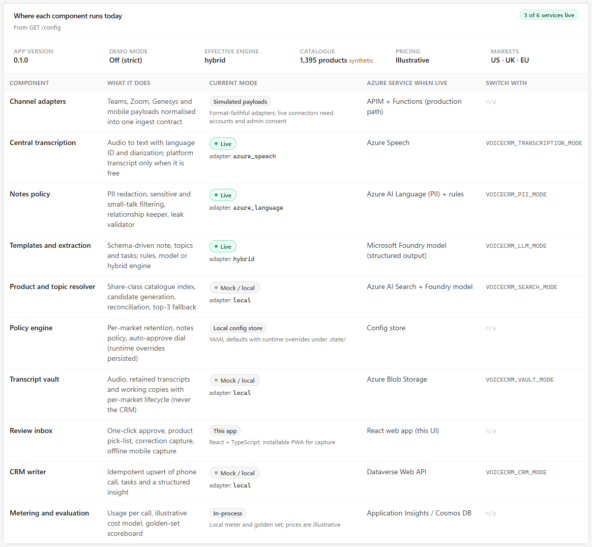

**What is real, and what is shown.** Say this part out loud; it is the first thing a technical audience asks.

| Live end to end | Built and unit-tested, not run live | Not built |
|---|---|---|
| Azure Speech, Azure AI Language and the Foundry model; Teams ingestion by polling Graph (one real scheduled meeting on the demo tenant); the Record button; the phone line with a browser caller (Azure Communication Services) | the Dataverse writer, the Azure Blob vault, the AI Search adapter, the Zoom and Genesys webhook handlers and parsers (native-format payloads), Teams change-notification (webhook) mode; a call from a real phone number to the phone line (the code path is built, the demo tenant has no number yet) and a person answering it in a Teams client | the live Zoom OAuth download and Genesys API fetch; the Genesys caller number (ANI) from live notifications; the follow-up email draft; the Snowflake hand-off; a scheduled retention sweep; enforcement of the summary-retention setting |

## 3. One call, end to end (scenario A)

Sidebar -> **Live demo** -> section **A**. A recorded call goes through speech-to-text, the privacy filter and the model, and you
watch each step. Then you open the review screen and walk its cards in pipeline order, which is stages 2 to 5.

**A1. Pick and play.** The list holds eight recorded calls (neural-voice audio, one voice per speaker) made by
`scripts\make_audio.bat`. The hero call is pre-selected; play a few seconds so the audience hears it.

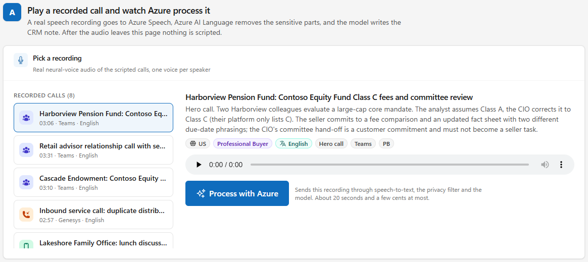

**A2. Process.** Press **Process with Azure**. Five rows fill in, each with the service behind it, what it did and how long it
took: *Recording received* (the vault), *Speech to text* (Azure Speech), *Privacy filter* (Azure AI Language), *Summarise and
extract* (the Foundry model) and *Match the CRM account and validate* (the CRM). It takes 10 to 20 seconds.

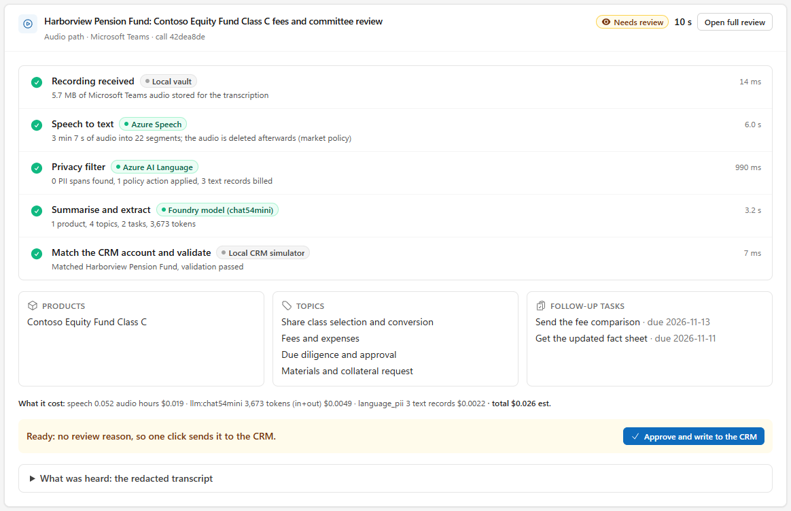

**A3. Open the full review.** Press **Open full review**. **Do not approve yet**: the evidence quotes show only while the
working copy exists, and the Pipeline card is more useful before the write ([3.4](#34-stage-4-review-and-write)).

### 3.1 Stages 1 and 2: capture, ingest, transcribe

**You see** the Pipeline card in the right column: the first three rows.

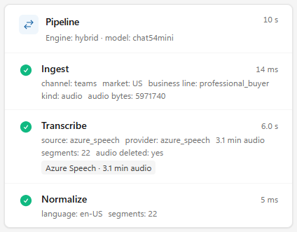

**Say it:** "However the call arrives, it becomes one conversation, and we pay for speech-to-text only when the platform has not
already given us a transcript. This three-minute Teams recording took about five seconds and two cents. The audio is deleted
straight after, because the US policy keeps nothing."

**Call out**

- **One front door per channel, one canonical conversation.** Teams: Graph change notifications or the poller (WebVTT with
  `<v Speaker>` cues). Zoom: `POST /api/v1/webhooks/zoom` answers `endpoint.url_validation` and checks `x-zm-signature`
  (HMAC-SHA256, five-minute tolerance). Genesys: `POST /api/v1/webhooks/genesys` takes the notification envelope; its transcript
  JSON (`transcripts[].phrases[]`) is parsed from an upload or a simulated payload. Mobile and any file: `POST /api/v1/ingest/upload`
  (WAV, MP3, M4A, OGG or WebM audio; WebVTT or JSON transcripts). Every parser renders to the same canonical conversation:
  speaker-labelled segments with offsets, language, source id, market, business line and consent basis.
- **Idempotent.** The key is `(source, source_interaction_id)`. A duplicate delivery returns the first conversation
  (`duplicate_of`) instead of a second one. A re-run after a failure bumps a version number that is part of the CRM
  idempotency key.
- **The transcript source is a policy** ([4.1](#41-transcription-policy)). Teams and Genesys prefer the platform's transcript,
  Zoom and mobile go to Azure Speech, uploads use a transcript when the file is one. The first source in the list that is
  available wins. The row shows `source`, `provider`, minutes of audio and `audio deleted`.
- **Azure Speech: the fast transcription REST API** (`POST {endpoint}/speechtotext/transcriptions:transcribe`, api-version
  2025-10-15), with a Microsoft Entra token or a key. The request carries the candidate locales `en-US` and `es-US` (language
  identification) unless a language is set; **diarization** with `maxSpeakers = max(2, 1 + participants)`, capped at 35; and a
  **phrase list** built from the catalogue (fund names, aliases and share-class phrases, at most 200 phrases or 3,200
  characters) so "Contoso Equity Fund, Class C" is not heard as something else. Genesys stereo recordings use one channel per
  party instead of diarization.
- **Formats and limits.** WAV, MP3, OGG/Opus and FLAC; 250 MB and 2 hours per file. A WebM/Opus recording from the browser goes
  through as it is, with no conversion.
- **Segments.** Phrases from one speaker are merged across pauses up to 1.5 seconds into segments of up to 30 seconds; each
  carries offsets, a locale and a confidence.
- **Resilient.** 408, 429 and 5xx answers are retried with exponential backoff and jitter (four retries, 1 to 30 seconds,
  `Retry-After` honoured, a 300-second timeout); a `Retry-After` beyond the cap fails fast with a clear message.
- **The vault** holds the audio only to be transcribed, and deletes it right after when the market's `audio_retention_days` is 0.
- **Quality.** Mean word error 2.4% over the eight recordings and 1.7% on the hero call through the Record button, with
  speech-to-text taking 4 to 13 seconds ([live-demo.md](live-demo.md)). The voices are synthetic: measure your own recordings
  with `scripts\rehearse_audio.bat`.

**Prove it:** Sources -> **Upload a recording or transcript**, send the same file twice with the same *Source interaction id*:
the second answer is "Already ingested" ([part 9](#9-the-rest-of-the-product)). Tests: `test_service.py`
(`test_duplicate_delivery_is_idempotent_and_reprocess_after_failure_bumps_the_version`) and `test_transcription_azure_speech.py`
(diarization, stereo, phrase list, throttling).

### 3.2 Normalize: who said what

**You see** the **Transcript (redacted)** card.

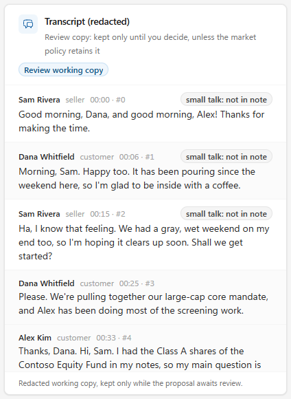

**Say it:** "The seller's commitments become tasks and the customer's do not. That only works if who said what is right, so roles
are decided by evidence and not by the order the service happens to label the voices."

**Call out**

- Speakers resolve in this order: an exact id or name, a fuzzy name match (score 85 or more), role labels, evidence in the talk
  (+3 for a self-introduction such as "it's Sam", -2 for being greeted by name), and finally position: the first unresolved
  speaker is the seller.
- The language comes from the segment locales, then an English/Spanish stop-word check, then the language hint, then `en-US`.
- The card shows redacted text only, with each segment's speaker, role, offset and id, and a tag from the privacy policy
  (*small talk: not in note*, *kept as relationship fact*, *redacted*, *omitted*). It is the **working copy**: kept only until
  you decide, and expired by the vault after 24 hours at the latest.
- The segment ids (#5, #10, ...) are what the Evidence under every product, topic and task points to.

**Prove it:** scroll the card, then open an Evidence line below and find its segment here. Test: `test_speakers.py`
(`test_every_scripted_call_gets_its_roles_right_when_labelled_like_diarization`).

### 3.3 Stage 3: understand

Stage 3 does three jobs in order: make the text safe (**Privacy policy**), make it structured (**Extract**, with the product and
topic resolver) and check the result (**Resolve** the CRM account, **Validate**).

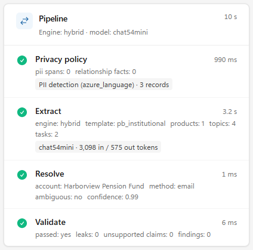

| Pipeline row | What it did here |
|---|---|
| Privacy policy | the call went to Azure AI Language in 3 packed text records; no sensitive span was found; the policy still dropped 4 small-talk segments |
| Extract | engine `hybrid`, the `chat54mini` deployment, about 3,100 tokens in and 580 out; 1 product, 4 topics, 2 tasks, template `pb_institutional` |
| Resolve | the CRM match: account Harborview Pension Fund, method `email`, confidence 0.99 |
| Validate | passed; 0 leaks; 0 unsupported claims |

#### 3.3.1 The privacy filter: Azure AI Language

**Say it:** "Card numbers, IDs, credentials and health details never reach a note, and the check runs before any model sees the
text. [Part 4.2](#42-notes-policy) runs a call that has something to remove."

**Call out**

- `POST {endpoint}/language/:analyze-text?api-version=2025-11-01`, kind `PiiEntityRecognition`, language `en` or `es`.
  Consecutive segments are packed into documents of up to 4,000 characters (`VOICECRM_PII_PACK_CHARS`), at most five per
  request, so the billed text records (3 here) are far fewer than the segments (22).
- Azure's categories are mapped to five policy categories: `payment_card`, `bank_account`, `government_id`, `credentials` and
  `personal_contact`. People, organisations, dates and URLs are deliberately not removed: they are the content of a sales note.
  Local card and credential rules are merged with Azure's answer. Medical and family-health content is a policy judgement made
  locally.
- **It fails closed.** If Azure AI Language errors, the conversation fails and can be retried; the check is never skipped.
  Throttling is retried with `Retry-After`.

**Prove it:** tests `test_pii_azure_language.py` (`test_document_errors_fail_closed_without_echoing_text`,
`test_throttling_is_retried_with_retry_after`) and `test_notes_policy.py`.

#### 3.3.2 Extract: the engine writes, the code decides

**You see** the **Note for the CRM** card, with the raw markdown opened: exactly what the CRM receives.

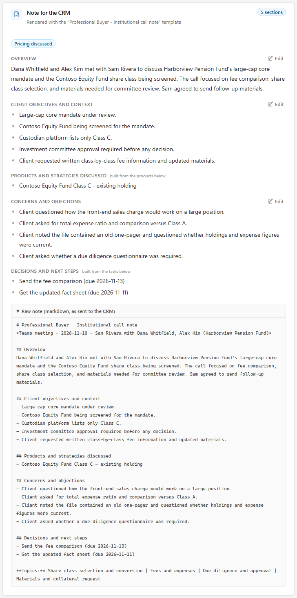

**Say it:** "The product, topic and task decisions are code we can test. The model's job is to write the note well. Switch the
engine on this screen and the decisions do not move, only the prose."

**Call out**

- Three engines (`processing.engine`; the default follows `VOICECRM_LLM_MODE`, which is `hybrid` here):
  - `rules`: everything deterministic, an extractive note, no model call, about 0.1 seconds;
  - `hybrid`: the rules decide products, topics and tasks; the model writes the note and may confirm what the rules found;
  - `llm`: the model also decides topics and tasks; products stay catalogue-grounded.
- **The model call** is Chat Completions on a Foundry (Azure OpenAI) deployment with a **strict JSON-schema** response format,
  temperature 0, at most 2,000 output tokens and a 120-second timeout. It receives the redacted, policy-visible segments, the
  call date and channel, the catalogue-grounded product candidates, the rule suggestions and the allowed topic list. It returns
  sections, product confirmations, topics and tasks, each with the segment ids it relied on.
- **Python disposes.** Every model answer is reconciled. A product must be one of the rules' candidates and counts only when
  the share class was actually stated. Topics must be in the controlled list with valid segment ids (a hybrid extra topic needs
  at least four supporting segments). Tasks must be the seller's or a colleague's, carry evidence, and get their due date
  recomputed from what was said; a date before the call, or more than 366 days after it, is cleared.
- **Resilient.** 408, 429 and 5xx answers are retried (up to six times, 1 to 30 seconds, `Retry-After` honoured), invalid JSON
  gets one repair retry, and refusals and content-filter hits are not "repaired". Unsupported parameters (temperature, reasoning
  effort, the token-limit name) are negotiated away. If the model still fails, the call **falls back to the rules engine** and the
  proposal says so (`llm_fallback`).
- **Cost.** About 3,100 tokens in and 580 out per call, around half a cent on this deployment; `rules` costs nothing in tokens.

**Prove it:** on the review screen open **Engine** (under Template), pick *rules*, then *llm*. The note is re-extracted from the
working copy and the *Decisions and next steps* do not change.

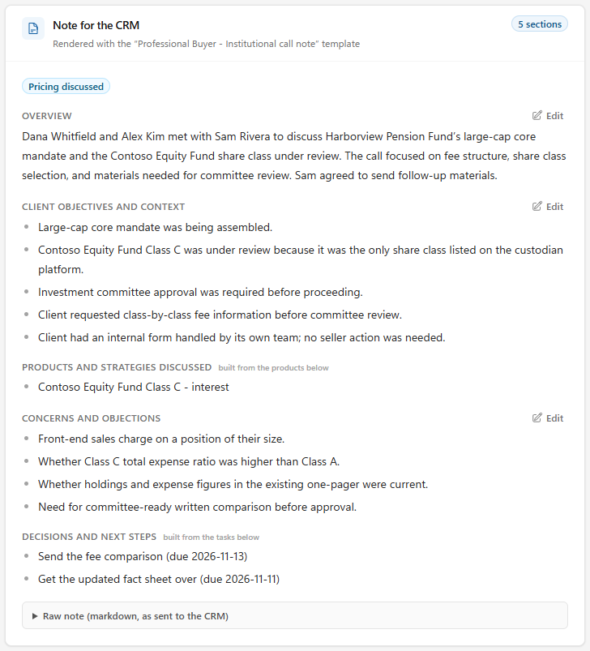

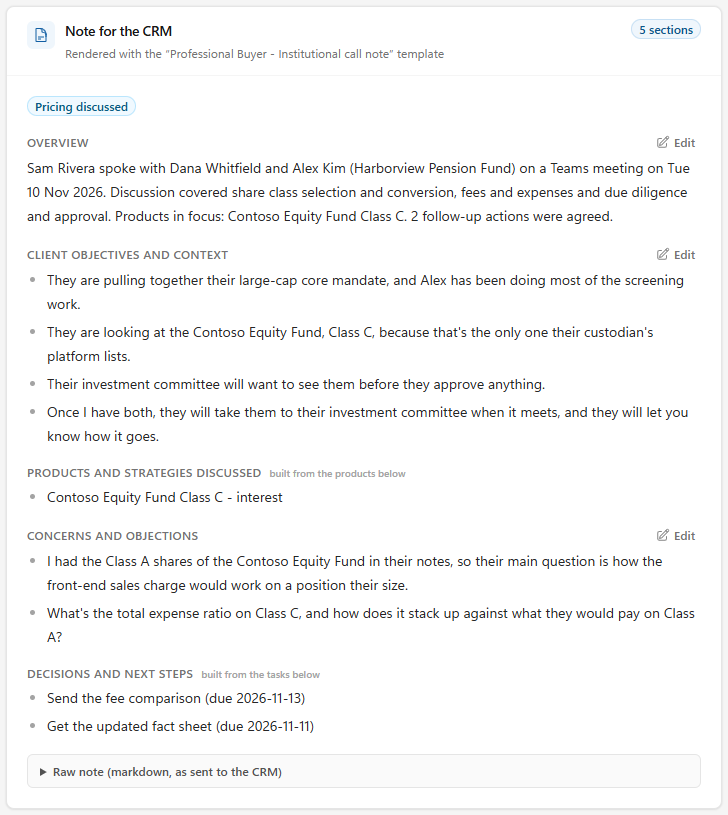

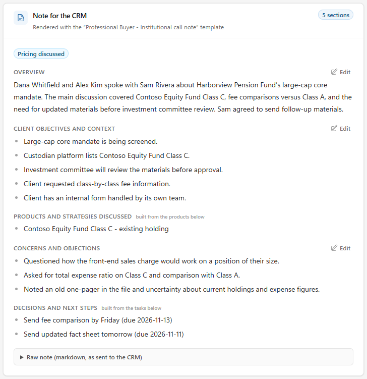

Tests: `test_llm_foundry.py` (retry, repair, refusals), `test_llm_pipeline.py`
(`test_model_failure_falls_back_to_the_rules_engine_and_is_flagged`).

#### 3.3.3 Products, topics and tasks

**You see** the **Products discussed** card, with *Evidence* opened.

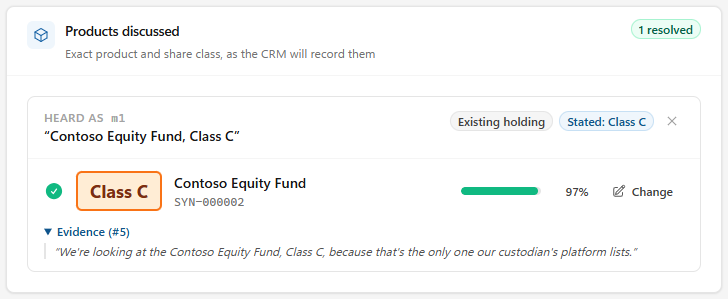

**Say it:** "This is the customer's top ask: Class C must never become Class A. When a speaker corrects themselves, the
correction wins. When the class is never said, the system asks instead of guessing."

**Call out**

- **The catalogue is data:** 1,395 synthetic products in 326 fund families and 8 share classes; every share class is its own
  product (`data\catalogue\products.json`).
- **Finding the fund.** Fund mentions are found as runs of catalogue vocabulary and scored by idf-weighted token overlap (a brand
  match adds 0.04, a mismatch subtracts 0.12). Recognition slips are corrected (fuzzy cutoff 87; "contosa" becomes "contoso"),
  and English and Spanish aliases and share-class phrases ("class see", "clase ce", "r six") are understood.
- **Finding the class.** A class phrase is linked to the nearest compatible fund mention. "Not class A" rules A out. A later
  "actually" or "I meant" correction overrides an earlier claim. A class phrase right after "which share class?" answers it. An
  ETF is a vehicle, not a class.
- **Confidence.** A stated class scores `min(0.99, 0.60 + 0.37 x family confidence)` (97% here); a learned alias scores 0.97; no
  class stated scores 0.4 x family confidence and **needs a pick**, with the top three candidates offered. Below the review
  threshold (0.75, `product_review_threshold`) a mention also needs a pick.
- **Stance** per mention: interest, existing holding, comparison, objection or information only. Later mentions ("the global
  equity fund") resolve to an earlier branded fund; category chat with no brand is dropped.

**You see** the **Topics** and **CRM tasks** cards.

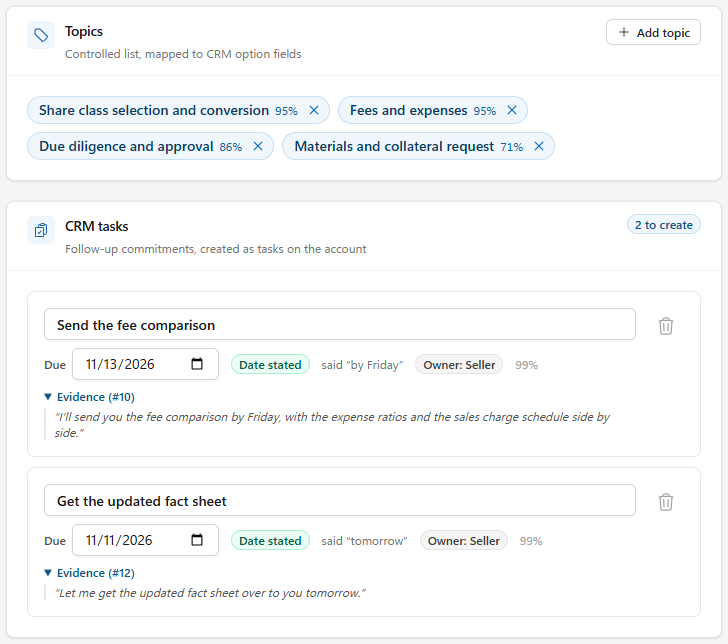

- **Topics.** 20 controlled topics with English and Spanish synonyms, weighted by phrase length (0.5, 0.8 and 1.0 for one, two
  and three or more words, customer turns x1.15), threshold 1.0, at most 5, confidence capped at 0.95. They map to the CRM
  option fields.
- **Tasks.** Only the seller's (or a colleague's) commitments. The customer's promise ("I'll take it to our committee") is not a
  task. Dates follow one documented convention: "tomorrow" is the call date plus one, a bare weekday or "by Friday" is the next
  such day after the call, "next Thursday" is that day next week, and "next week" alone is deliberately undated. The card shows
  both the date and what was said (*Date stated*, said "by Friday").

**Prove it:** open an Evidence line; run `pb-ambiguous-equity-fund` for the top-three pick ([part 9](#9-the-rest-of-the-product)).
Tests: `test_product_resolver.py`, `test_catalogue_index.py`, `test_topics.py`, `test_tasks.py`.

#### 3.3.4 CRM match and validate

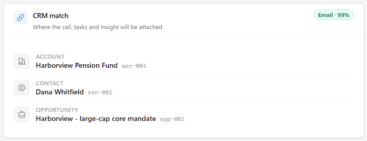

**Say it:** "Where it will be filed, and the last gate before a person sees it."

**Call out**

- **Matching order:** email (0.98), phone number (0.92, or 0.96 when confirmed), account domain or name, contact name plus
  organisation (0.90 in the Record button run), then meeting metadata. An ambiguous match, such as two contacts called Alex Kim,
  is shown as ambiguous and never guessed.
- **Validate is independent of the engines.** It re-scans every CRM-bound field (sections, tasks, relationship facts, product
  names, evidence quotes) for card numbers, IDs and medical content, and scrubs and reports what it finds. It checks that every
  product and topic exists in the catalogue and taxonomy, that evidence exists, that no task belongs to the customer, that due
  dates are in range and that the note fits its template. **Leaks** are sensitive content removed from a CRM-bound field;
  **unsupported claims** are products, topics or tasks without evidence.
- **Review reasons** come from the resolver and the validator: `product_needs_pick`, `crm_match_ambiguous`,
  `crm_match_missing` and `validation_failed`.

**Prove it:** test `test_validator.py`; run the Record button with a blank form ([part 8](#8-scenario-a-spoken-live-the-record-button))
to see `crm_match_missing`.

### 3.4 Stage 4: review and write

#### 3.4.1 Review: one click

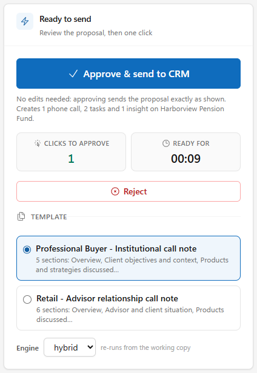

**Say it:** "One click. The screen counts the clicks and the seconds, because fewest clicks was the goal."

**Call out**

- **Status flow:** received, processing, needs_review, approved, written; failed or rejected on the side.
- **One click** is an empty-body approve: the proposal is sent exactly as shown. Edits are possible (pick or drop a product,
  replace topics, edit or drop a task, edit a section, switch the template or engine); each edit is re-rendered and
  **re-validated for leaks** before it is accepted, and a sensitive edit is refused with a 422. *Clicks to approve* is the
  number of edits plus the approve click; the Inbox shows the mean.
- **Teaching.** When a reviewer picks a product for a name the catalogue did not know **and the class was stated**, the pick is
  stored as a learned alias (spoken name to product) and applied first next time ([part 9](#9-the-rest-of-the-product)). A pick on
  a call where the class was never said is not taught.
- **Auto-approve** is a policy dial ([4.4](#44-review-policy)): off by default. When on, a proposal with no review reasons, an
  overall confidence of 0.9 or more and a CRM match is written with zero clicks. Overall confidence is 0.5 x products + 0.2 x
  topics + 0.3 x tasks (for the model engines, the lower of that and the model's own figure).
- **Reject** strips the evidence quotes and deletes the working copy and the audio.
- **The working copy** is what a template switch, an engine switch and a reprocess run from. After 24 hours they answer
  `410`: re-ingest the call.

**Prove it:** note *Clicks to approve* and *Ready for* above the button, then press **Approve & send to CRM**.

#### 3.4.2 Write: what lands in the CRM

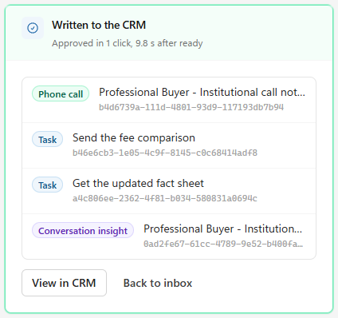

**Say it:** "What lands in the CRM is a note, tasks, products and topics. Never a transcript."

**Call out**

- **The package** is one phone call (the note as its description; direction, start, end and duration; the account or
  opportunity it is regarding; the contact; the seller as owner), one task per commitment (subject, description, due date,
  regarding, owner) and one conversation insight (template, language, summary, sections, product and topic ids, relationship
  facts, engine, model, confidence, review status and an optional vault pointer). The package type has **no transcript field**.
- **Idempotent.** The key is `source:source_interaction_id:vN`: approving or retrying the same version never writes a second
  set, and a reprocess is a new version with a new key. If a later write in a package fails, the records already created are
  deleted.
- **The Dataverse writer** (`VOICECRM_CRM_MODE=dataverse`) uses the Web API with Entra sign-in and retries 429 and 503 answers
  honouring `Retry-After` (four retries, waits capped at 60 seconds). The standard profile writes the `phonecalls` and `tasks`
  tables and carries the insight as a compact JSON footer in the call's description; a custom profile writes an insight table
  with typed columns and lookups from `data\crm\field_profile.yaml`.
- **Guards before any write.** `assert_no_transcript` rejects WebVTT cues, voice tags, timestamped speaker dumps and long prose
  pointers. A second guard refuses Microsoft's own sales CRM (MSX) hosts, so writes only go to a dedicated non-production
  environment.

**You see** the Pipeline card complete: *Review* (state approved, clicks 1), *Retention* and *CRM write* (created 4: the phone
call, two tasks and the insight), then the usage and cost of the whole call.

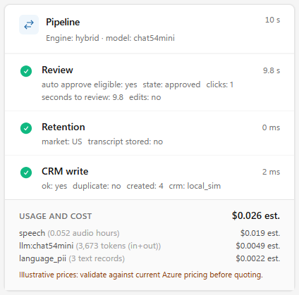

**Prove it:** tests `test_crm_dataverse.py` (`test_429_retry_after_is_honoured`,
`test_the_transcript_guard_runs_before_any_http_call`, `test_failure_after_the_call_is_rolled_back`) and
`test_credentials_and_guards.py` (`test_msx_organisations_are_refused`).

#### 3.4.3 Retention: what is kept

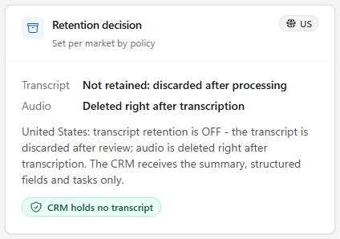

**Say it:** "Whether a transcript is kept is a market decision, and the CRM never holds one either way."

**Call out**

- The retention engine decides at approval: a transcript is stored if and only if the market's retention is on, and expires after
  `transcript_retention_days`; audio expires after `audio_retention_days`, and 0 means deleted right after transcription.
- Three kinds of vault item: `audio`, `working` (the redacted conversation held for review, 24 hours at most) and `transcript`
  (the redacted transcript, only where the market says on). Local files or Azure Blob with Entra sign-in.
- After a write with retention off, the stored proposal's evidence quotes are stripped, which is why the Evidence lines now show
  only segment numbers.
- **The sweep is manual** today: `POST /api/v1/retention/sweep` or the `sweep` command. In production, run it on a schedule or
  use Blob lifecycle rules.

### 3.5 Stage 5: where it lands

Sidebar -> **CRM**. Three tabs matter.

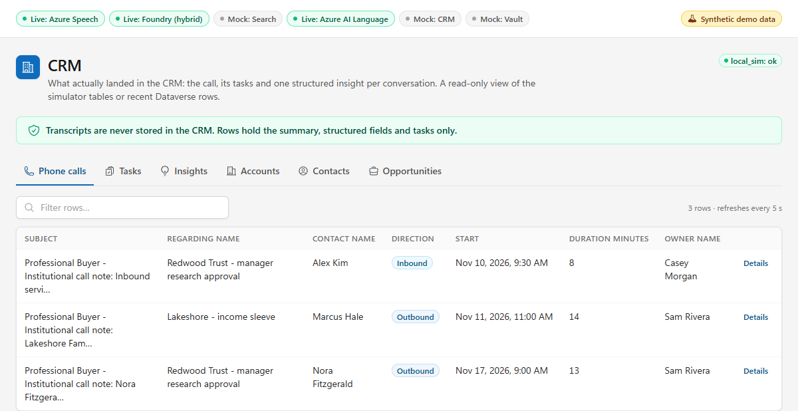

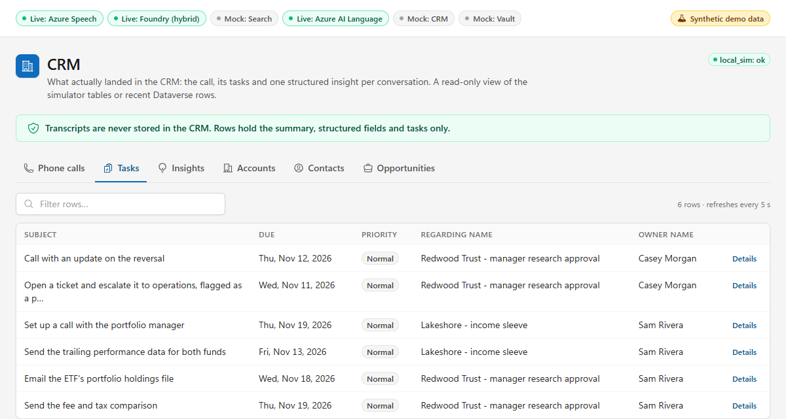

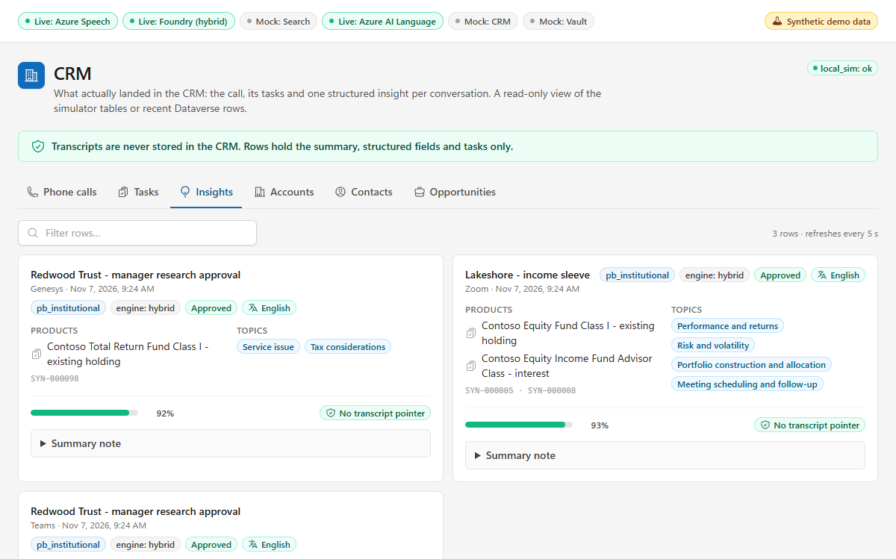

**Say it:** "This is what sellers and analysts get: the note on the call, the tasks on the account, and a structured insight an
analytics team can mine. Not a transcript."

**Call out**

- The CRM page is a read-only view of the simulator tables (or of recent Dataverse rows when `VOICECRM_CRM_MODE=dataverse`).
- The insight holds product and topic ids, not text; names are looked up for display. The banner is true by construction
  (3.4.2).
- **Not built, said plainly:** the follow-up email draft, and the hand-off to the data hub. The existing CRM-to-data-hub feed
  is the downstream; whether new custom fields flow into it is a question for the data team. The Sales agent in Microsoft 365
  Copilot is the native, no-build path for Teams meetings only.

### 3.6 What it cost and how long it took

The whole Pipeline card after the write: every stage records its status, duration and detail, and every billed call records its
usage. The cost block at the bottom is computed from that usage.

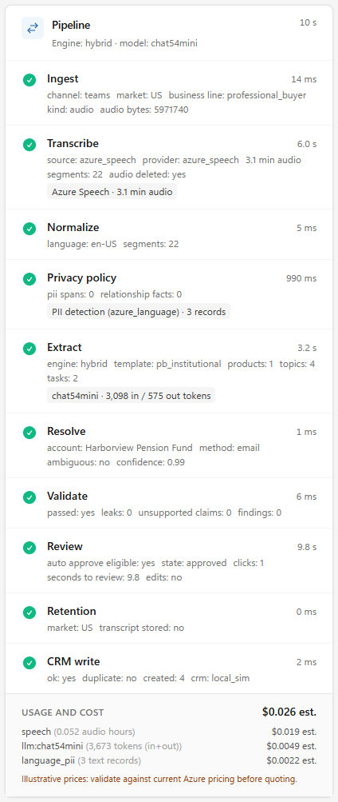

| Line (this call) | Quantity | Cost |
|---|---|---|
| speech | 0.052 audio hours | $0.019 |
| llm:chat54mini | 3,673 tokens in and out | $0.0049 |
| language_pii | 3 text records | $0.0022 |
| **total** | review-ready in 9 to 18 seconds | **$0.026** |

The prices are list prices from `data\pricing.yaml` ($0.36 per audio hour, $0.75 per 1,000 PII records, model tokens by
deployment). They are illustrative, not a quote: validate against current Azure pricing. A Teams call takes the platform
transcript, so its Speech line is absent and a call costs about $0.007.

### 3.7 Other calls worth running

From **Sources -> Simulate a call** (every call), or from section A when it has a recording:

| Call | What it shows | Where to look |
|---|---|---|
| `pb-ambiguous-equity-fund` | the share class is never said, so it offers a top-three pick instead of guessing | the Inbox row says **Product needs a pick**; the Products card ([part 9](#9-the-rest-of-the-product)) |
| `retail-teams-relationship-privacy` | a spoken card number and a medical aside are removed; "Seahawks fan" is kept | **What the privacy policy did** ([4.2](#42-notes-policy)) |
| `pb-teams-spanish-clase-c` | Spanish in, English CRM note out; "clase C" resolves to Class C | the note and the task titles |
| `pb-genesys-inbound-service` | an inbound service call known only by the caller's phone number; two CRM contacts are named Alex Kim | **CRM match**: the *Phone* method picks the right Alex Kim. The number comes from the call's metadata: live Genesys number extraction is not built |
| `pb-teams-legacy-blue-chip` | a former fund name the catalogue has never seen: it asks once, then learns | **Teach it once** ([part 9](#9-the-rest-of-the-product)) |

## 4. The policies: governance as data

Four policies decide what the pipeline may do, and none of them is code.

| Policy | The business need | Setting | Read by | You see it in |
|---|---|---|---|---|
| **Transcription** | one provider; do not pay twice | `processing.transcription_source_preference` | stage 2 | Pipeline: Transcribe; Policies: Routing |
| **Notes** | omit card numbers, IDs, health and other personal disclosures; drop small talk; keep relationship context | `notes` | stage 3, and the validator | What the privacy policy did; Policies: Notes policy |
| **Retention** | a transcript on or off per market; never in the CRM | `markets.US`, `markets.UK`, `markets.EU` | stage 4 and the vault | Retention decision; Policies: Transcript retention |
| **Review** | a person only where the system is unsure; the path to zero-touch | `processing` (engine, thresholds, auto-approve) | stages 3 and 4 | Ready to send; Policies: Processing |

The defaults are in `data\policies\policies.yaml`. A change made on the Policies page is saved as a runtime override in
`<state folder>\policies.override.yaml` and applies to the next call; delete that file to return to the defaults. The examples
are illustrative, not any firm's actual policy.

### 4.1 Transcription policy

Sidebar -> **Policies**; open **Routing: transcript source and default template** at the bottom of the Processing card.

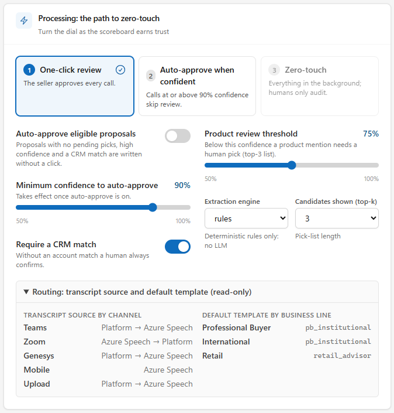

**Say it:** "One provider decides. Use what the platform gives us for free, and send audio to Azure Speech only where there is no
transcript."

**Call out**

- The order per channel: Teams, platform then Azure Speech; Zoom, Azure Speech then platform; Genesys, platform then Azure Speech;
  mobile, Azure Speech; uploads, platform then Azure Speech.
- The first source that is available wins. "Platform" means the ingest carries a transcript. The code does not check licence
  entitlement: whether Zoom transcripts are entitled on a plan, and how Genesys bills transcription at volume, are open questions.
- The effect shows in the cost: a platform-transcript call has no Speech line.
- The page shows it read-only; edit the YAML to change an order.

**Prove it:** run a simulated Teams call in [part 5](#5-scenario-b-a-teams-meeting): *Speech to text* reads "platform
transcript used - no transcription fee".

### 4.2 Notes policy

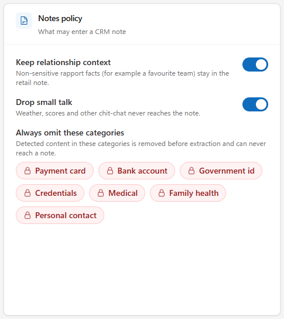

**Say it:** "Card numbers, medical details and family health never reach a note. Football chat is dropped. 'Seahawks fan' stays,
because it helps the relationship."

Run `retail-teams-relationship-privacy` (Sources -> Simulate a call -> **Run via transcript**) and open its review.

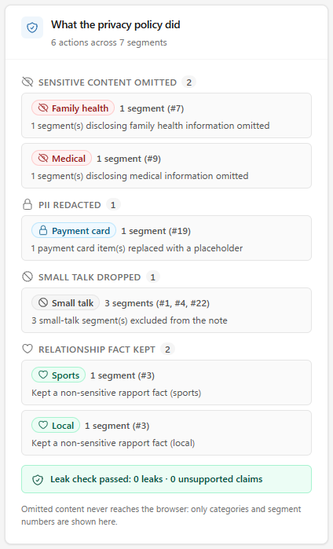

The call has a family-health aside (#7), a medical aside (#9) and a spoken card number (#19). Here is what the redacted
transcript shows for each:

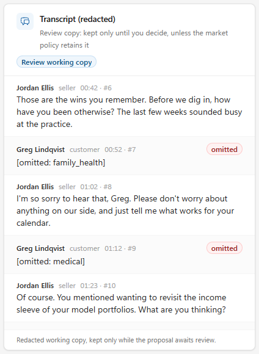

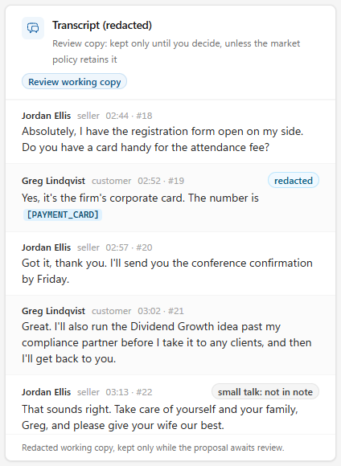

**Call out**

- **Four actions**, each recorded as a `PolicyAction`: `pii_redacted` (payment card, bank account, government id, credentials,
  personal contact: replaced by a placeholder such as `[PAYMENT_CARD]`), `omitted_sensitive` (medical, family health: the whole
  segment is excluded and shown as `[omitted: medical]`), `kept_relationship` (sports, hobby, local, contact preference: a safe
  rapport fact), and `dropped_small_talk` (greetings, weather, acknowledgements).
- **The audit trail names categories and counts, never text.** The page shows "6 actions across 7 segments" and segment numbers
  only.
- The model never sees what was redacted or omitted, and the validator re-scans every CRM-bound field afterwards ([3.3.4](#334-crm-match-and-validate)).
- It fails closed ([3.3.1](#331-the-privacy-filter-azure-ai-language)).
- The settings are `keep_relationship_context`, `drop_small_talk` and `omit_categories` in `policies.yaml`.

**Prove it:** tests `test_notes_policy.py`, `test_validator.py`, and `test_golden_set.py` (privacy leaks stay at 0).

### 4.3 Retention policy

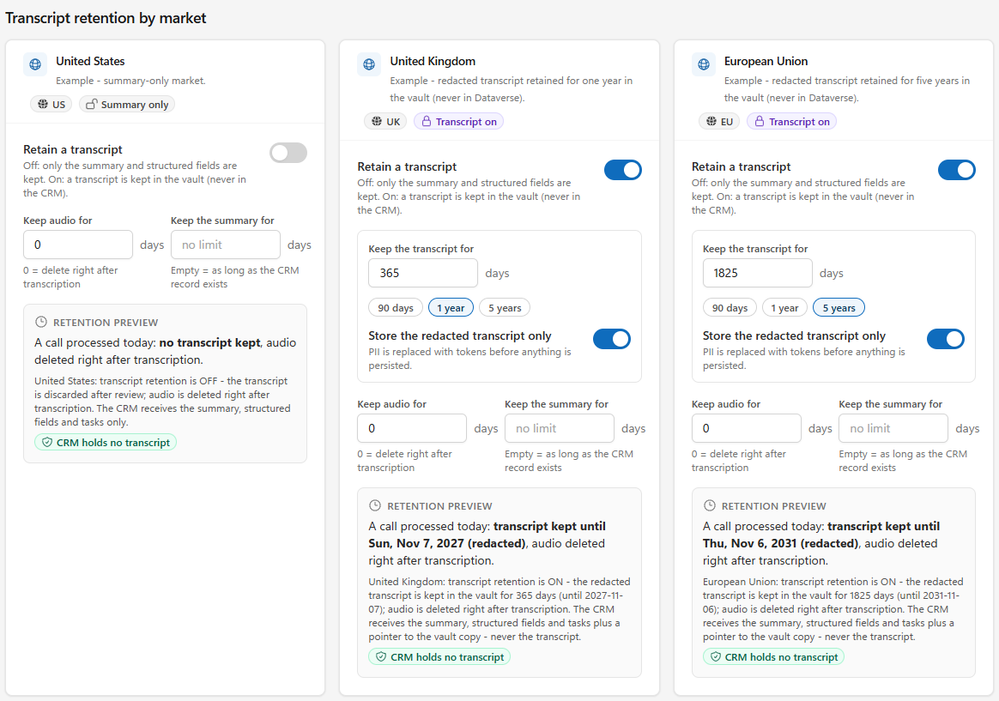

**Say it:** "The same call, two markets, two outcomes. In the US nothing is kept. In the EU a redacted transcript is kept for five
years in the vault. In neither is a transcript in the CRM."

The two Retention decision cards below are for the same call: first with market US, then with the market overridden to EU
(Sources -> Simulate a call -> **Overrides** -> market).

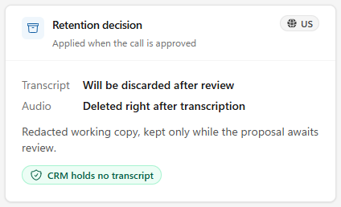

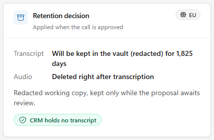

**Call out**

- Per market: `transcript_retention` on or off; `transcript_retention_days` (needed when on); `store_redacted_only`;
  `audio_retention_days` (0 deletes right after transcription); `summary_retention_days`. The examples are US off, UK 365 days and
  EU 1,825 days.
- The **retention preview** on this page and the **Retention decision** on a call come from the same engine and the same
  explanation text.
- The vault holds the only copy of a retained transcript (local files, or Azure Blob with Entra sign-in); the CRM gets a pointer
  at most.
- **Two honest gaps.** `summary_retention_days` is recorded and shown, but nothing enforces it against the CRM yet: the CRM's own
  lifecycle applies. And the sweep that removes expired vault items is manual.

### 4.4 Review policy

The upper part of the Processing card (the image in [4.1](#41-transcription-policy)) is the dial from one click to zero-touch.

**Say it:** "Start with one click per call. As the scoreboard earns trust, turn on auto-approve. Zero-touch is the same pipeline
with the human step removed where the system is sure."

| Setting | Default | What it does |
|---|---|---|
| Auto-approve eligible proposals | off | write proposals that pass every check with zero clicks |
| Minimum confidence to auto-approve | 90% | the overall confidence a proposal needs |
| Require a CRM match | on | a proposal with no account match always waits for a person |
| Product review threshold | 75% | below this a product mention needs a pick |
| Extraction engine | `rules` | rules, hybrid or llm; a live `VOICECRM_LLM_MODE` of `hybrid` or `foundry` sets the effective default |
| Candidates shown | 3 | the length of the pick list |

The page header shows the **effective engine**: `hybrid` here, because `VOICECRM_LLM_MODE=hybrid` wins over the policy default.

### 4.5 Try it

Each of these was run live; undo it afterwards.

| Do this | You should see |
|---|---|
| Run `retail-teams-relationship-privacy` with market US, then with market EU under **Overrides** | the Retention decision reads "discarded after review" for US and "kept in the vault (redacted) for 1,825 days" for EU |
| Policies -> United States -> **Retain a transcript** on, 90 days; run the call | the retention preview and the call's Retention decision say the redacted transcript is kept in the vault for 90 days, with the date |
| Policies -> Notes policy -> turn **Keep relationship context** off; run the privacy call | the relationship notes are empty and the privacy card has no *Relationship fact kept* group |
| Policies -> Processing -> turn **Auto-approve** on; run the hero call from Sources | it goes straight to *Written to the CRM*: the Review row reads state auto_approved, clicks 0 |
| Same, and raise **Minimum confidence** to 99% | the call waits in the Inbox with no review reason: its overall confidence (0.95) is below the bar |
| Set **Product review threshold** to 99% and run the hero call | the 97% product now needs a pick (`product_needs_pick`) |

## 5. Scenario B: a Teams meeting

Sidebar -> **Live demo** -> section **B**. Microsoft Graph publishes a scheduled meeting's transcript some minutes after it
ends, and VoiceCRM picks it up, so nobody uploads anything.

**B1. Is the tenant ready?** Press **Check Teams setup**. With a tenant it signs in to Graph as the app, tests each step live
ingestion depends on and gives the fix for every failure. The long pole is the tenant side: an app registration with admin
consent and an application access policy for each organiser (allow a day; [live-demo.md](live-demo.md), section 1).

**B2. Rehearse with a simulated Teams call.** Choose a call and press **Simulate a Teams call**. It is rendered as a native Teams
transcript file (WebVTT) and goes through the real parser and pipeline, with the live privacy filter and the live model.

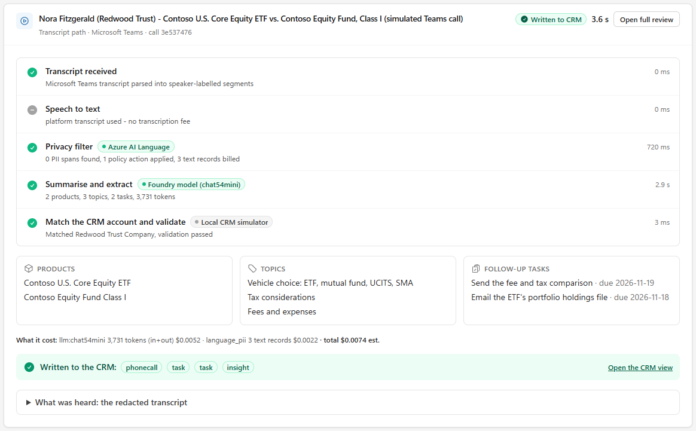

**Say it:** "No upload, no new tool for the seller, and no speech bill: Teams already transcribed the meeting, so the policy used
its transcript."

**Call out**

- **The Speech row is skipped**: "platform transcript used - no transcription fee". Privacy filter and model run as in scenario A.
- **How the real path works.** The poller asks Graph for the meeting transcripts of each configured organiser
  (`VOICECRM_TEAMS_ORGANIZERS`) over a lookback window (480 minutes) every 20 seconds (`VOICECRM_TEAMS_POLL_SECONDS`, backing off to
  5 minutes after errors). It downloads the content as WebVTT (`$format=text/vtt`, `<v Speaker>` cues) and remembers what it has
  seen, so a transcript is ingested once. The organiser is the seller; the customer is inferred from the other attendees, which
  gives an **email** CRM match.
- **Webhook mode** is built too: `POST /api/v1/webhooks/teams` answers Graph's validation token and checks the `clientState`;
  it needs a public https endpoint, so the demo polls.
- **Not real time.** Graph lists the transcript minutes after the meeting ends: within 8 minutes in our run, and one Microsoft Q&A
  report says about 20. It covers scheduled meetings, not "Meet now".
- **Verified.** One real scheduled meeting on the demo tenant was listed by Graph, downloaded (21 cues, 430 words), ingested and
  matched to the right account. The eight recordings below can be rehearsed without a meeting: `scripts\rehearse_audio.bat
  --meeting -v` runs them through Speech, the privacy filter and the model and scores them against their answer keys (about a
  minute and $0.25; [live-demo.md](live-demo.md), section 3).

**B3. No time for a live meeting? Import an earlier one.** On the same page, the card **Import earlier meetings** (also on
**Sources**). Choose how far back to look (the last 30 days by default, up to 90) and press **Find meetings**: Microsoft Graph
returns the transcripts the configured organisers still have, newest first, with the title, the guests, the start, the length and
whether the Inbox already has the call. Tick the ones you want (**Select all new** takes up to 25) and press **Import N
selected**. Each one goes through the pipeline as if the meeting had just ended: its row turns into the Inbox status
(*Processing*, then *Needs review*) with an **Open** link, and the Inbox has the call. The card appears only when live Teams
ingestion is on, so it is not in the screenshots.

**Say it:** "I did not have a meeting to run today, so I am pulling one the seller held last week, straight from Microsoft Graph.
It is the same path the poller uses; the only difference is who pressed the button."

**Call out**

- **The same call as the poller, with an earlier start.** `GET /api/v1/sources/teams/history?days=30` asks Graph for
  `getAllTranscripts(meetingOrganizerUserId, startDateTime)` for each organiser in `VOICECRM_TEAMS_ORGANIZERS` with the start days
  back instead of minutes, then reads each meeting for its subject and guests. The newest 60 are listed (`truncated` says there
  were more). The first search on the demo tenant took about 10 seconds. Nothing is downloaded or ingested by the search.
- **The import is the live code.** `POST /api/v1/sources/teams/import` downloads each transcript (WebVTT), runs it through the same
  parser and hands it to the same pipeline, in one function shared by the poller, the webhook and the import (3 downloads at a
  time, 25 meetings per request). One failure is reported for that meeting and does not stop the others.
- **Idempotent.** The key is the Graph transcript id. A meeting already in the Inbox, whether the poller ingested it or an earlier
  import did, is listed as *In the Inbox* and is never imported twice; a call that failed or was rejected can be imported again.
- **Only your organisers.** An organiser that is not in `VOICECRM_TEAMS_ORGANIZERS` is refused (422). The app's Graph permissions
  and the application access policy are per organiser, so VoiceCRM cannot read anyone else's meetings.
- **The live counters stay put.** The *Live Teams ingestion* card counts what the poller found by itself, so "the poller found it"
  stays true when you show B4; an import reports in its own toast and in the Inbox.
- **Old meeting, old dates.** Due dates count from the meeting's own start, so "by Friday" in a meeting from three weeks ago is a
  date in the past. Pick the newest meeting, or say so.
- **Reset, then import.** *Reset demo data* empties the Inbox but the poller still remembers the meetings it ingested; the import
  does not use that list, so reset followed by import is the quick way to show a real meeting arriving.
- **Verified live.** On the demo tenant the search listed the real scheduled meeting, the import produced a *Needs review* call with
  the host and the guest named (2.7 s), the list then showed it as in the Inbox, and a second import changed nothing.
  Tests: `backend\tests\pipeline\test_teams_live.py` (listing, states, the poller's remembered list, duplicates, failures) and
  `backend\tests\api\test_teams_routes.py` (status codes and validation).

**B4. A real meeting (needs the tenant).** As the host:

1. Schedule a meeting in the Teams calendar and invite a guest. **Not "Meet now"**: only scheduled meetings are listed by Graph.
2. Join, start transcription (Meeting controls -> Record and transcribe) and choose the spoken language.
3. Play one of the recordings below near the host's microphone, or read a call aloud, then end the meeting.
4. A few minutes later the **Live Teams ingestion** card shows it ingested and the Inbox has a new Teams call.

The eight recordings are made by `scripts\make_meeting_audio.bat` (they need Azure Speech) into `data\audio\meeting`:

| # | Recording | What it shows |
|---|---|---|
| 1 | `class-c-call` | share-class precision: Class C is the product, Class A only a comparison; two dated seller tasks |
| 2 | `ambiguous-fund-call` | it asks instead of guessing: the fund is clear, the share class never is |
| 3 | `legacy-name-call` | it learns: a former fund name needs one pick, then resolves by itself |
| 4 | `privacy-call` | a card number, a personal cell number and a medical detail never reach the note |
| 5 | `competitor-call` | a cheaper index fund is a concern on the record, not a product tag |
| 6 | `etf-vs-fund-call` | similar names, different products: the ETF and the mutual fund are tagged separately |
| 7 | `no-actions-call` | restraint: market chat and no commitments, so no tasks are invented |
| 8 | `spanish-call` | Spanish in, English out (set Teams' spoken language to Spanish first) |

**B5. No tenant yet? Upload the transcript.** Each recording also comes with a Teams-style `.vtt` file. Sidebar -> **Sources** ->
**Upload a recording or transcript**: choose the `.vtt`, set Channel to *Microsoft Teams*, Seller name `Aisha West`, Customer
name `Dana Whitfield`, Customer organisation `Harborview Pension Fund` and Customer email `dana.whitfield@harborview-pension.example`
(leave the rest at its defaults), then **Upload and process**. The Inbox gets a Teams call titled by the file name, matched to
Harborview Pension Fund and Dana Whitfield by email. Due dates count from the call's start time, which defaults to the moment you
upload; set **Advanced -> Call started at** to line them up with the meeting.

## 6. Scenario C: hundreds of calls

Sidebar -> **Live demo** -> section **C**. The scripted calls are cycled under fresh ids through the same pipeline the webhooks
use. Nothing is spent until you press **Start**.

**C1. Set up the run.** Choose 50, 200 or 800, or type a number (up to 2,000). *What goes in*: **Platform transcripts** (what
Teams, Zoom and Genesys deliver; no speech charge) or **Real audio** (the recordings through Azure Speech). Leave *Arrival* on
*All at once*, parallelism on automatic and auto-approve on. The box on the right sizes the run first.

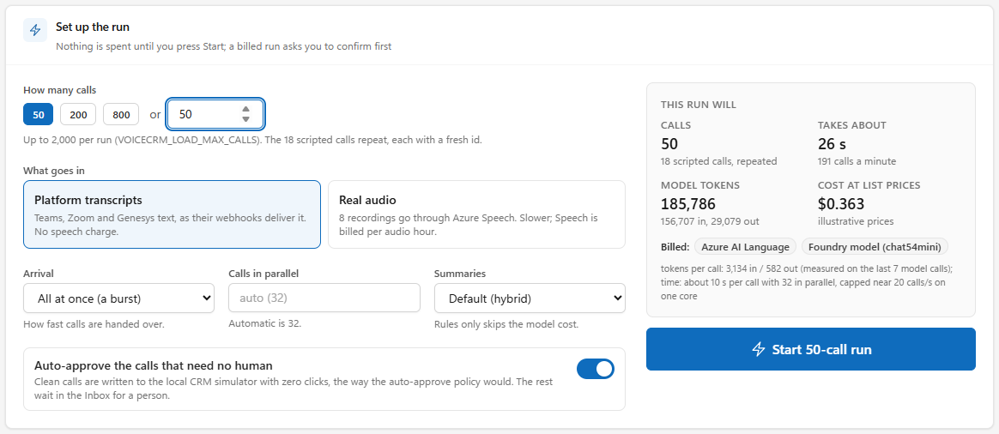

**C2. Confirm.** A billed run asks first. Read it out loud: the billed services, the estimated cost, the tokens, the time. Confirm
only when you mean it; **Cancel** spends nothing.

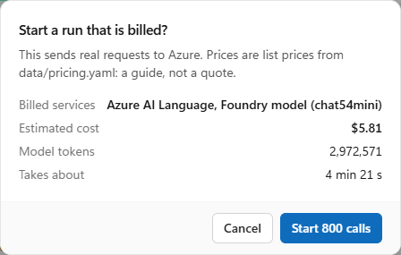

*An 800-call run, about $5.8 (the estimate is re-measured from recent calls). The measured run cost $5.91 in 172 seconds,
[live-demo.md](live-demo.md), section 4.*

**C3. Watch, then read the report.** The page scrolls to a live board (finished, in flight, waiting, failed, written to the CRM)
and the Inbox's **Pipeline throughput** card updates every second. This is a 50-call run:

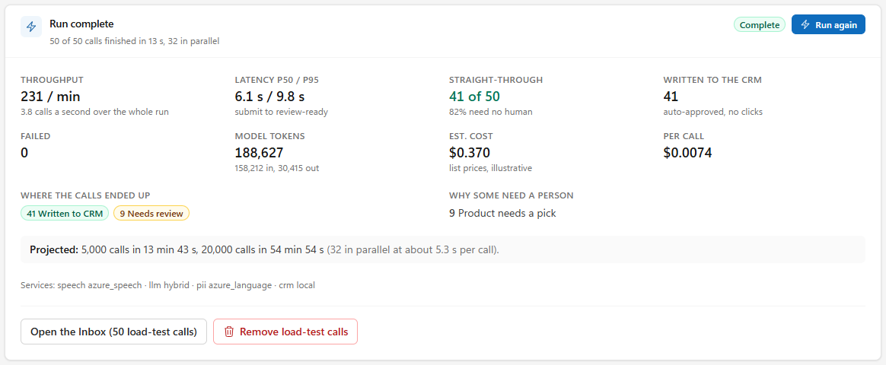

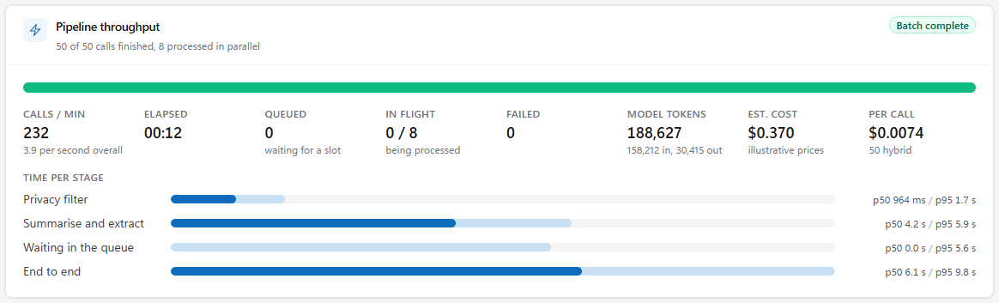

**Say it:** "Same pipeline, a few hundred calls a minute on one small process, and every number on this page is measured from the
run, not typed in. About one call in five needed a person because the share class was never said: that is the system refusing
to guess."

**Call out**

- **What this run measured:** 50 calls finished in 13 seconds (about 230 a minute), latency p50 6.1 s and p95 9.8 s (submit to
  review-ready), 41 of 50 written to the CRM with zero clicks and 9 waiting for a product pick (the model's reading varies a
  little from run to run), $0.0074 per call. The report also projects 5,000 and 20,000 calls from the measured per-call time.
- **How it scales:** bounded parallelism (32 by default, chosen from the live services), one process, state in SQLite. The
  production path puts a queue (Service Bus) between ingest and the pipeline, a shared state store (Cosmos DB or Postgres) and
  more replicas.
- **What limits it:** model tokens per minute, Azure AI Language and Speech request limits, and the Dataverse service limits.
  Speech, Azure AI Language, the model and Dataverse all retry throttling with backoff, and the run reports failures instead of
  hiding them.
- **Cost per call:** about $0.007 on the platform-transcript path (about 3,100 tokens in and 580 out, plus 3 PII records), about
  $0.026 with audio.
- **Honesty:** the 18 scripted calls repeat, each with a fresh id, so this measures capacity and cost, not accuracy.

**C4. Clean up.** Press **Remove load-test calls** in the report (or on the Inbox banner) and confirm. Only calls a load test
created are removed.

## 7. Scenario D: a phone call to the VoiceCRM line

Sidebar -> **Live demo** -> section **D**. A customer dials the VoiceCRM line from a dial pad in the browser (a VoIP call over
Azure Communication Services, ACS). The line answers, plays a recording notice, rings the seller, records **each side on its own
channel**, and a few seconds after the hang-up the call is in the Inbox like any other: no upload, nothing for the seller to
type. **This needs the phone line set up** (an ACS resource, a dev tunnel and two Event Grid subscriptions:
[phone-line.md](phone-line.md#3-set-it-up)), and the page must be opened at **http://localhost:8010**, not `127.0.0.1`: the
calling SDK refuses that address.

> **Verified.** On the demo tenant, with two real Chrome windows (each one's microphone fed by a recording): the call reached the
> line 3 to 9 seconds after **Call**, the notice took about 9 seconds, the recording event arrived 3 to 6 seconds after the
> hang-up and the conversation was in the Inbox about 2 seconds after that. Voicemail, a caller whose browser was killed and a
> Teams seller who did not answer were exercised too. **Not verified:** a person answering in a Teams client, and a call from a
> real phone: the demo tenant could not order a number ([phone-line.md](phone-line.md#7-a-real-phone-number)).

**D0. Before the demo.** Start the tunnel (it forwards the phone ingress port only), the app, and check the line:

```bat
scripts\run_phone_tunnel.bat     rem the tunnel to the phone ingress (port 8011), in its own window
scripts\run_backend.bat          rem the app; it also starts the ingress
scripts\phone_check.bat          rem every step PASS, or the fix for the one that is not
```

**D1. Is the line ready?** Press **Check phone setup**. Each row is a real test, and a failure says how to fix it.

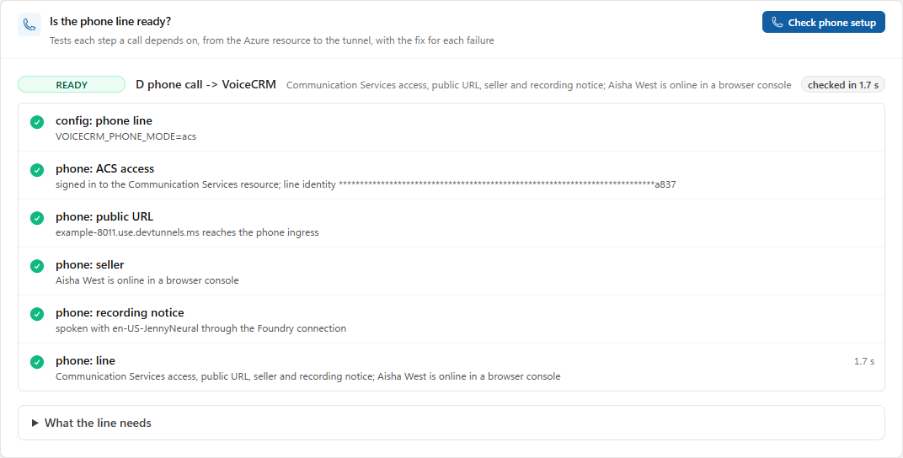

| Check | What it does | A pass proves |
|---|---|---|
| config: phone line | reads `VOICECRM_PHONE_MODE` and the settings the line needs | nothing required is missing |
| phone: ACS access | signs in to the ACS resource with Entra and makes sure the line's identity exists | the app can create identities, issue tokens and control calls |
| phone: public URL | calls `<public url>/api/v1/webhooks/phone/health` through the tunnel | Azure can reach the phone ingress (and not the API) |
| phone: seller | finds an online browser console, or resolves the Teams user in `VOICECRM_PHONE_SELLER` | someone will be rung |
| phone: recording notice | checks that the notice text and the Foundry (AI Services) endpoint are set | the notice can be spoken (the check places no call) |

**D2. Open the seller console (window 1).** In **Seller console**, switch on **Answer calls in this browser**: it shows *Online*,
and the Phone line card names the seller. Do this **before** dialling: with no console online the line takes a message instead
of ringing anyone (the dial pad warns you). (To ring a Teams client instead, set `VOICECRM_PHONE_SELLER=teams:<user>`.)

**D3. Dial (window 2).** In **Call the VoiceCRM line**, set **Who is calling** (the defaults are the seed contact, Dana Whitfield
of Harborview Pension Fund, so the CRM match is by email) and press **Call**. The **Phone line** card writes the call's timeline as
it happens: call received, answered, notice played, recording started, seller rung.

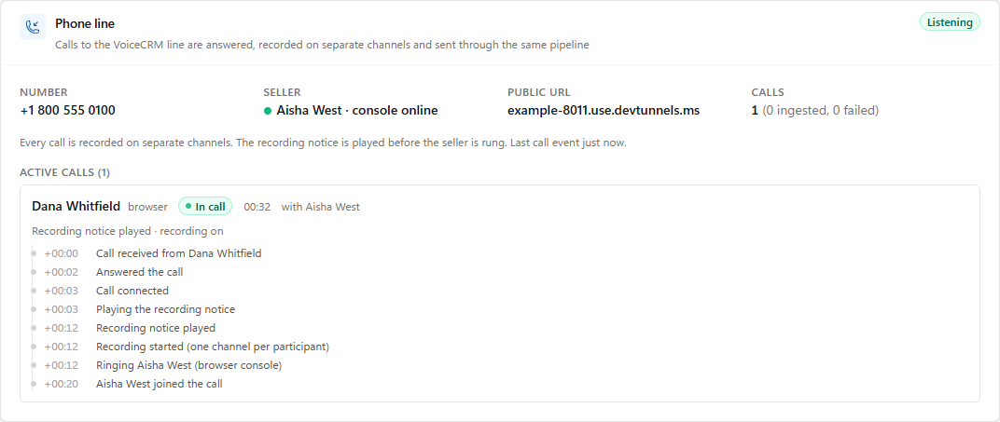

The seller console rings with the caller's name; **Accept**. The caller's pad shows the connected call and its clock.

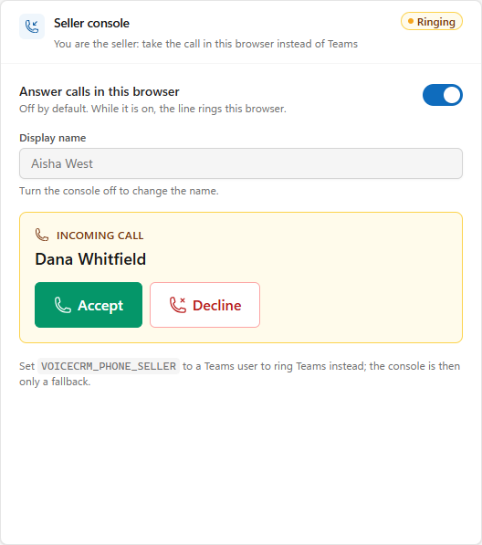

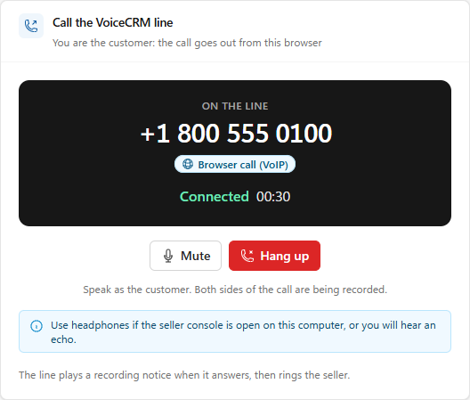

**D4. Talk, then hang up.** Use headphones if both windows are on one computer. Two people can read this (the caller is Dana, the
seller Aisha); leave a short pause between turns. **Both windows on one computer share its microphone**, so whoever speaks is
heard on both channels: mute the side that is not speaking (**Mute** on the dial pad and on the console), or have the second
person answer in Teams on their own device. The script:

| Who | Says |
|---|---|
| Dana (caller) | "Hi Aisha, it's Dana Whitfield at Harborview Pension Fund. I'm calling about the Contoso Equity Income Fund." |
| Aisha (seller) | "Hi Dana, thanks for calling. What would you like to know about the fund?" |
| Dana | "Could you send me the expense ratio comparison by Monday? Our committee meets next week." |
| Aisha | "Of course. I'll email the expense ratio comparison to you by Monday, and I'll set up a review call for next week." |
| Dana | "That works for me. Thank you, Aisha." |
| Aisha | "My pleasure, Dana. Have a good afternoon." |

Leave the share class out, as the script does, to show the call asking for a pick; say it aloud, as the hero call does in
[part 3](#3-one-call-end-to-end-scenario-a), and the product resolves without one. Either side can hang up. The Inbox gets the call
as *Processing* a few seconds after the hang-up, and the Phone line card moves it to *ingested* when the pipeline is done. A call in
which nobody said anything (a hang-up, an empty voicemail) is shown as *Missed* with the reason and never reaches the Inbox.

**D5. Read the result.** The Inbox has a **Phone** call from Dana Whitfield about 15 seconds after the hang-up (ready for review
about 15 seconds after that).

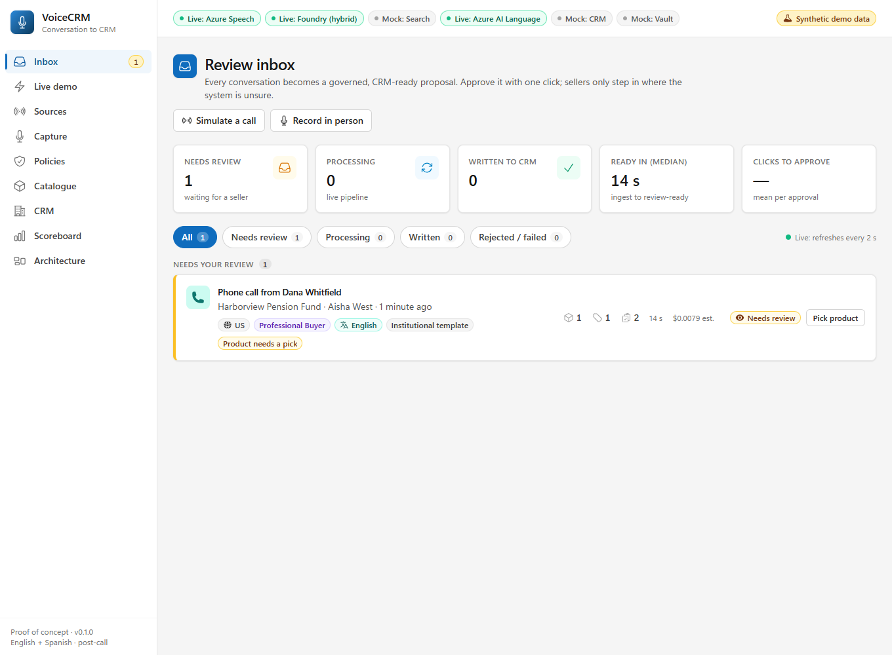

Open it. The note names Dana Whitfield and Harborview Pension Fund; the fund is named but not its share class, so the Products
card asks for a pick instead of guessing; the two seller commitments become tasks, dated from the call (the capture read both as
Monday; a reviewer can edit a date); **CRM match** says *Email, 99%*. The header reads "Aisha West -> Dana Whitfield", and the
transcript labels every line by who spoke it, because the two voices came on separate channels.

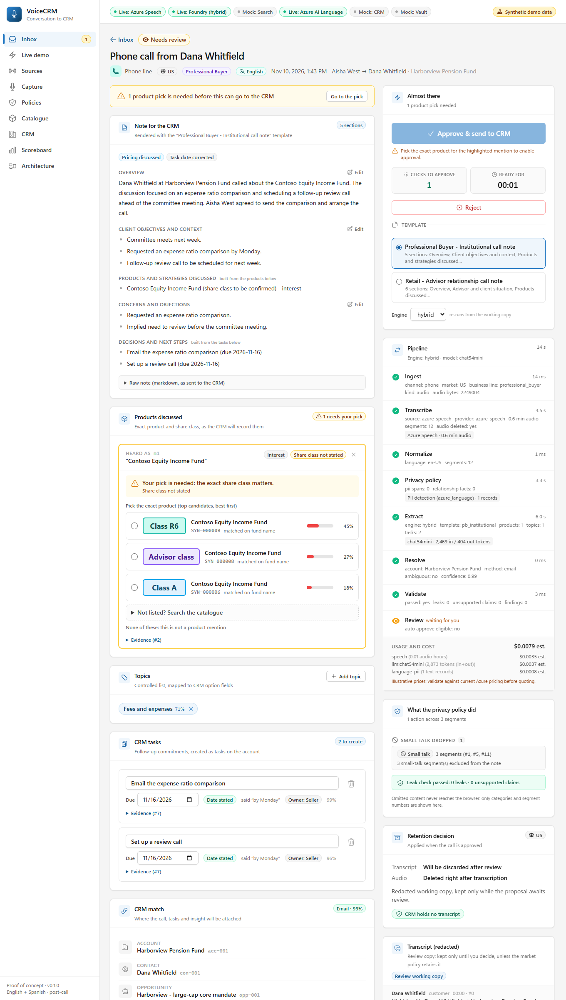

*The images are a live capture: `tools\capture_phone.py` speaks this script with Azure text to speech into two real browsers and
places the call ([part 12.2](#122-regenerate-the-screenshots)). The Pipeline card is scenario A's, with the channel `phone`.*

**Say it:** "A customer phones the line. They hear that the call is recorded, the seller picks up, and when they hang up the
seller has nothing to type: the note, the product, the follow-up tasks and the CRM match are waiting for one click. Each person was
recorded on their own channel, so who said what is a fact, not a guess, and a call nobody answers still becomes a message."

**Call out**

- **The dial pad is a real ACS call.** The page asks `POST /api/v1/phone/token` for a short-lived VoIP token for a fresh ACS
  identity (the line's own identity is refused), and the Calling SDK dials the line's identity. The number on the pad is a
  placeholder (`VOICECRM_PHONE_DISPLAY_NUMBER`) until a real one exists. The SDK runs only on https, `file:` or `localhost`,
  which is why this scenario needs `localhost`; the pad and the console say so when the address is wrong.
- **How the app hears about the call.** ACS publishes `IncomingCall` to Event Grid, which posts it through a dev tunnel to
  `POST /api/v1/webhooks/phone/events`. The webhooks live on a second, tiny listener (`VOICECRM_PHONE_INGRESS_PORT`, default
  8011) that serves nothing else, and the tunnel forwards that port only: the API on 8010 has no sign-in and is never exposed. The
  Event Grid URL carries a secret (`VOICECRM_PHONE_WEBHOOK_SECRET`, compared in constant time) and each call's callback URL
  carries an HMAC of the call id. ACS gives 30 seconds to answer and a ringing call is useless after a minute, so that subscription
  makes two delivery attempts; the recording subscription retries for 24 hours.
- **Answer, notice, then record.** The line answers with Call Automation, plays the notice with text to speech
  (`VOICECRM_PHONE_NOTICE`, voice `en-US-JennyNeural`) through the Foundry (AI Services) connection, and only then starts
  recording: the notice is not in the recording, and the conversation says the caller heard it (`consent: recorded_with_consent`).
  With `VOICECRM_PHONE_REQUIRE_NOTICE=true` (the default) a call whose notice cannot be played is ended, not recorded.
- **One channel per person.** The recording is unmixed WAV, the caller on channel 0 and the seller on channel 1, and its metadata
  names the participant on each channel. Azure Speech transcribes each channel on its own (`channels: [0, 1]`; the caller is
  `cust1`, the seller `seller`), so every segment is attributed by channel, overlapping speech is kept and there is no diarization
  to get wrong. The line's own identity gets a channel too (its prompts land there) and is ignored. If the participants cannot be
  matched, the audio is mixed to mono and diarization decides; the call's timeline says so.
- **Nobody answers.** If no seller is online, the invitation fails, or the seller does not pick up within
  `VOICECRM_PHONE_RING_SECONDS` (25 s, plus 5 s), the caller is told to leave a message and the line keeps recording for up to
  `VOICECRM_PHONE_VOICEMAIL_SECONDS` (180 s). A voicemail takes the same path as a call, with a silent seller channel, and a
  call-back number spoken in it is redacted like any other. To show it, switch the console off and call again, and speak after the
  prompt.
- **Nothing said is not a message.** A caller who hangs up, or a voicemail with no message, leaves a recording with nothing in
  it, and the line does not send it on. It measures the speech-level audio on the channels that carry the conversation (never the
  line's own prompts: 100 ms stretches louder than an RMS of 100 on the 16-bit scale, where room noise sits near 10 to 20), and
  below `VOICECRM_PHONE_MIN_SPEECH_SECONDS` (1.5 s; `0` sends everything on) the call is **Missed** with the reason on the Phone
  line card: no Inbox row, no Speech charge. If a recording passes but Azure Speech finds no language in it (HTTP 422
  `NoLanguageIdentified`), the adapter raises a plain `NoSpeechError`, the conversation fails with "No speech could be recognised in
  the recording", and the call is **Missed**. The service is deliberately not retried with a forced locale: on noise it invents
  words ("Yes.", "A."), which would become a note about a call nobody spoke in. *Measured:* two real hang-ups on the demo tenant
  had 0.0 s and 0.9 s of speech-level audio, and Azure Speech found no words in either, even with the language forced.
- **Hanging up.** Either side hanging up ends the call for both. The longest call is 30 minutes (`VOICECRM_PHONE_MAX_CALL_MINUTES`).
  A caller whose browser is killed is noticed by ACS after about a minute (measured: 73 seconds).
- **From recording to Inbox.** When the recording is ready, ACS publishes `RecordingFileStatusUpdated` (3 to 6 seconds after the
  hang-up). The line downloads the WAV and its metadata (only from the recording service's own hosts), renders the stereo file
  and submits it as `channel=phone`, with the call's own start, end and duration (the recording starts at the first sound). If
  nothing arrives within 15 minutes the call shows as failed, and a late recording is still ingested. The card then reads
  *Processing* until the pipeline is done, and *Ingested* (or *Failed*, with the pipeline's own reason) after that. In the capture it
  was 14 seconds from ingest to review-ready: Speech 4.5 s, privacy filter 3.3 s, model 6.0 s, and $0.0079 for the three (ACS usage
  is billed separately and is not in the app's cost view).
- **The pipeline did not change.** The phone channel adds `phone` to the channel list, one transcription-policy entry
  (`phone: [azure_speech]`) and the channel-to-speaker map on the Speech request. From Normalize on it is scenario A
  ([part 3](#3-one-call-end-to-end-scenario-a)): the same privacy policy, extraction and product resolution, review and retention
  ([part 4](#4-the-policies-governance-as-data)).
- **Idempotent and tidy.** The conversation key derives from the recording's document id (`acs-<id>`), so an Event Grid
  redelivery never makes a second call. ACS keeps a recording for 24 hours, so the line deletes its copy once the pipeline has
  the audio; the retention policy then decides what is kept.
- **The caller is identified, not guessed.** The dial pad's *Who is calling* fields travel with the token. The CRM match tries the
  email first and then the phone number (digits compared); a caller from a real phone is identified by the number the carrier
  presents.
- **A real number later.** Nothing above changes: a caller from a phone arrives in the same event (`caller_kind: phone`), and
  `VOICECRM_PHONE_ACCEPT_TO` lets the line answer for a Teams Phone resource account. What is missing is the number, an admin step
  in the tenant (the demo tenant's number orders were refused for identity verification and a missing wallet:
  [phone-line.md](phone-line.md#7-a-real-phone-number)).

**Prove it:** **Check phone setup** (D1), or `scripts\phone_check.bat`. The Phone line card shows every call's timeline, and
`GET /api/v1/sources/phone` returns the same with the notice and recording state. Switch the console off and call to see the
voicemail path. Tests: `backend\tests\pipeline\test_phone_live.py` (every call state, with a scripted ACS and a virtual clock, and
the silent-recording and pipeline-outcome cases), `backend\tests\pipeline\test_no_speech.py` (the plain "no speech" failure),
`backend\tests\adapters\test_phone_source.py` (events, recording metadata, channel planning, WAV handling, speech measurement),
`test_telephony_acs.py` and `test_telephony_arm.py` in the same folder, and `backend\tests\api\test_phone_routes.py` (the webhooks
and the ingress).

## 8. Scenario A, spoken live: the Record button

Instead of playing a recording, you and a colleague read the call aloud into the laptop microphone, and the same pipeline
processes it. Sidebar -> **Capture** (or **Record in person** at the top of the Inbox). **This needs live Azure Speech.**

> **Verified.** A real Chrome Record button, fed the hero call as its microphone, recorded 190 seconds as WebM/Opus (2.4 MB). Azure
> Speech transcribed it at 1.7% word error, every one of the 20 segments went to the right speaker (the call has three voices; it
> separates two), and the result matched the played recording: the same product, topics and two seller tasks, matched to
> Harborview by name and organisation, review-ready 22 seconds after the upload for $0.026. Human voices were not tested, so
> rehearse once.

**8.1 Open Capture and fill in "Who is it with?".** Allow the microphone when the browser asks. Type **Client organisation**
`Harborview Pension Fund` and **Client name** `Dana Whitfield`; open **Your details** and set **Your name** `Sam Rivera` (the
seller in the script). Leave Market on *United States* and Business line on *Professional Buyer*. These fields link the call to the
CRM account.

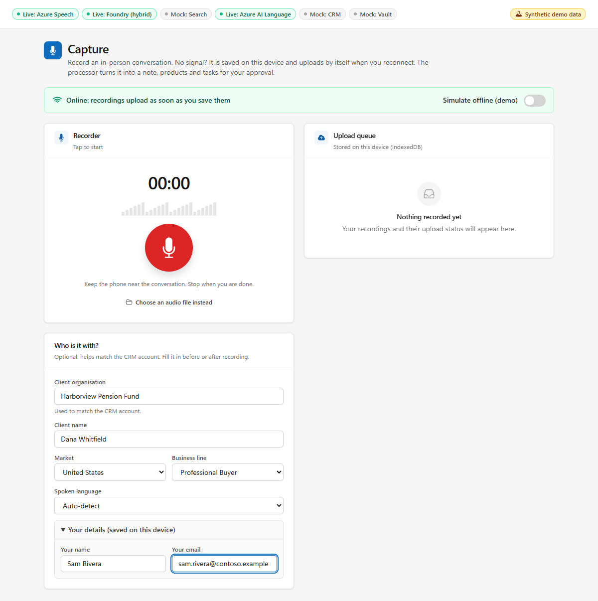

**8.2 Put the script where you can both read it.** Open the hero call's review in another window or on a phone and use its
**Transcript (redacted)** card ([3.2](#32-normalize-who-said-what)). Do it before you approve that call: the US policy keeps no
transcript, so an approved call no longer shows one (run the hero call again from Sources and leave it unapproved). Sam Rivera is
the seller; Dana Whitfield and Alex Kim are the customers, so one of you reads Sam and the other reads both customers. **The
seller speaks first.** Leave a short pause between turns and do not talk over each other. It takes about 3 minutes.

Want it shorter? Ad-lib 30 seconds, saying "class C" explicitly: *"Hi Dana, it's Sam from Contoso Woodgrove. Following up on the
Contoso Equity Fund, class C. I'll send the fee comparison by Friday and set up a session with your committee."*

**8.3 Record.** Press the red microphone. The clock runs, the bars move, and **Pause** and **Stop** appear.

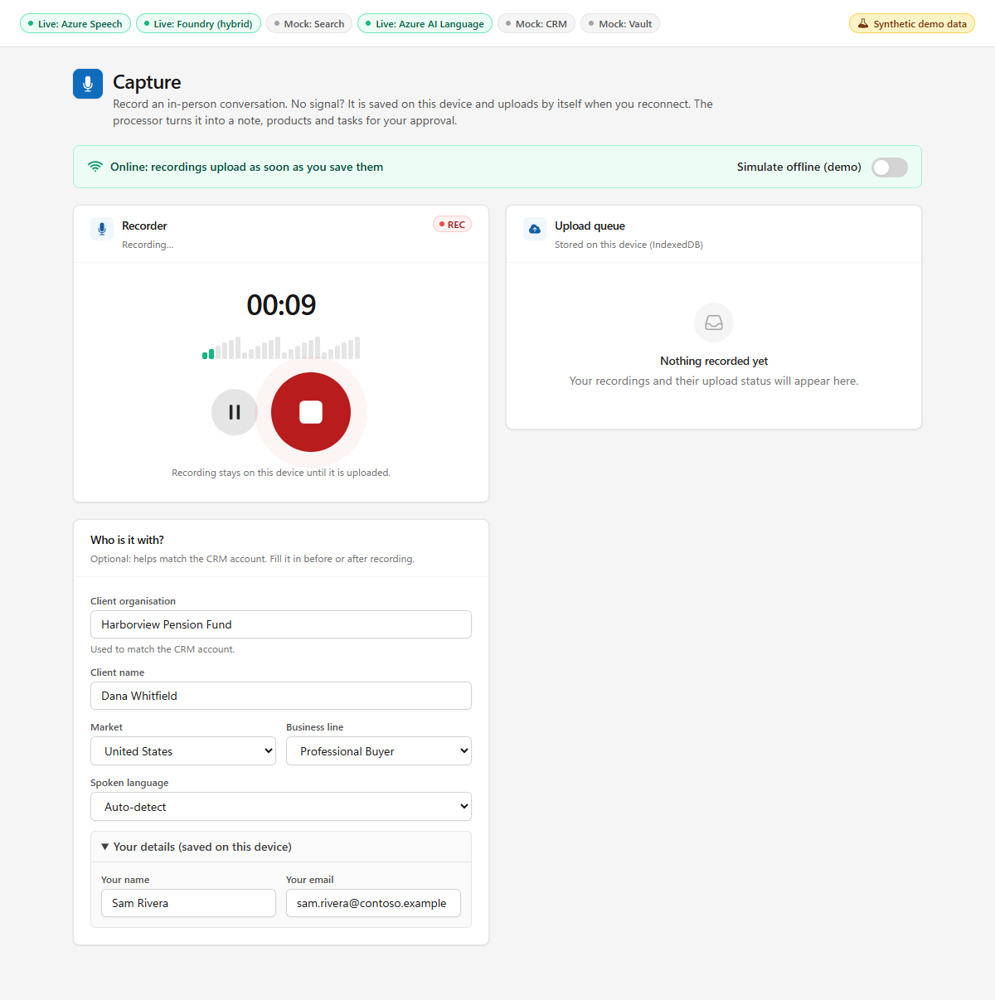

**8.4 Stop, listen, save.** **Stop** gives you a playback and the size; press **Save & upload**.

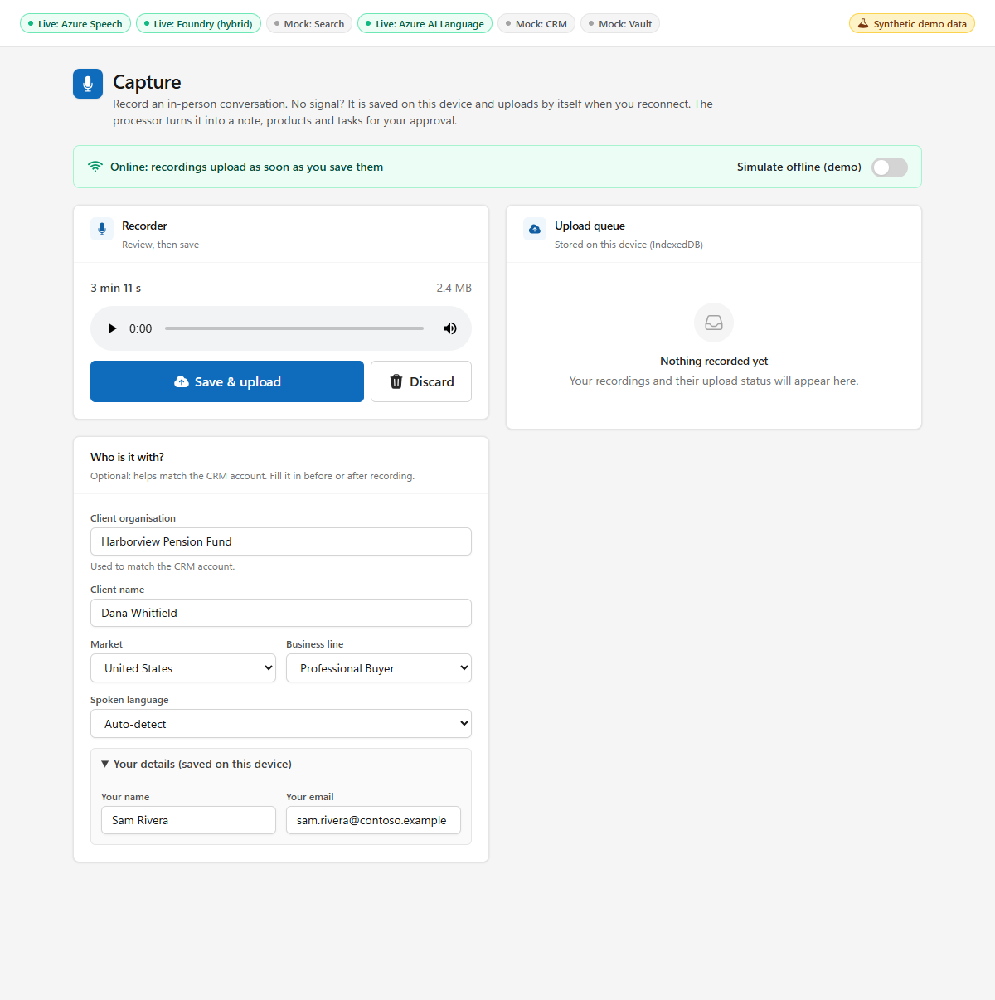

**8.5 Open the review.** The upload queue shows **Uploaded**; press **Open the review** (or watch the Inbox, where the call appears
with the in-person icon).

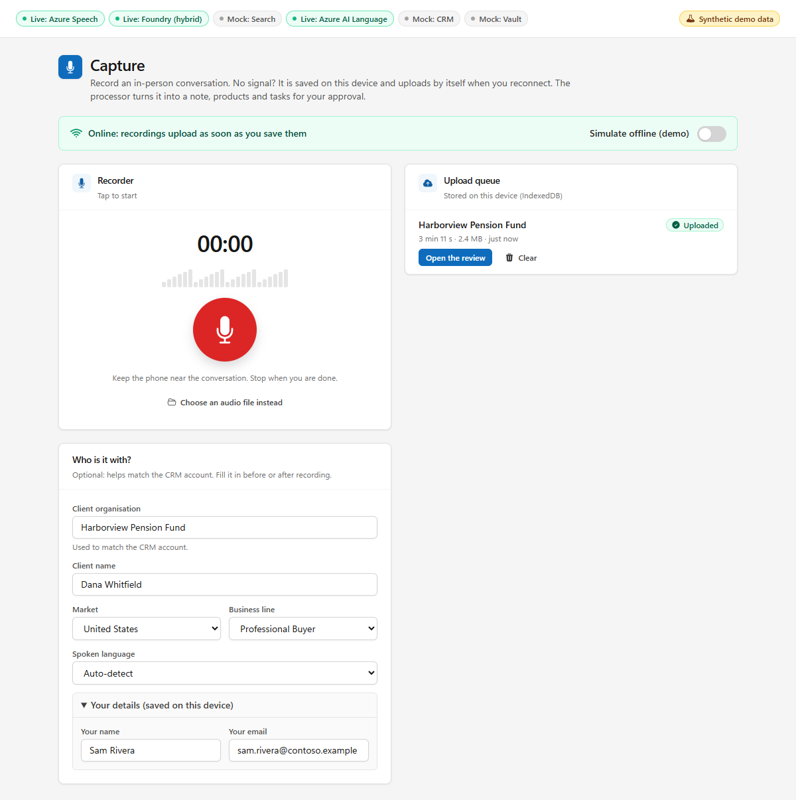

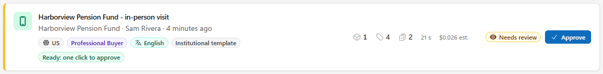

**8.6 Read the result.** About 20 seconds after the upload the review is ready. The note names "Sam Rivera with Dana Whitfield
(Harborview Pension Fund)", the product is Class C, there are four topics and two tasks, and **CRM match** says *Name org, 90%*.
Due dates are counted from the moment you recorded, so "tomorrow" means the day after you record.

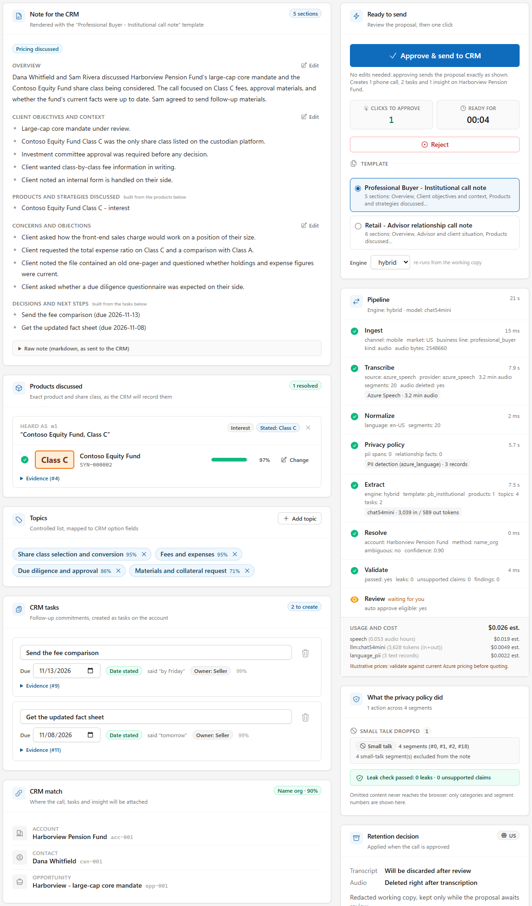

**Call out**

- **The browser records, Azure transcribes.** `MediaRecorder` with echo cancellation and noise suppression; the first format the
  browser supports from WebM/Opus (Chrome, Edge), MP4 (Safari) and OGG/Opus. The file is uploaded unchanged as `channel=mobile`
  with the form fields, queued locally while offline and sent when the connection returns, and Azure Speech accepts it as it is.
- **Two speakers.** A capture has a seller and one customer, so `maxSpeakers` is 2; with three voices the two customers merge into
  one label. Roles follow the rules in [3.2](#32-normalize-who-said-what), with the first speaker as the seller.
- **The CRM match depends on the form.** With a client name and organisation it matches by name and organisation (0.90); without
  them there is no match.
- **Why a secure page.** The microphone is only available on https, `localhost` or `127.0.0.1`.

**What if you skip the form?** The transcript, the speakers, the product and the tasks come out the same, but the CRM match
fails: the Inbox row reads "Unknown customer", "Demo Seller" and a **No CRM match** chip, the review says **No match**
(`crm_match_missing`), and the call needs a person instead of one click.

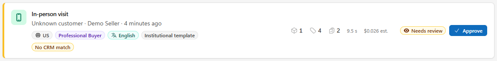


| Tip | Why |
|---|---|
| Let the seller open, and set **Your name** | the first voice is the seller unless the names in the talk say otherwise |
| Sit close to one microphone, in a quiet room | the browser records one channel and separates two voices by sound; **Spoken language** can stay on *Auto-detect* |
| Open the page at `http://127.0.0.1:8010` or `localhost`, or over https | microphone access needs a secure page; otherwise use **Choose an audio file instead** |
| Avoid "today", "tonight" and "tomorrow" if you record in the evening | dates are worked out from the recording's UTC start time, which is already the next day in the US evening |
| The same page works on a phone | install it as an app; **Simulate offline (demo)** shows the offline queue |

## 9. The rest of the product

**Inbox.** Every call lands here. *Ready: one click to approve* means nothing needs a person; *Needs review* with a reason chip
means one thing does. The tiles are measured: needs review, written to the CRM, median time to review-ready and the mean clicks
to approve.


**Sources.** Sidebar -> **Sources**. How each channel connects: the endpoint, what it does, the mode and the transcript order.


*Teams reads "Simulated payloads" in this capture because Teams ingestion is off on the capture server. Zoom and Genesys read
"Simulated payloads" because their live download hop is not built: the handlers and parsers are ([part 2](#2-the-picture-five-stages)).*

**Simulate a call** runs any scripted call as the channel's native payload through the real parser (**Run via transcript**), or a
recording through Azure Speech (**Run via audio**). *Overrides* change the market, business line or template for one call;
*ASR noise* adds the recognition slips real speech makes ("class see").


**Upload** takes an audio file or a Teams or Zoom transcript. The *Source interaction id* is the idempotency key: the same id
twice is recognised as a duplicate.


**Product picks and learning.** Run `pb-ambiguous-equity-fund`: the fund is clear, the class never said, so the card offers the
top three.


Run `pb-teams-legacy-blue-chip` (a former fund name the catalogue has never seen): there is **no candidate**, and the call needs a
pick.


Press **Change**, search *equity fund class c*, pick *Contoso Equity Fund Class C* and approve. The pick is stored as a learned
alias. Run the same call again: it resolves by itself, with no review reason.


Sidebar -> **Catalogue** lists what it learned, and searches the catalogue the way the resolver scores it.


**Say it:** "It does not guess, it asks once, and it remembers. The learned name is applied before anything else, at 97%
confidence, and the scoreboard shows the before and after."

**Scoreboard.** Sidebar -> **Scoreboard** -> **Run evaluation**, then again with **Apply learning**. It replays the 18 scripted
calls (English and Spanish, with deliberate traps) through the real pipeline on the transcript path and scores them against
the answer key.


**Call out:** product top-1 and top-3, share-class confusions, topic precision, recall and F1, task precision and recall with due
dates, privacy leaks (0), relationship facts kept, latency and cost per call. With the rules engine there is no model call, but
the privacy filter still uses the live Azure AI Language service, so a run costs a few cents. The golden set is a development
set, tuned while looking at it: treat the numbers as a regression gate and a demonstration, and measure real accuracy on customer
calls. The targets shown are straw-man, not agreed.

## 10. Questions you will be asked

| Question | Answer |
|---|---|
| Where does our data go? | To the Azure resources in your subscription: Speech, Language and the Foundry deployment, signed in with Entra. Nothing goes to a third party. The CRM gets a note and fields; a transcript exists only in the vault, and only where the market policy says so. |
| Can a transcript reach the CRM? | No. The CRM package has no transcript field, and a guard rejects WebVTT cues, voice tags, timestamped speaker dumps and long prose pointers before any write ([3.4.2](#342-write-what-lands-in-the-crm)). |
| Can the model invent a product? | No. Products come from the catalogue index; the model can only confirm a candidate, and only when the share class was stated. The validator checks catalogue ids and evidence ([3.3.2](#332-extract-the-engine-writes-the-code-decides)). |
| What if Azure AI Language or the model is down? | The privacy filter fails closed: the conversation fails and can be retried, the check is never skipped. A model failure falls back to the rules engine and says so. Speech, Azure AI Language, the model and Dataverse retry throttling and transient errors with backoff. |
| How accurate is it? | On the 18-call development set with the rules engine: product top-1 and top-3 at 100% once the two former fund names have been learned, topic F1 95%, no privacy leaks; the hybrid engine scores 94% topic F1. It was tuned on that set, so real accuracy has to be measured on your calls. The scoreboard is built for that. |
| What does a call cost? | About $0.026 with audio and $0.007 with a platform transcript, at list prices; the rules engine removes the token cost. See [3.6](#36-what-it-cost-and-how-long-it-took). |
| Can we use another model? | Point `VOICECRM_FOUNDRY_DEPLOYMENT` at another Foundry chat deployment that supports strict JSON-schema output. The adapter negotiates unsupported parameters, and the engines are behind a Protocol. |
| Which languages? | English and Spanish: candidate locales `en-US` and `es-US`. The model writes English CRM notes from Spanish calls; the rules engine avoids free-text translation. |
| How does it improve? | A reviewer's product pick becomes a learned alias, applied first next time. The scoreboard measures before and after. |
| How is this different from the Sales agent in Microsoft 365 Copilot? | The Sales agent is the native, no-build path for Teams meetings: preparation, recap, tasks and follow-up drafts. VoiceCRM covers every channel, with your own policies, exact share-class precision, per-market retention and a way to measure accuracy. They can coexist. |
| What is not production-ready? | Part 2 lists it: the live Zoom and Genesys hops, Genesys number extraction, a real phone number for the phone line, the email draft, the data-hub hand-off, a scheduled sweep and summary-retention enforcement. Also one replica, SQLite state and no sign-in of its own. |
| Can a customer dial a real phone number? | Today the caller dials from a dial pad in the browser, a VoIP call over Azure Communication Services. A real number needs a Teams Phone service number connected to the ACS resource, an admin step in the tenant; the app does not change ([part 7](#7-scenario-d-a-phone-call-to-the-voicecrm-line), [phone-line.md](phone-line.md#7-a-real-phone-number)). |
| Do callers know they are recorded? | Yes: the phone line plays a recording notice before recording starts, the notice is not in the recording, and the conversation records that it was played. If it cannot be played the call is ended, not recorded (`VOICECRM_PHONE_REQUIRE_NOTICE`, on by default). |
| What happens to a call nobody speaks in? | It is shown as *Missed* on the Phone line card, with the reason, and is not sent to the pipeline: no Inbox row and no Speech charge. The threshold is `VOICECRM_PHONE_MIN_SPEECH_SECONDS` (1.5 s of speech-level audio). If Azure Speech finds no speech in a recording that passes, the conversation fails with a plain message rather than a service error. |
| Can a retry write twice? | No. The CRM key is `source:source_interaction_id:vN`; a reprocess is a new version, and a failed write deletes what it created. |
| What does a person do? | One click, or none with auto-approve. They step in for `product_needs_pick`, `crm_match_ambiguous`, `crm_match_missing` or `validation_failed`. |
| Can we audit it? | Every stage records status, duration and detail; usage is metered per call; policy actions name categories and counts; review feedback records clicks and seconds. Logs carry counts and timings, never transcript text. |

## 11. When something does not match what you see

| You see | Because | Do this |
|---|---|---|
| A chip reads **Mock: Speech**, **Mock: Model** or **Mock: PII** | that service is not configured, or its settings are incomplete | set the modes and endpoints in `.env`, restart, and press **Check services now** ([live-demo.md](live-demo.md), section 1) |
| **Check services now** shows NOT READY | a service answered with an error | read the failed row: it names the fix (a missing role, a wrong endpoint, a missing deployment) |
| Section A says "No recordings yet" | the audio is generated, not stored in the repository | `scripts\make_audio.bat` (needs Azure Speech), or use Sources -> Simulate a call |
| **Not configured** in section B | Teams ingestion is off | set `VOICECRM_TEAMS_MODE=poll` and `VOICECRM_TEAMS_*` ([live-demo.md](live-demo.md), section 3) |
| Section D is **Not configured**, or **Check phone setup** shows a failed row | the phone line is off, or a step is missing: the tunnel, the Event Grid subscriptions, a role on the Foundry resource | set `VOICECRM_PHONE_MODE=acs` and the `VOICECRM_PHONE_*` settings, then read the failed row; symptoms and fixes are in [phone-line.md](phone-line.md#9-when-it-does-not-work) |
| The dial pad or the seller console says the calling SDK needs https or `localhost` | the page is open at `127.0.0.1`, which the Azure Communication Services calling SDK refuses | open `http://localhost:8010` ([part 7](#7-scenario-d-a-phone-call-to-the-voicecrm-line)) |
| A phone call ends but never reaches the Inbox | no recording event arrived, the recording could not be processed, or nobody spoke | the call's timeline on the Phone line card says which; a *Missed* call with "No speech in the recording" had nothing to transcribe (speak after the voicemail prompt, or switch the seller console on before dialling); `scripts\phone_check.bat subscriptions` should list both Event Grid subscriptions as Succeeded |
| The Inbox shows a phone call as failed: "No speech could be recognised in the recording" | the recording had too little speech for Azure Speech to identify a language, and passed the line's own check | expected for a hang-up that left some noise; nothing to fix. **Reset demo data** clears it |
| **Import earlier meetings** is missing, or lists nothing | the card shows only when Teams ingestion is on; only scheduled meetings with transcription started have a transcript, for the organisers in `VOICECRM_TEAMS_ORGANIZERS` | pick a longer period (up to 90 days); a Graph refusal is shown on the card with the fix; restart the backend if the page says it could not search (an older backend has no `/sources/teams/history` route) |
| The Record button is greyed out, or the page says it needs a secure connection | the browser only allows the microphone on https, `localhost` or `127.0.0.1` | open `http://127.0.0.1:8010`, allow the microphone, or use **Choose an audio file instead** |
| The recording says **No match** | the client organisation and name were empty | fill them in before **Save & upload** |
| The seller and customer lines look swapped | the customer spoke first and the names gave no hint | let the seller open and set **Your name** |
| A template or engine switch answers 410 | the working copy expired after 24 hours | ingest the call again |
| Due dates differ from the images | recordings are dated by the moment you record; scripted calls have a fixed date | expected |
| The Inbox has more rows than the images, or CRM rows and learned names are left over | you ran extra calls, a load test, or earlier rehearsals | **Reset demo data** ([part 12](#12-reset-the-demo-and-regenerate-the-screenshots)); **Remove load-test calls** removes only a load test's calls |
| A policy change did not stick, or an old one will not go away | edits are saved in `.state\policies.override.yaml` | change it on the Policies page, or **Reset demo data** (it returns the policies to the shipped defaults) |
| **Reset demo data** is greyed out | a call is still being processed or a load test is running (the card says which), or the CRM is a real Dataverse environment | wait: the card re-checks every few seconds; a real CRM is never reset |
| The page says it could not read what is stored | the running backend is older than the UI and has no `/demo/data` route | restart the backend (`scripts\run_backend.bat`) |
| `frontend\dist` is missing, or the page is blank | the UI was not built | `npm run build` in `frontend`, then reload |
| Port 8010 is busy | another process is using it | the [README](../README.md#run-it) shows how to use another port |

## 12. Reset the demo and regenerate the screenshots

### 12.1 Reset the demo data

Earlier runs leave calls in the Inbox, CRM rows, vault copies, learned product names, scoreboard runs and policy edits behind.
Before a demo, and after a rehearsal, clear them: sidebar -> **Live demo** -> the last section, **Start clean** (the **Reset** link
in the page header jumps to it). The card lists what is stored right now.


Press **Reset demo data**. The confirmation lists what will go, with counts, and what stays.


Confirm, and the card reads "Nothing to reset". The Inbox is empty, the CRM tabs hold only the seeded accounts, contacts and
opportunities, and the scoreboard, the Catalogue's learned aliases and the Policies page are back to their starting point.


**Say it:** "Everything on this screen is synthetic and local. One click returns it to a clean start, so each rehearsal and each
customer session begins from an empty Inbox."

**Call out**

- **What goes:** every conversation with its stage events, usage and review feedback; every vault copy (audio, working copies,
  retained transcripts); the phone-call activities, tasks and insights the pipeline wrote to the CRM simulator; learned aliases;
  scoreboard runs; the policy edits saved from the Policies page (`<state folder>\policies.override.yaml`); and the in-memory
  figures that describe those calls (the Inbox throughput card, the last load-test report, the Teams status card, and the
  finished calls on the Phone line card; a phone call still in progress carries on).
- **What stays:** the catalogue, topics and templates; the CRM accounts, contacts and opportunities (including contacts you added
  with `crm-add`); your recordings in `data\audio`; `.env`; and the lists of Teams meetings and phone events already handled, so
  a reset does not bring an old meeting or call back into an empty Inbox. To bring a past meeting back, use **Import earlier
  meetings** ([part 5](#5-scenario-b-a-teams-meeting), B3).
- **Guards.** It only runs against the local CRM simulator: with `VOICECRM_CRM_MODE=dataverse` the API answers 409 and the button
  is off, so a real CRM is never touched. It waits while a call is being processed or a load test is running (the card says
  which and re-checks every 3 seconds), and the API needs `{"confirm": true}`.
- **API:** `GET /api/v1/demo/data` shows what a reset would remove and changes nothing; `POST /api/v1/demo/reset` does it.
  Tests: `backend\tests\api\test_demo_reset.py` (what goes, what stays, each refusal, and that the resolver forgets a learned
  alias, not only the table).
- **By hand:** stop the backend and delete the `.state\` folder. Do not delete it while the backend runs: Windows keeps the
  SQLite files open.

**Prove it:** teach `pb-teams-legacy-blue-chip` ([part 9](#9-the-rest-of-the-product)), reset, and run the call again: it needs a
pick again, because the learned name is gone.

### 12.2 Regenerate the screenshots

The tool starts a throwaway server with an empty state and Teams ingestion forced off, so your own `.state` and your tenant are
never touched. It needs `npm run build` first, the recordings from `scripts\make_audio.bat`, and Playwright with an installed
Chrome or Edge (`.venv\Scripts\python.exe -m pip install playwright`).

```bat
.venv\Scripts\python.exe tools\capture_walkthrough.py                    rem every image: live Azure, about 10 minutes and under $0.60
.venv\Scripts\python.exe tools\capture_walkthrough.py --only a,policies  rem a subset: services, architecture, a, engines, policies, b, product, record, inbox, crm, sources, scoreboard, c, reset
.venv\Scripts\python.exe tools\capture_walkthrough.py --seconds 20       rem a short recording for the Record button part
.venv\Scripts\python.exe tools\capture_screenshots.py                    rem the README gallery: local services, free
.venv\Scripts\python.exe tools\capture_phone.py --base-url http://localhost:8010   rem the six phone images (part 7): one real call, about 90 seconds
```

Before it saves an image the tool scans the visible text for a profile path, a tenant or resource host name and any term in your
git-ignored `.deny-terms.local`, and stops if one appears. The Record button part drives the real button: a headless Chrome whose
microphone is the hero recording. Run `scripts\check_public.bat` before you publish.

The phone images are the exception: `capture_phone.py` does not start a server. It needs the phone line running
([phone-line.md](phone-line.md#3-set-it-up)) with `VOICECRM_PHONE_SELLER` empty, a built frontend and Azure text to speech for the
two voices, and it places a real call between two browsers, each playing its own voice as the microphone. That call is recorded,
transcribed and billed like any other and stays in the Inbox, so run it against a throwaway state folder
(`VOICECRM_STATE_DIR`) or reset the demo afterwards. Tunnel addresses on screen are replaced before each screenshot.

## Appendix: no Azure account

Without Azure the same product runs on its local services (`VOICECRM_DEMO_MODE=true`, the default in `.env.example`): scripted
transcripts, a local pattern detector, the rules engine, the CRM simulator. The chips read **Mock: ...** and the A button reads
**Process (mock speech)**. Parts 1.2, 2, 3 (run the calls from **Sources -> Simulate a call -> Run via transcript**), 4, 6 and 9
work as described, without the Azure rows; the Record button needs live Speech. The [README](../README.md#run-it) has the
quick start and a gallery captured on the local services.
